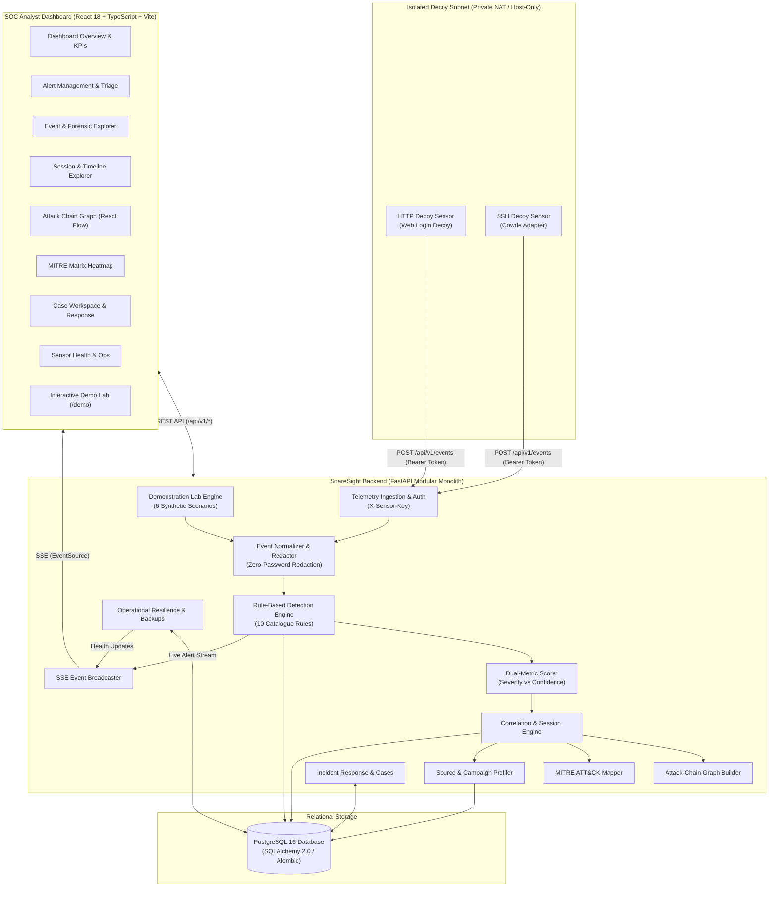

# SnareSight
### Deception-Driven Threat Detection & Security Operations Platform

[](docs/release/RELEASE_CANDIDATE_REPORT.md)
[](backend/)
[](frontend/)
[](docs/documentation/DATABASE_REFERENCE.md)
[](docs/documentation/TESTING_AND_QA_GUIDE.md)
[](docs/documentation/SYSTEM_ARCHITECTURE.md)

---

## 1. Executive Overview & Problem Statement

Modern Security Operations Centers (SOCs) face an overwhelming volume of ambiguous perimeter security alerts. Perimeter defenses (firewalls, WAFs, EDRs) generate thousands of notifications daily, resulting in severe analyst alert fatigue, high false-positive rates, and missed multi-stage intrusions.

**SnareSight** solves this challenge through **high-fidelity cyber deception**. By deploying realistic, isolated decoy services (honeypots) within private virtual network perimeters, SnareSight converts unauthorized interaction into unambiguous security intelligence. In an isolated enterprise environment, **legitimate users and benign systems have zero business need to interact with decoy services**. Therefore, any interaction with a SnareSight sensor is anomalous by definition.

SnareSight captures interaction telemetry, normalizes events, applies explainable rule-based threat detection, correlates multi-stage activity into intrusion sessions and attack chains, maps verified observations to the **MITRE ATT&CK®** matrix, and presents live findings via a real-time web-based SOC dashboard.

---

## 2. What SnareSight Is NOT (Explicit Disclaimers & Boundaries)

To ensure operational clarity and prevent misuse or architectural misunderstandings:

1. **NOT a Generic SIEM:** SnareSight is not designed to ingest millions of benign corporate syslog messages or endpoint heartbeats. It is a specialized deception-detection and correlation platform focused on high-fidelity honeypot telemetry.
2. **NOT an Antivirus or Endpoint Protection (EPP/EDR) Tool:** SnareSight does not install kernel drivers or monitor client workstation processes.
3. **NOT a Malware Sandbox or Detonation Chamber:** SnareSight does **not** execute, unpack, or detonate captured malicious binaries. Under the project's **Zero-Execution Invariant**, captured payloads are hashed, fingerprinted, and safely quarantined.
4. **NOT an Offensive Security or Exploit Tool:** SnareSight is purely defensive. It does not perform active port scanning, counter-attacks, vulnerability exploitation, or hack-backs.
5. **NOT Legal Proof of Individual Physical Identity:** Attribution in SnareSight is based on network layer artifacts (IP addresses, user agents, interaction timing). An IP address or threat profile does not legally prove the physical identity of an individual person. Threat actor profiles represent clustered behavioral patterns, not verified persons.

---

## 3. Core System Capabilities

SnareSight is architected as a modular monolith providing 15 integrated subsystems:

* **Decoy Sensor Management:** Ingestion and health monitoring for isolated decoys (HTTP web decoys, SSH Cowrie adapters) with authenticated sensor heartbeats and token authentication.
* **Telemetry Normalization:** Structured transformation of raw sensor feeds into standardized event schemas with strict provenance tracking (`live_honeypot`, `synthetic_demo`, `controlled_simulation`).
* **Deterministic Threat Detection:** 10 catalogue detection rules covering brute force, credential stuffing, path traversal, command injection, reconnaissance scans, and default credential abuse.
* **Dual-Metric Scoring Policy:** Independent calculation of **Severity** (impact on assets, 0–100) and **Confidence** (certainty of malice based on observed evidence, 0–100).
* **Multi-Stage Session Correlation:** Dynamic temporal clustering grouping individual events into coherent intruder sessions.
* **Attack Chain Graphing:** Interactive directed graph visualization of intruder progression across attack phases.
* **Evidence-Grounded MITRE ATT&CK Mapping:** Explicit technique mapping tied directly to forensic evidence without speculative attribution.
* **Source Intelligence & Threat Profiling:** Aggregation of threat actor profiles, observed tactics, targeted decoys, and behavioral risk scores.
* **Campaign Clustering:** Heuristic grouping of related intrusion sessions across multiple IP addresses and temporal windows.
* **Defensive Response & Incident Cases:** Analyst-guided case workspace, containment workflows, audit trails, and auto-generated firewall blocking rules (iptables, UFW, AWS Security Groups).
* **SOC Analytics & Reporting:** Executive KPIs, detection trend metrics, sensor reliability ratings, and exportable security reports (JSON/Markdown).
* **Operational Resilience & Self-Healing:** Internal health monitoring, pipeline throughput tracking, automated database backups, and dry-run isolated restore verification.
* **Demonstration & Synthetic Lab:** Fully self-contained demonstration environment (`/demo`) with 6 deterministic attack scenarios (A through F) and automated detection quality evaluation.
* **Real-Time Streaming:** Server-Sent Events (SSE) broadcasting live alerts, events, and sensor status updates directly to analyst browsers.

---

## 4. System Architecture



---

## 5. Technology Stack

| Layer | Technologies | Description |
|---|---|---|
| **Frontend** | React 18, TypeScript, Vite, Tailwind CSS, Lucide Icons, Recharts, React Flow | High-performance, responsive single-page web application for SOC operations. |
| **Backend** | Python 3.11+, FastAPI, Pydantic v2, Uvicorn | Asynchronous modular monolith adhering to OpenAPI standards and type safety. |
| **Database & ORM** | PostgreSQL 16, SQLAlchemy 2.0, Alembic | Fully normalized relational event store with comprehensive migration tracking. |
| **Real-Time Push** | Server-Sent Events (SSE) | Unidirectional event streaming over HTTP for real-time analyst dashboard updates. |
| **Testing** | Pytest, Vitest, Playwright | Comprehensive backend unit/integration tests, frontend UI tests, and E2E validation. |
| **Containerization** | Docker, Docker Compose, Nginx | Multi-stage release candidate containers with non-root execution and health checks. |

---

## 6. One-Click Quickstart: `python start.py`

The easiest way to launch the entire SnareSight platform (FastAPI backend + React frontend + auto-opening your web browser) is using the one-click launcher:

```bash
# From repository root
python start.py
```
This launcher automatically:
1. Detects Python virtual environment and Node `npm`.
2. Inspects and initializes the database (PostgreSQL 16 or local persistence).
3. Starts the FastAPI backend core on port `8000`.
4. Starts the React + Vite frontend on port `5173`.
5. Automatically opens your default web browser to `http://localhost:5173`.
6. Provides graceful shutdown of all processes when you press `Ctrl+C`.

---

## 7. Deployment via Docker Compose

The fastest way to deploy and run the entire SnareSight platform is using Docker Compose:

### Prerequisites
* Docker Engine 24.0+ and Docker Compose v2.20+
* 4 GB RAM and 10 GB available disk space

### Step-by-Step Instructions

1. **Clone the repository:**
   ```bash
   git clone https://github.com/your-org/SnareSight.git
   cd SnareSight
   ```

2. **Configure environment variables:**
   ```bash
   # Copy sample environment configuration
   cp backend/.env.example backend/.env
   ```

3. **Start the containers:**
   ```bash
   docker compose up --build -d
   ```

4. **Verify container health:**
   ```bash
   docker compose ps
   ```
   All three services (`snaresight-db`, `snaresight-backend`, and `snaresight-frontend`) will report `healthy`.

5. **Access the application:**
   * **SOC Analyst Dashboard:** [http://localhost](http://localhost) (or port 80/3000 depending on configuration)
   * **FastAPI Interactive API Docs (Swagger):** [http://localhost:8000/docs](http://localhost:8000/docs)
   * **Demonstration Lab:** [http://localhost/demo](http://localhost/demo)

---

## 7. Local Developer Setup (Native Windows & Linux)

For active development, run the backend and frontend directly on your host machine:

### Prerequisites
* Python 3.11+
* Node.js 20+ or 22+ & npm
* PostgreSQL 16 running locally (or in Docker: `docker run -d -p 5432:5432 -e POSTGRES_DB=snaresight -e POSTGRES_USER=postgres -e POSTGRES_PASSWORD=postgres postgres:16-alpine`)

### 1. Backend Setup (PowerShell / Bash)
```powershell
# Navigate to backend directory
cd c:\Projects\SnareSight\backend

# Create and activate virtual environment
python -m venv venv
.\venv\Scripts\Activate.ps1    # On Linux/macOS: source venv/bin/activate

# Install dependencies
pip install --upgrade pip
pip install -r requirements.txt

# Run database migrations
alembic upgrade head

# Start FastAPI development server
uvicorn app.main:app --host 127.0.0.1 --port 8000 --reload
```

### 2. Frontend Setup (Separate Terminal)
```powershell
# Navigate to frontend directory
cd c:\Projects\SnareSight\frontend

# Install dependencies
npm install

# Start Vite development server
npm run dev
```
Open your browser to `http://localhost:5173` to interact with the live SOC Dashboard.

---

## 8. Demonstration Lab & Synthetic Scenarios

SnareSight features an integrated, safe demonstration environment (`/demo`) that executes 6 deterministic, harmless synthetic attack scenarios:

| Scenario Code | Scenario Name | Target Service | Generated ATT&CK Techniques | Expected Detection Rule |
|---|---|---|---|---|
| **SCN-A** | Web Login Brute Force | HTTP Web Decoy | T1110.001 (Password Guessing) | `RUL-001` (Brute Force Detection) |
| **SCN-B** | Credential Stuffing Campaign | HTTP Web Decoy | T1110.004 (Credential Stuffing) | `RUL-002` (Credential Stuffing) |
| **SCN-C** | Web Path Traversal Probe | HTTP Web Decoy | T1083 (File & Directory Discovery) | `RUL-003` (Path Traversal) |
| **SCN-D** | Command Injection Attempt | HTTP Web Decoy | T1059.004 (Unix Shell Injection) | `RUL-005` (Command Injection) |
| **SCN-E** | Network Decoy Reconnaissance | Decoy Perimeter | T1595.002 (Vulnerability Scanning) | `RUL-004` (Reconnaissance Scan) |
| **SCN-F** | Multi-Stage Intrusion Chain | Web Decoy + SSH | T1595, T1110, T1059, T1083 | Multi-Rule Attack Chain |

To trigger a scenario, navigate to `/demo` in the browser or send a request to the backend:
```bash
curl -X POST "http://localhost:8000/api/v1/demo/scenarios/SCN-A/run" \
  -H "Authorization: Bearer <ANALYST_TOKEN>"
```

---

## 9. Testing & Quality Verification

Run the automated test suites to verify system integrity:

```powershell
# 1. Run Backend Unit & Integration Tests (19 tests)
cd c:\Projects\SnareSight\backend
pytest -v

# 2. Run Frontend Unit Tests (9 tests)
cd c:\Projects\SnareSight\frontend
npm test -- --run

# 3. Verify Production Frontend Build
npm run build
```

---

## 10. Security & Isolation Invariants

SnareSight strictly enforces five non-negotiable security invariants across all deployments:

1. **Zero Public Internet Exposure:** Decoy sensors must never be bridged directly to the public Internet during lab operation.
2. **Strict Host-Only / Private Subnet Isolation:** Decoy virtual machines operate strictly within isolated virtual switches.
3. **Zero-Execution Invariant:** Captured payloads, scripts, or binary files are never executed on the host or server.
4. **Localhost Binding Discipline:** Backend APIs and database ports bind strictly to `127.0.0.1` unless behind a TLS reverse proxy.
5. **Zero-Password Storage Policy:** Decoy passwords captured during attacks are hashed with SHA-256 and salt before ingestion; plaintext passwords are never persisted in database logs.

---

## 11. Authoritative Documentation Suite

For detailed technical references, operational runbooks, and architectural designs, consult the documentation catalog:

* [Developer Setup & Installation Guide](docs/documentation/DEVELOPER_SETUP_GUIDE.md) — Comprehensive runbook for local installation, database setup, and debugging.
* [System Architecture & Design Specification](docs/documentation/SYSTEM_ARCHITECTURE.md) — Modular monolith architecture, data flow, and 5 Mermaid diagrams.
* [Complete API Reference](docs/documentation/API_REFERENCE.md) — Exhaustive REST and SSE endpoint documentation across all 15 modules.
* [Database & Data Model Reference](docs/documentation/DATABASE_REFERENCE.md) — Full relational schema, entity relationships, indexes, and Alembic migrations.
* [Honeypot & Sensor Operations Manual](docs/documentation/HONEYPOT_OPERATIONS_MANUAL.md) — Decoy deployment, token rotation, network isolation, and health checks.
* [Detection Engine & MITRE ATT&CK Mapping](docs/documentation/DETECTION_AND_ATTACK_MAPPING.md) — Rule catalogue, dual-scoring policy, and ATT&CK alignment.
* [SOC Analyst User Manual](docs/documentation/SOC_ANALYST_USER_MANUAL.md) — User guide for triage, session analysis, attack chains, and case response.
* [Administrator & Maintenance Guide](docs/documentation/ADMINISTRATOR_GUIDE.md) — RBAC administration, backup/restore procedures, and retention holds.
* [Security, Privacy & Threat Model](docs/documentation/SECURITY_AND_PRIVACY.md) — STRIDE evaluation, five invariants, and attribution disclaimers.
* [Testing & Quality Assurance Guide](docs/documentation/TESTING_AND_QA_GUIDE.md) — Test suites, quality gates, defect registers, and Playwright runbooks.
* [Troubleshooting Knowledge Base](docs/documentation/TROUBLESHOOTING.md) — Diagnostics and remediation steps for common operational issues.
* [Project Handover & Evaluator Guide](docs/documentation/PROJECT_HANDOVER.md) — Comprehensive handover dossier for project evaluators and mentors.
* [Master Documentation Index](docs/README.md) — Top-level index organizing all project documentation.

---

## 12. License & Intellectual Property

SnareSight is developed as an academic and security research platform. All rights reserved. Refer to project contribution and licensing terms in [CONTRIBUTING.md](CONTRIBUTING.md).
