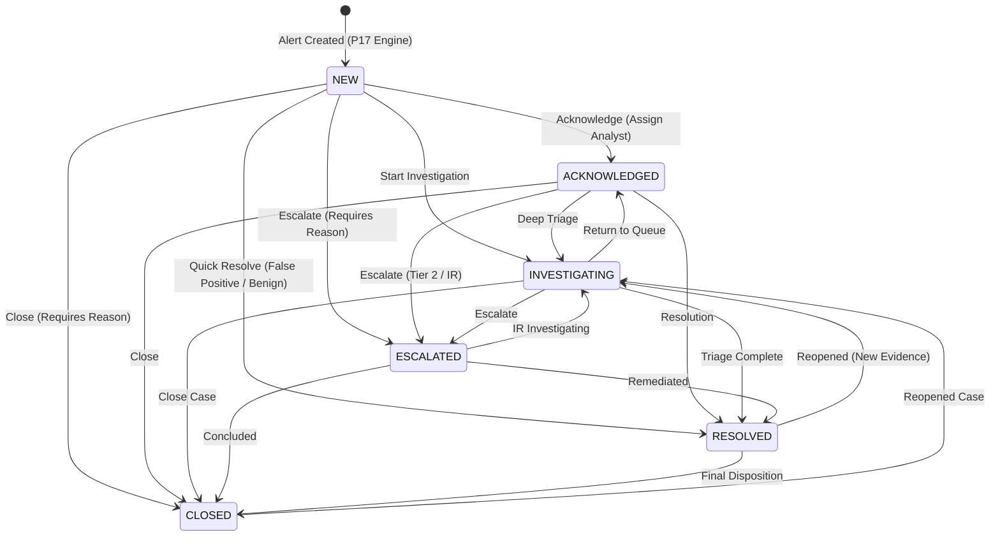

# Alert Lifecycle & State Transitions

## 1. Lifecycle State Machine

SnareSight implements a 6-stage operational lifecycle for all security alerts. Every transition is strictly validated by the backend service.

---

## 2. Valid Transition Matrix

| Initial State | Allowed Target States | Disallowed Jumps (Rejected with HTTP 400) |
|:---|:---|:---|
| `NEW` | `ACKNOWLEDGED`, `INVESTIGATING`, `ESCALATED`, `RESOLVED`, `CLOSED` | None (Direct triage permitted) |
| `ACKNOWLEDGED` | `INVESTIGATING`, `ESCALATED`, `RESOLVED`, `CLOSED` | `NEW` (Cannot reset to unacknowledged) |
| `INVESTIGATING` | `ACKNOWLEDGED`, `ESCALATED`, `RESOLVED`, `CLOSED` | `NEW` |
| `ESCALATED` | `INVESTIGATING`, `RESOLVED`, `CLOSED` | `NEW`, `ACKNOWLEDGED` |
| `RESOLVED` | `CLOSED`, `INVESTIGATING` | `NEW`, `ACKNOWLEDGED`, `ESCALATED` |
| `CLOSED` | `INVESTIGATING` (Reopen) | `NEW`, `ACKNOWLEDGED`, `RESOLVED`, `ESCALATED` |

---

## 3. Mandatory Field Validations

To prevent unrecorded or sloppy triage actions, the backend enforces mandatory input constraints:

1. **Acknowledge (`POST /api/v1/alerts/{id}/acknowledge`):**
   - Requires `analyst_id`. Automatically assigns analyst if unassigned.
2. **Assign (`POST /api/v1/alerts/{id}/assign`):**
   - Requires `analyst_id` (target) and `assigned_by` (actor).
3. **Escalate (`POST /api/v1/alerts/{id}/escalate`):**
   - Requires non-empty `reason` (min length 3 chars).
   - Requires non-empty `escalation_role` (e.g., `TIER_2_ANALYST`, `INCIDENT_RESPONSE_LEAD`).
4. **Resolve (`POST /api/v1/alerts/{id}/resolve`):**
   - Requires `resolution_category` (`BENIGN_SCANNER`, `FALSE_POSITIVE`, `CONTAINED_HONEYPOT`, etc.).
   - Requires non-empty `resolution_reason` explaining the disposition.
5. **Close (`POST /api/v1/alerts/{id}/close`):**
   - Requires non-empty `closure_reason`.
6. **Triage Decision (`POST /api/v1/alerts/{id}/triage-decision`):**
   - Requires decision enum: `TRUE_POSITIVE`, `LIKELY_TRUE_POSITIVE`, `NEEDS_INVESTIGATION`, `BENIGN_ACTIVITY`, `FALSE_POSITIVE`, `INSUFFICIENT_EVIDENCE`.
   - Requires non-empty `justification`.

