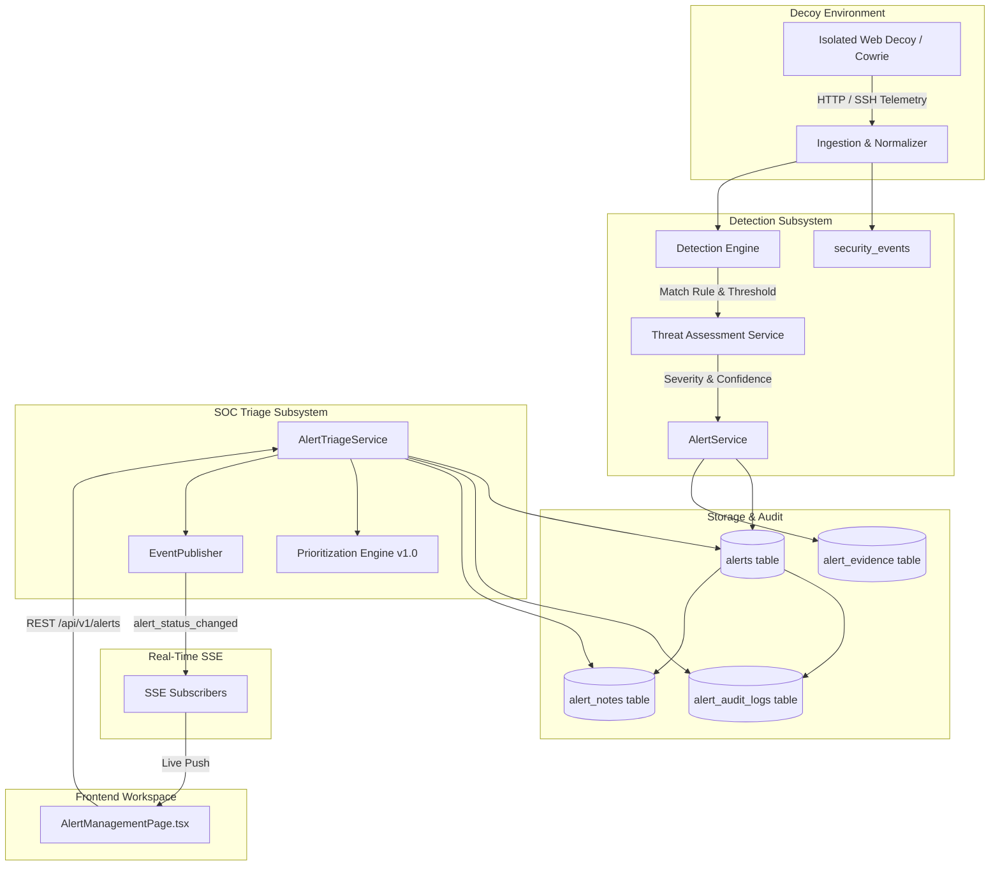

# Alert Management Architecture & Data Flow

## 1. System Architecture Diagram

---

## 2. Component Roles & Subsystems

### A. Detection & Persistence Subsystem
- **`AlertService` (`backend/app/services/alert_service.py`):**
  - Evaluates rule triggers against deduplicated events.
  - Enforces 300s session cooldown to prevent alert storms.
  - Evaluates suppression rules without deleting underlying forensic events.
  - Generates immutable `AlertModel` and `AlertEvidenceModel` junction records.

### B. SOC Triage Subsystem
- **`AlertTriageService` (`backend/app/modules/alerts/service.py`):**
  - Manages server-side pagination, multi-attribute filtering, and stable sorting.
  - Enforces the strict lifecycle state machine (`NEW`, `ACKNOWLEDGED`, `INVESTIGATING`, `ESCALATED`, `RESOLVED`, `CLOSED`).
  - Records all transitions and triage decisions to `alert_audit_logs`.
  - Coordinates analyst notes in `alert_notes`.
  - Resolves cross-subsystem links to Sessions, Source Profiles, Sequences, and MITRE techniques.

### C. Prioritization Engine
- **`AlertPrioritizer` (`backend/app/modules/alerts/prioritization.py`):**
  - Multi-factor deterministic scoring formula (Formula v1.0).
  - Keeps operational priority independent of intrinsic severity and analytical confidence.
  - Produces transparent mathematical breakdown and rationale string.

### D. Streaming Subsystem
- **`EventPublisher` (`backend/app/streaming/event_publisher.py`):**
  - Broadcasts post-commit SSE events: `alert_acknowledged`, `alert_assigned`, `alert_investigating`, `alert_escalated`, `alert_resolved`, `alert_closed`, `alert_note_added`, `alert_triage_decision`.
  - Streaming errors never abort database transactions.

