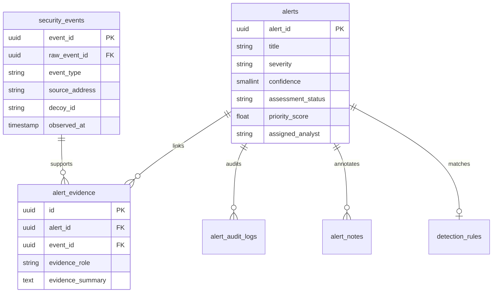

# Evidence Linking & Cross-Subsystem Context

## 1. Evidence Junction Model

Every alert generated in SnareSight is strictly anchored to one or more normalized security events via the `alert_evidence` relational junction table:

---

## 2. Evidence Roles

- **`TRIGGERING_OBSERVATION`:** The primary event that fulfilled the detection rule condition (e.g., the 5th consecutive failed login attempt exceeding the brute-force threshold).
- **`CORRELATED_OBSERVATION`:** Preceding or succeeding events within the evaluation time window that contributed to the threshold calculation or confirmed anomalous behavior.

---

## 3. Deep-Linking to Security Events Explorer

From the Alert Management workspace, analysts can navigate directly to the raw and normalized telemetry:
- In the **Supporting Evidence** tab, every item displays an `investigation_url` formatted as:
  `/events?event_id=<event_uuid>`
- Clicking this opens the full 6-tab forensic drawer in the Security Events Explorer, allowing inspection of HTTP headers, payload parameters, session timeline, and cryptographic hash verification.

---

## 4. Cross-Subsystem Correlation Resolution

When an alert is queried, `AlertTriageService.get_alert_relationships` resolves cross-subsystem links:
1. **Activity Session (`/sessions?session_id=...`):** Resolves the parent `ActivitySessionModel` based on `event.session_id`.
2. **Source Profile (`/source-intelligence?profile_id=...`):** Resolves historical recurrence and total sessions for the source IP.
3. **Behavioral Sequences (`/sequences?sequence_id=...`):** Checks whether supporting events are members of multi-session attack progressions.
4. **Campaign Investigations (`/investigations?cluster_id=...`):** Checks whether the alert or source IP belongs to an open threat cluster.
5. **MITRE ATT&CK Matrix (`/mitre?technique_id=...`):** Resolves technique mappings (`attack_detection_mappings` -> `attack_techniques`).

