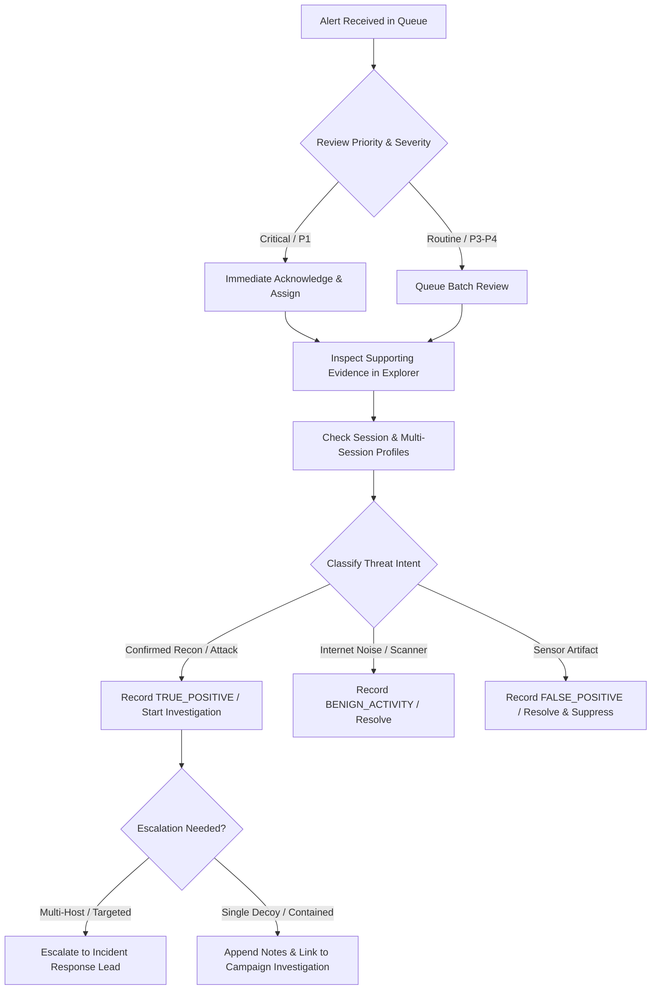

# Analyst Triage Workflow & Decision Models

## 1. SOC Analyst Playbook

When an alert is flagged on SnareSight decoys, analysts follow a standardized forensic triage sequence:

---

## 2. Structured Triage Decision Categories

Analysts record structured triage assessments that document analytical conclusions without claiming unverified physical identities:

| Triage Decision | Definition | Expected Analyst Action |
|:---|:---|:---|
| `TRUE_POSITIVE` | Telemetry definitively matches honeypot probe, brute-force burst, or web path traversal. | Correlate with session and attack sequence. Link to campaign investigation cluster. |
| `LIKELY_TRUE_POSITIVE` | High-confidence interaction consistent with attack tooling or credential guessing. | Review source profile; check for multi-session recurrences across sensors. |
| `NEEDS_INVESTIGATION` | Ambiguous telemetry; unable to verify automated scanner vs. targeted human probing. | Start formal investigation (`INVESTIGATING`); add notes with forensic hypotheses. |
| `BENIGN_ACTIVITY` | Known benign scanner (e.g. search engine crawler, Shodan/Censys public scanner). | Resolve with category `BENIGN_SCANNER` and summary explanation. |
| `FALSE_POSITIVE` | Internal configuration test, monitoring health check, or decoy protocol anomaly. | Resolve with `FALSE_POSITIVE` category; optionally register suppression rule. |
| `INSUFFICIENT_EVIDENCE` | Truncated connection or single TCP SYN with no application payload. | Close or resolve with explanation of telemetry limitations. |

---

## 3. Append-Only Analyst Notes & Audit Integrity

- **Notes Storage (`alert_notes` table):**
  - Analysts append notes with automatic UTC timestamps and user attribution (`author_id`, `author_role`).
  - Notes cannot be edited or deleted through normal SOC interfaces, preserving the integrity of the investigation record.
- **Audit Logging (`alert_audit_logs` table):**
  - Every lifecycle transition records `previous_status`, `new_status`, `analyst_id`, `action_type`, and `details`.
  - Stored in PostgreSQL with foreign key cascade to `alerts.alert_id`.

