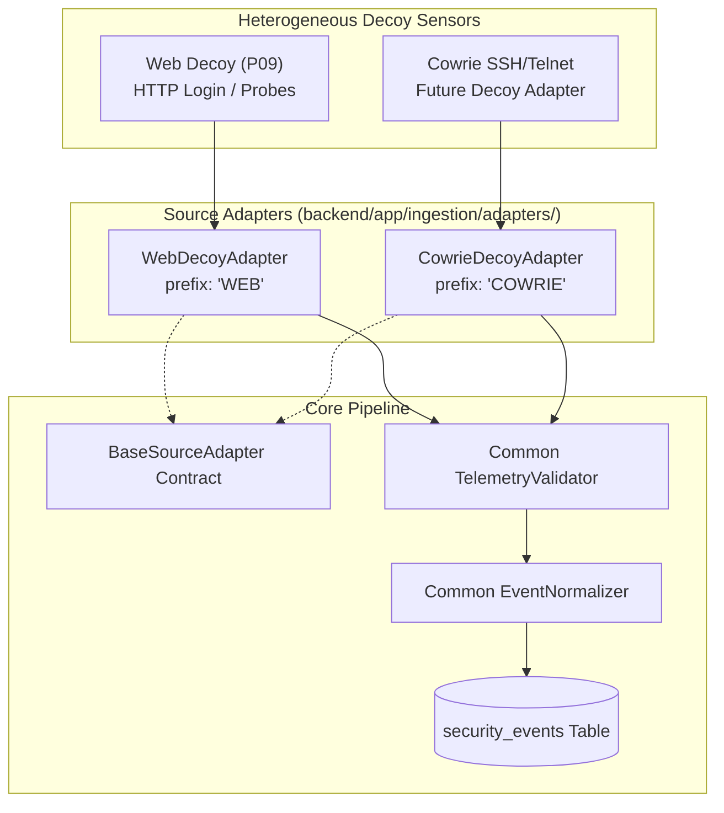

# Cross-Source Event Adapters Architecture

**Document ID:** ARCH-ADAPT-001  
**Classification:** Technical Architecture Specification  
**Scope:** SnareSight Phase 3 — Event Pipeline & Database (P14)  
**Status:** IMPLEMENTED  

---

## 1. Overview & Decoupling Strategy

Honeypots spanning different protocols and services produce divergent event structures. For example:
- A Web Login honeypot produces HTTP request paths, methods, and form parameter summaries.
- An SSH honeypot produces terminal commands, terminal dimensions, and key exchange handshakes.

SnareSight uses a **Source-Specific Adapter Pattern** to decouple the core ingestion and normalization pipeline from sensor-specific log formats.

---

## 2. Implemented Source Adapters

### 2.1 Web Decoy Adapter ([`WebDecoyAdapter`](file:///c:/Projects/SnareSight/backend/app/ingestion/adapters/web_decoy.py))
- **Source Prefix:** `WEB` (handles `WEB-001`, `WEB-DECOY-01`).
- **Telemetry Processed:** `login_attempt`, `decoy_page_visited`, `simulated_decoy_access`, `invalid_request`.
- **Parsing Behavior:** Maps HTTP paths, methods, client IP/port, session cookies, and login interaction parameters into the standard raw event dictionary.

### 2.2 Cowrie Decoy Adapter Template ([`CowrieDecoyAdapter`](file:///c:/Projects/SnareSight/backend/app/ingestion/adapters/cowrie.py))
- **Source Prefix:** `COWRIE` (prepared for future `COWRIE-SSH-01`).
- **Scope:** Prepared adapter specification supporting future Cowrie SSH/Telnet deployments without requiring live Cowrie installation or altering existing database schemas.
- **Parsing Behavior:** Maps Cowrie event IDs (`cowrie.session.connect`, `cowrie.login.failed`, `cowrie.command.input`) into `AUTHENTICATION`, `COMMAND_INTERACTION`, or `CONNECTION` categories, extracting terminal inputs and source network endpoints safely.

---

## 3. Preservation of Source-Specific Evidence

The adapter architecture guarantees that source-specific forensic fields are never discarded:
- If a sensor provides terminal commands, they are preserved under `sanitized_metadata.command`.
- If a sensor provides uploaded file hashes, they are preserved under `sanitized_metadata.file`.
- If a sensor provides HTTP headers, safe non-credential headers are preserved under `sanitized_metadata.safe_headers`.

