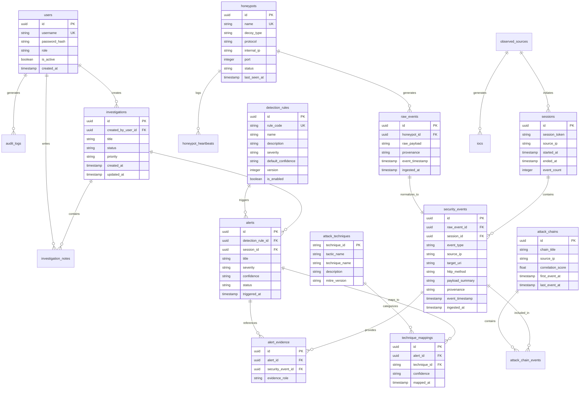

# SnareSight: Logical Database Design & Entity Relationships
**Document ID:** ARCH-005  
**Status:** Approved Logical Data Model  

---

## 1. Entity-Relationship Diagram (ERD)

---

## 2. Core Entities & Schema Rules

1. **`raw_events` vs. `security_events`:**
   * `raw_events` stores unmodified, exact JSON text sent by the decoy forwarder, ensuring legal/forensic evidentiary preservation.
   * `security_events` stores indexed, normalized columns (e.g., `source_ip`, `event_type`, `http_method`) for fast SQL querying and rule evaluation.
2. **Data Provenance Preservation:**
   * Both `raw_events` and `security_events` enforce an enum `provenance`:
     * `live_honeypot`: Interaction captured from active decoy service.
     * `synthetic_demo`: Seeded mock event for UI demonstration.
     * `controlled_simulation`: Generated by automated test harnesses.
3. **Dual Timestamps:**
   * Every event stores both:
     * `event_timestamp`: When the adversary performed the action on the decoy.
     * `ingested_at`: When the SnareSight collector processed the event.
4. **Credential Redaction Policy:**
   * Plaintext passwords entered into decoys are **never stored**. Instead, an irreversible SHA-256 hash or masked summary (e.g., `pass**** (length 11)`) is recorded in the normalized schema to track dictionary reuse without storing secrets.
5. **Retention & Archival Strategy:**
   * High-volume raw events are retained for 90 days.
   * Correlated alerts, attack chains, and investigations are retained indefinitely.

