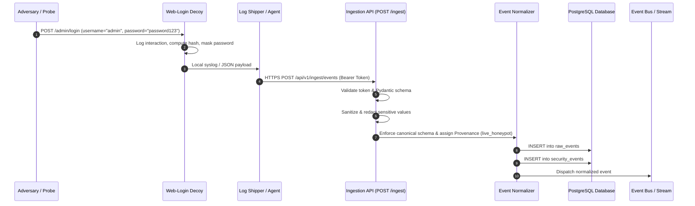
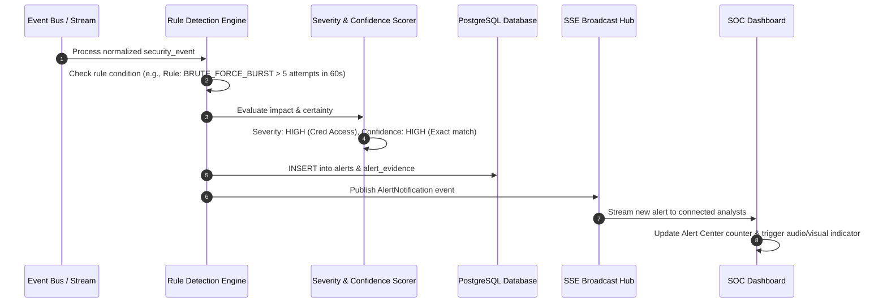
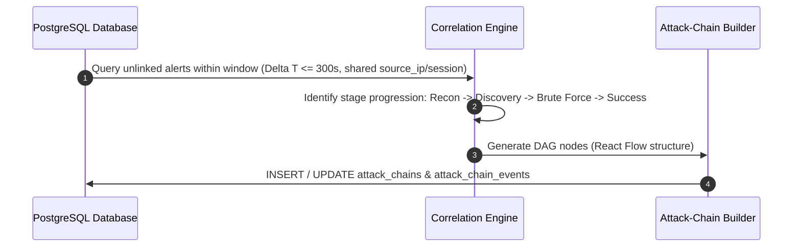
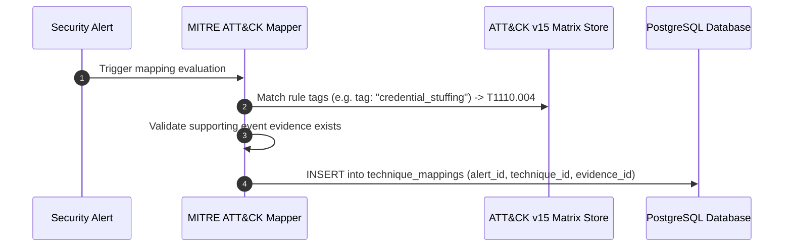
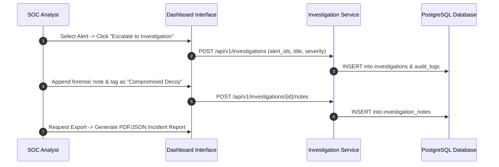
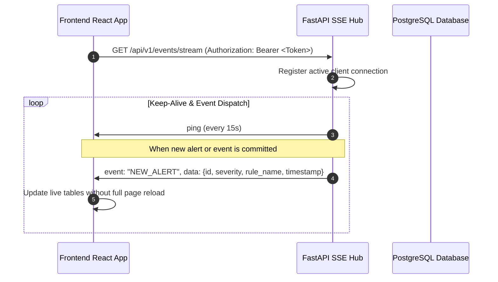

# SnareSight: End-to-End Data Flow Specification
**Document ID:** ARCH-003  
**Status:** Approved Data Flow Baseline  

---

## 1. Primary Data Flows

This document specifies the exact sequential progression of security data across the platform, from decoy interaction to analyst investigation.

---

### Flow A: Honeypot Event Ingestion & Normalization

---

### Flow B: Deterministic Threat Detection & Alert Generation

---

### Flow C: Temporal & Session Correlation (Attack Chain Construction)

---

### Flow D: Evidence-Backed MITRE ATT&CK Mapping

---

### Flow E: Analyst Investigation & Triage Workflow

---

### Flow F: Real-Time SSE Dashboard Synchronization

---

## 2. Failure & Edge Case Handling

1. **Collector Disconnection / Network Glitch:**
   * Log forwarder maintains an in-memory disk-backed spool buffer (up to 50 MB) inside the isolated VM.
   * On reconnection, batched events are shipped with original occurrence timestamps (`event_timestamp`).
2. **Malformed Payload Injection:**
   * Payloads failing Pydantic validation are rejected with HTTP 422, logged to an ingestion error counter, and dropped without crashing the pipeline.
3. **Duplicate Event Transmissions:**
   * Normalizer calculates an event signature hash `SHA256(source_ip + timestamp + event_type + payload_summary)`.
   * Duplicate signatures within a 10-second sliding window are ignored.
4. **SSE Client Reconnection:**
   * If the browser loses network connectivity, the EventSource API automatically re-establishes the connection and requests a delta backfill via standard REST endpoints.

