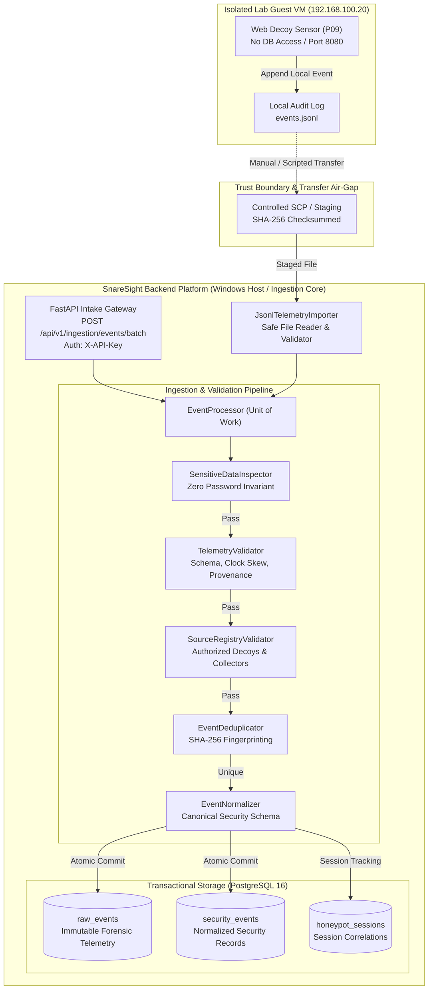

# SnareSight Event Ingestion Architecture

**Document ID:** ARCH-ING-001  
**Classification:** Internal Security Architecture Reference  
**Scope:** SnareSight Phase 3 — Event Pipeline & Database (P13)  
**Status:** IMPLEMENTED  

---

## 1. Overview and High-Level Architecture

The **SnareSight Event Ingestion and Validation Engine** forms the central telemetry intake gateway for the SnareSight platform. Its primary mission is to safely receive, inspect, authenticate, sanitize, normalize, deduplicate, and transactionally persist telemetry produced by isolated honeypot sensors (such as the `web-decoy` built in P09) and external collectors.

The ingestion engine enforces a strict **Zero-Trust Ingestion Boundary**:
1. **Network Isolation:** Honeypots deployed in isolated guest virtual machines never hold network routes, firewall permissions, or credentials to PostgreSQL.
2. **Dual-Ingress Modalities:** Telemetry is accepted through two secure mechanisms:
   - **Controlled JSONL File Importer:** Offline forensic batch ingestion from export files staged in a protected boundary directory.
   - **Authenticated REST API Gateway:** Secure batch endpoint (`POST /api/v1/ingestion/events/batch`) protected by API key authentication, payload size ceilings, and rate limits.
3. **Defense-in-Depth Sanitization:** Rejection and inspection occur before any data touches the database session or persistence models.
4. **Zero Password Persistence Invariant:** Strictly enforced at memory inspection, validation schemas, ORM definitions, error reporting, and storage.



---

## 2. Ingestion Pipeline Stages

The ingestion process executes through five discrete pipeline stages:

```
[Incoming Telemetry]
        │
        ▼
┌──────────────────────────────────────┐
│ Stage 1: Sensitive Data Inspection   │ ──(Forbidden Keys / Canary Strings)──► [REJECTED (HTTP 422 / Diagnostic)]
│ Zero Password Persistence Invariant  │
└──────────────────┬───────────────────┘
                   │ Pass
                   ▼
┌──────────────────────────────────────┐
│ Stage 2: Schema & Provenance Valid.  │ ──(Invalid Format, Clock Skew > 5m)──► [REJECTED (Validation Error)]
│ ISO Timestamps, UUIDv4, SemVer       │
└──────────────────┬───────────────────┘
                   │ Pass
                   ▼
┌──────────────────────────────────────┐
│ Stage 3: Source & Decoy Registration │ ──(Unknown Collector / Fake Decoy)───► [REJECTED (Unauthorized Source)]
│ Active Status & Decoy Binding        │
└──────────────────┬───────────────────┘
                   │ Pass
                   ▼
┌──────────────────────────────────────┐
│ Stage 4: Deduplication Check         │ ──(Duplicate Event Fingerprint)──────► [DUPLICATE (Idempotent No-Op)]
│ Deterministic SHA-256 Fingerprint    │
└──────────────────┬───────────────────┘
                   │ Unique
                   ▼
┌──────────────────────────────────────┐
│ Stage 5: Normalization & Persistence │ ──(DB Failure)───────────────────────► [ROLLBACK (Transaction Aborted)]
│ Atomic 2-Table Persistence           │
└──────────────────┬───────────────────┘
                   │ Commit
                   ▼
[ACCEPTED & PERSISTED]
```

### Stage 1: Sensitive Data Inspection (`SensitiveDataInspector`)
- Inspects all incoming payloads recursively for forbidden authentication credentials (`password`, `auth_token`, `private_key`, `secret`, `credential`).
- Scans string representations for synthetic canary password strings (`CanaryPass`, `TestPass123!`).
- If any forbidden key or sentinel string is detected, the event is immediately rejected with `IngestionErrorCode.FORBIDDEN_FIELD_PRESENT`. The sensitive payload is stripped from all logs and rejection diagnostics.

### Stage 2: Telemetry Schema & Provenance Validation (`TelemetryValidator`)
- Validates payload conforms to the SnareSight Raw Telemetry Contract (P11 schema).
- Verifies timestamp syntax (strict ISO-8601 UTC) and evaluates clock skew tolerance (future timestamps exceeding 300 seconds are rejected with `IngestionErrorCode.CLOCK_SKEW_EXCEEDED`).
- Confirms UUIDv4 formatting for `raw_event_id` and alphanumeric session format.
- Validates data provenance tags against authorized enumeration: `["real_attacker", "internal_test", "controlled_test", "synthetic_simulation", "automated_scan", "research"]`.
- Ensures simulation tags (`synthetic_simulation`) cannot be dropped or coerced to live telemetry.

### Stage 3: Source Registry Validation (`SourceRegistryValidator`)
- Verifies that `source.source_id` is an authorized, active collector registered in the platform registry.
- Verifies that `honeypot.decoy_id` matches an active deception deployment.
- Verifies that the collector is explicitly authorized to forward telemetry for the claimed decoy.

### Stage 4: Event Deduplication (`EventDeduplicator`)
- Generates a deterministic SHA-256 hash using immutable event attributes:
  `SHA-256(source_id:decoy_id:timestamp:session_id:event_type:client_ip:interaction_payload)`
- Queries `security_events.event_hash` and `raw_events.raw_event_id` to determine idempotency.
- If a match is found, increments the duplicate counter, logs the duplicate fingerprint, and returns `status: duplicate` without creating duplicate database rows.

### Stage 5: Event Normalization & Transactional Persistence (`EventNormalizer`, `EventProcessor`)
- Transforms raw sensor telemetry into the canonical SnareSight Security Event schema:
  - Standardizes actions (`attempted_login`, `viewed_page`, `probed_path`).
  - Standardizes outcomes (`success`, `failure`, `blocked`, `observed`).
  - Classifies severity based on threat taxonomy.
- Opens an explicit database transaction:
  - Persists unadulterated sanitized payload to `raw_events`.
  - Persists normalized record to `security_events` with foreign key linkage `raw_events.raw_event_id`.
  - Atomically commits the transaction or rolls back on any error.

---

## 3. Concurrency, Atomicity, and Error Handling

1. **Transaction Isolation:** Each ingested event or batch item operates inside an isolated database transaction block. A failure in one event does not corrupt prior persisted events or abort the entire batch.
2. **Atomic Ingestion State:** Database commits write to both `raw_events` and `security_events` atomically. Orphaned raw records or unlinked security events are structurally impossible.
3. **Graceful Degradation:** If the primary PostgreSQL service is temporarily unavailable or running in offline verification mode, the engine uses SQLAlchemy dual-engine abstractions with in-memory SQLite support for safe local test execution.

