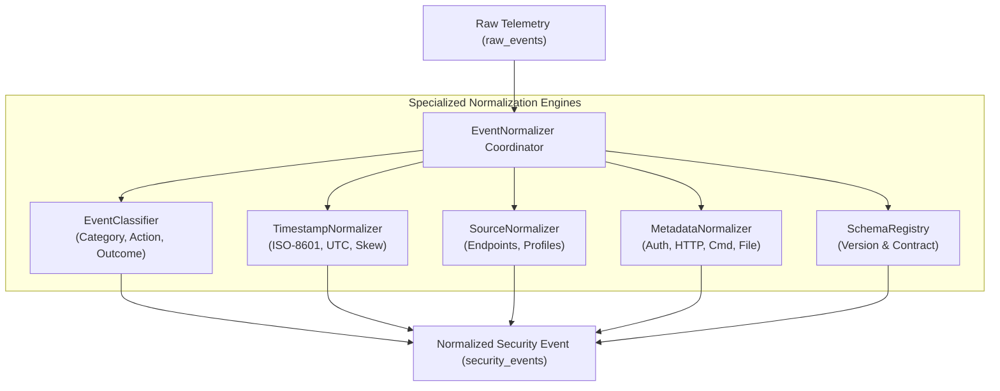

# SnareSight Event Normalization Architecture

**Document ID:** ARCH-NORM-002  
**Classification:** Internal Technical Architecture Reference  
**Scope:** SnareSight Phase 3 — Event Pipeline & Database (P14)  
**Status:** IMPLEMENTED & VERIFIED  

---

## 1. Executive Summary & Purpose

The **SnareSight Centralized Normalization Engine** translates heterogeneous telemetry produced by varied honeypot sensors into canonical, taxonomy-aligned Normalized Security Events (`security_events`).

The engine enforces a strict decoupled architecture:
1. **Source Log Independence:** Core normalization is independent of any specific sensor log syntax or transport.
2. **Modular Micro-Services:** Specific concerns are isolated into specialized engines:
   - `EventClassifier`: Taxonomy categories, actions, outcomes, and contradiction detection.
   - `TimestampNormalizer`: Timezone-aware UTC standardization, microsecond precision, skew boundary checks, and late-arriving event identification.
   - `SourceNormalizer`: Source endpoint extraction, pseudonymous profile derivation, and network attribution boundaries.
   - `MetadataNormalizer`: Forensic interaction grouping (`auth`, `http`, `command`, `file`), parameter sanitization, and Zero Password enforcement.
   - `SchemaRegistry`: Canonical schema contracts and version tracking.
3. **Forensic Evidence Immutability:** Raw events in `raw_events` remain untouched and permanently linked via foreign key (`raw_event_id`).

---

## 2. Normalization Workflow

For every validated raw event, the normalizer executes a 6-stage transformation:

1. **Classification Mapping & Validation:**
   - Evaluates the raw event type against the canonical action map.
   - Verifies the event category conforms to the approved taxonomy: `CONNECTION`, `REQUEST`, `AUTHENTICATION`, `SESSION`, `COMMAND_INTERACTION`, `FILE_INTERACTION`, `SERVICE_HEALTH`, `SECURITY_OBSERVATION`, `SIMULATION`.
   - Derives the interaction outcome (`SUCCESS`, `FAILURE`, `BLOCKED`, `ERROR`, `UNKNOWN`).
   - Executes contradiction checks: Decoy authentication attempts cannot be classified as `SUCCESS`; artificial simulations cannot claim production/live provenance.

2. **Source & Target Endpoint Normalization:**
   - Extracts `source_address`, `source_port`, and `source_protocol`.
   - Generates a pseudonymous profile reference (`observed_source_id: src_profile_<session_prefix>`), ensuring that IP addresses are not conflated with personal identity.
   - Derives `target_service` and `target_port` based on decoy type.

3. **Metadata Structuring & Sanitization:**
   - Groups forensic evidence into structured sub-dictionaries: `auth` (credential length, fingerprint, simulated outcome), `http` (method, path, status, user agent), `command` (for terminal decoys), and `file` (for upload decoys).
   - Strictly scrubs prohibited authentication credentials (`password`, `auth_token`, `private_key`).

4. **Timestamp Standardization:**
   - Converts all timestamps to timezone-aware UTC.
   - Preserves original observed time precision.
   - Records discrete processing timestamps: `observed_at`, `received_at`, `normalized_at`.

5. **Provenance Preservation:**
   - Preserves the original collection provenance (`controlled_test`, `live_honeypot`, `synthetic_simulation`) verbatim.

6. **Relational Assembly:**
   - Generates a new UUIDv4 `event_id` and attaches the parent `raw_event_id` foreign key.

