# Event Normalization Flow

**Document ID:** ARCH-NORM-001  
**Classification:** Technical Architecture Specification  
**Scope:** SnareSight Phase 3 — Event Pipeline & Database (P13)  
**Status:** IMPLEMENTED  

---

## 1. Normalization Purpose and Security Context

Honeypot decoys produce raw, heterogeneous event logs tailored to their specific protocol or service (HTTP, SSH, SMB, Database). Security analysts and automated correlation engines (SIEM) require a consistent, taxonomy-aligned normalized event format.

The `EventNormalizer` component translates raw honeypot events into the canonical `security_events` schema while ensuring:
1. **Unmodified Provenance:** The raw payload is permanently stored in `raw_events` without modification.
2. **Deterministic Classification:** Mapping rules consistently categorize interactions into canonical action, outcome, and severity classifications.
3. **Traceability:** Normalized records maintain a strict foreign key link (`raw_event_id`) back to the raw telemetry.

---

## 2. Taxonomy and Normalization Mappings

### Action Mappings
| Raw Event Type (`event_type`) | Raw Interaction Context | Normalized Action (`action`) |
| :--- | :--- | :--- |
| `honeypot.login_attempt` | POST `/login`, `/auth` | `attempted_login` |
| `honeypot.page_visit` | GET `/`, `/index.html` | `viewed_page` |
| `honeypot.resource_access` | GET `/admin`, `/wp-admin` | `probed_path` |
| `honeypot.command_execution` | Terminal commands | `executed_command` |
| `honeypot.connection` | TCP handshake | `connected` |

### Outcome Mappings
| Raw Interaction Fields | Normalized Outcome (`outcome`) |
| :--- | :--- |
| HTTP Status 200 / "success": true | `success` |
| HTTP Status 401 / 403 / "success": false | `failure` |
| HTTP Status 429 / Firewall dropped | `blocked` |
| Passive observation / Scan detected | `observed` |

### Severity Assessment Matrix
| Interaction Signature | Default Severity | Rationale |
| :--- | :--- | :--- |
| Login attempt (`admin`, `root`) | `medium` | Targeted credential submission on decoy |
| Login attempt (repeated / bruteforce) | `high` | Multi-attempt automated authentication attack |
| Sensitive path probe (`/.env`, `/wp-login.php`) | `medium` | Deliberate vulnerability scanning |
| Standard homepage visit (`/`) | `low` | Ambient web reconnaissance |

---

## 3. Data Transformation Pipeline

```mermaid
flowchart LR
    subgraph Raw_Input["Raw Honeypot Event (P11)"]
        R_ID["raw_event_id: UUID"]
        R_TS["timestamp: ISO-8601"]
        R_SRC["source: { source_id, decoy_id }"]
        R_TYP["event_type: 'honeypot.login_attempt'"]
        R_CLI["client: { ip, port, user_agent }"]
        R_PAY["interaction: { username_attempted, method, path }"]
    end

    subgraph Normalizer["EventNormalizer Transformation"]
        Map1["Map action -> 'attempted_login'"]
        Map2["Map outcome -> 'failure'"]
        Map3["Evaluate severity -> 'medium'"]
        Map4["Extract network context"]
    end

    subgraph Normalized_Output["Normalized Security Event (P11)"]
        N_ID["event_id: UUID"]
        N_FK["raw_event_id: UUID (Foreign Key)"]
        N_TS["timestamp: ISO-8601"]
        N_ACT["action: 'attempted_login'"]
        N_OUT["outcome: 'failure'"]
        N_SEV["severity: 'medium'"]
        N_SRC["source_ip: '192.168.100.50'"]
        N_TGT["target_service: 'web_decoy'"]
        N_PROV["provenance: 'controlled_test'"]
    end

    Raw_Input --> Normalizer
    Normalizer --> Normalized_Output
```

---

## 4. Preservation of Raw Forensic Evidence

Normalized events do not overwrite or replace raw events. Both records are stored in PostgreSQL with exact relational integrity:
- `raw_events` stores the full forensic JSON document with cryptographic hashes.
- `security_events` stores the indexed, query-optimized relational representation.
- In any dispute regarding parser accuracy, the raw event record serves as the immutable legal and forensic source of truth.

