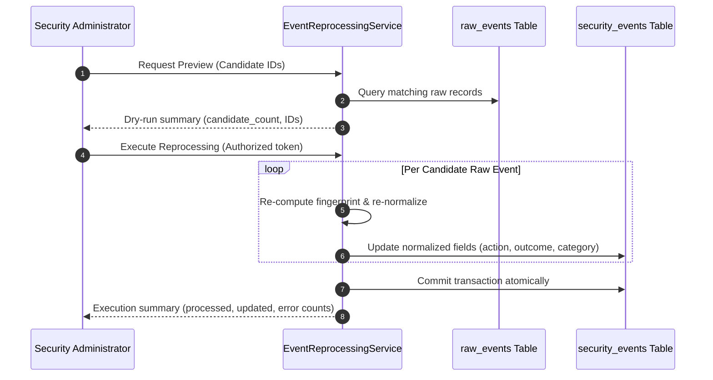

# Event Reprocessing Architecture

**Document ID:** ARCH-REPROC-001  
**Classification:** Operational Security Reference  
**Scope:** SnareSight Phase 3 — Event Pipeline & Database (P14)  
**Status:** IMPLEMENTED  

---

## 1. Reprocessing Objectives & Governance

As threat intelligence matures, detection rules evolve, or schema taxonomy updates occur, security engineers may need to re-evaluate historical telemetry.

The [`EventReprocessingService`](file:///c:/Projects/SnareSight/backend/app/retention/reprocessor.py) provides a controlled, auditable, non-destructive mechanism to re-normalize stored raw events without losing evidence or generating duplicates.

### Core Governance Rules:
1. **Explicit Selection Only:** Reprocessing is targeted by specific event IDs, session IDs, or date ranges. Bulk automatic reprocessing of the entire database is prohibited.
2. **Immutability of Raw Evidence:** The original record in `raw_events` is never modified or deleted.
3. **No Provenance Drift:** Historical provenance tags (`controlled_test`, `synthetic_simulation`) cannot be altered or upgraded to live telemetry.
4. **Dry-Run Preview:** A dry-run capability provides candidate record counts and IDs before any database update occurs.
5. **Audit Logging:** Every execution records the administrator identity, timestamp, candidate count, and updated record count.

---

## 2. Reprocessing Workflow

---

## 3. Verification & Integrity Results

- **`TEST DATA-003`:** Verified that re-running reprocessing preserves original provenance (`controlled_test`), retains original event IDs, and accurately updates normalized taxonomy categories without duplicate rows.

