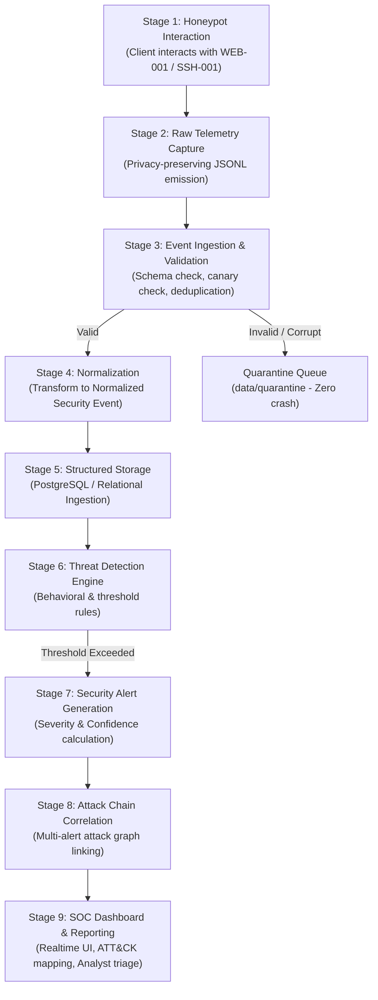

# SnareSight — Event Transformation Flow & Pipeline Architecture

**Document ID:** `SNARESIGHT-ARCH-FLOW-001`  
**Classification:** Confidential — Internal Cybersecurity Engineering  
**Authority:** Principal Data Architect & SIEM Pipeline Engineer  

---

## 1. End-to-End Pipeline Workflow

The SnareSight event pipeline transforms raw telemetry into actionable threat intelligence through nine discrete stages:



---

## 2. Detailed Pipeline Stages & Transformations

### Stage 1: Honeypot Interaction
- An external client interacts with a decoy listener (e.g. HTTP POST to `/login` on `WEB-001`).
- The decoy extracts network metadata (`source_address`, `user_agent`), sets or inspects the `session_id`, evaluates input bounds, and executes local privacy sanitization:
  - Submitted username is hashed with keyed HMAC-SHA256 (`username_fingerprint`).
  - Submitted password is categorized into coarse length buckets (`none`, `short`, `medium`, `long`).
  - Plaintext password is immediately deleted (`del password`).
- The decoy returns a simulated corporate response (HTTP 401).

### Stage 2: Raw Telemetry Capture
- The honeypot's internal logger appends a strictly-typed JSON record to `data/events.jsonl`.
- Enforces pre-write validation: rejects any record containing `"password":`.
- Tags initial `observed_at` UTC timestamp and `provenance` metadata.

### Stage 3: Event Ingestion & Validation
- The central ingestion worker tails the JSONL feed or receives forwarded records.
- Computes `received_at` UTC timestamp.
- Evaluates record against `raw_event.schema.json`:
  - If valid: Computes `deduplication_hash = SHA256(decoy_id + observed_at + session_id + payload_hash)`.
  - If duplicate: Increments duplicate counter, discards duplicate record.
  - If invalid: Preserves sanitized error record in quarantine; never drops evidence silently.

### Stage 4: Event Normalization
- The Normalizer maps source-specific fields into the canonical `Normalized Security Event` structure:
  - Generates unique `event_id` (UUIDv4) and sets `raw_event_id`.
  - Normalizes action (`SUBMIT_CREDENTIALS`), category (`AUTHENTICATION`), and outcome (`FAILURE`).
  - Normalizes target (`target_service="WEB_PORTAL"`, `target_port=8080`).
  - Records `normalized_at = NOW(UTC)`.
  - Preserves immutable provenance (`source_type`, `environment`).

### Stage 5: Structured Event Storage
- The Normalized Event is persisted to the relational database (`normalized_events` table).
- Relational foreign keys and JSONB GIN indexes are updated.

### Stage 6: Threat Detection
- The Detection Engine evaluates streaming events against active behavioral rules:
  - *Single-event rules:* Anomalous probe detection, severe injection markers.
  - *Sliding-window rules:* Brute-force burst detection (e.g., 10 failed logins in 60s from same `source_address` or `session_id`).

### Stage 7: Security Alert Generation
- When rule conditions trigger, the engine emits a `Security Alert`:
  - Allocates unique `alert_id` (UUIDv4).
  - Populates `related_event_ids` with exact supporting event keys.
  - Computes `severity` (based on rule category) and `confidence` (based on evidence volume and corroboration).
  - Generates evidence-backed MITRE ATT&CK association.
  - Assigns initial lifecycle state: `assessment_status="NEW"`.

### Stage 8: Attack Chain Correlation
- The Correlation Engine analyzes temporal and source overlaps between active alerts.
- Correlates multi-phase activities (e.g. Reconnaissance -> Brute Force -> Shell Probe) under an `attack_chain_id`.

### Stage 9: SOC Dashboard & Analyst Workflow
- Alerts and attack chains are streamed in real time to the SOC Dashboard over WebSocket.
- Analysts review timeline evidence, assign investigations, adjust alert statuses, and approve recommended mitigations.

---

## 3. Provenance Preservation Across Pipeline Transformations

Provenance is an immutable attribute carried through every pipeline boundary:

```
Raw Event:
  "provenance": { "source_type": "controlled_test", "environment": "isolated_lab" }
       │
       ▼
Normalized Event:
  "provenance": { "source_type": "controlled_test", "environment": "isolated_lab" }
       │
       ▼
Security Alert:
  "provenance": { "source_type": "controlled_test", "environment": "isolated_lab" }
       │
       ▼
Attack Chain / Investigation Report:
  [AUDIT BANNER]: "GENERATED FROM CONTROLLED TEST TELEMETRY - NOT LIVE ATTACK ACTIVITY"
```

*Guarantee:* Synthetic simulations and controlled lab tests can NEVER be promoted to or conflated with genuine external adversary attacks.

