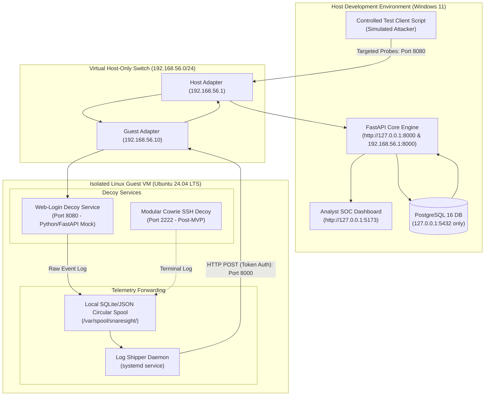

# SnareSight: Honeypot Lab Deployment Architecture
**Document ID:** ARCH-LAB-001  
**Phase:** 2 — Lab Isolation and Honeypot  
**Status:** Approved Deployment Architecture  

---

## 1. Architectural Topology

---

## 2. Decoy Deployment Lifecycle & Roles

1. **Initial Deception Target: Web-Login Decoy (Task P09):**
   * **Role:** Simulates a corporate single sign-on (SSO) or administrative portal.
   * **Execution Model:** Lightweight Python service running as an unprivileged system daemon (`snaresight-decoy` user) inside the Linux VM, bound strictly to internal IP `192.168.56.10:8080`.
   * **Behavior:** Captures HTTP POST parameters (username, submitted password length, password SHA-256 hash, client headers, source IP). Returns simulated authentication error screens without granting any real access.
2. **Modular Extension: Cowrie SSH Honeypot (Post-MVP):**
   * **Role:** Emulates a medium-interaction UNIX SSH shell on port `2222`.
   * **Integration:** Telemetry logs emitted to `/var/log/cowrie/cowrie.json` are read by the common Shipper Daemon and normalized into the standard SnareSight schema.

