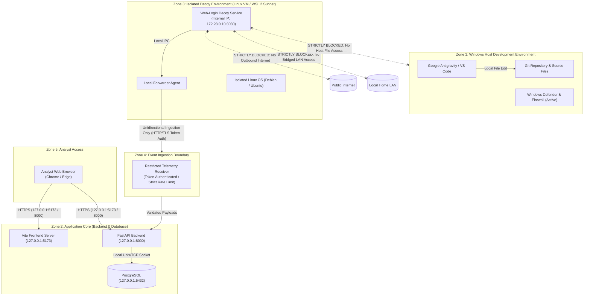

# SnareSight: Network Architecture & Trust Boundaries
**Document ID:** ARCH-004  
**Status:** Approved Security Architecture Baseline  

---

## 1. Network Segmentation & Trust Zones

To ensure zero risk to the host development environment, SnareSight defines five distinct security zones.

---

## 2. Inviolable Network Isolation Constraints

### Constraint 1: Strict Prohibition of Bridged Networking
* **Rule:** Decoy virtual environments must **never** be attached to a bridged network adapter. Bridged adapters place the virtual machine directly onto your physical home local area network (LAN), exposing your home router and family devices to honeypot probes.
* **Approved Topology:** Honeypot services must use an **Internal Host-Only** or **Private NAT** virtual switch.

### Constraint 2: Unidirectional Telemetry Flow
* The isolated decoy environment can **only initiate outbound TCP connections to the dedicated Ingestion API port** on the host.
* The decoy environment is completely prohibited from reaching the Windows host's file system, SMB shares, administrative RPC ports, or general LAN IP addresses.

### Constraint 3: Decoy Isolation from the Public Internet
* During development and evaluation, decoys must never be exposed via port-forwarding, Dynamic DNS, or cloud tunnels (e.g. ngrok) to the public Internet.
* Decoy interactions are driven solely by local security tests, scripted attack simulations, or controlled lab subnets.

### Constraint 4: Database Isolation
* PostgreSQL is bound exclusively to `127.0.0.1` (localhost). It must never accept connections from the decoy VM or external network interfaces.

---

## 3. Residual Network Risks & Mitigations

| Risk | Cause | Architectural Mitigation |
| :--- | :--- | :--- |
| **Decoy Network Escape** | Malicious script attempts to scan host subnet | Virtual firewall drops all outbound SYN packets from the decoy subnet except destination `Ingestion_IP:Port`. |
| **Telemetry Flood / DoS** | Attacker floods decoy login endpoint | Ingestion receiver enforces rate limiting (100 req/sec) and payload size limits (max 64 KB). |
| **Host Port Sniffing** | Compromised decoy probes host ports | Host firewall explicitly rejects all non-ingestion connection attempts originating from the decoy virtual adapter. |

