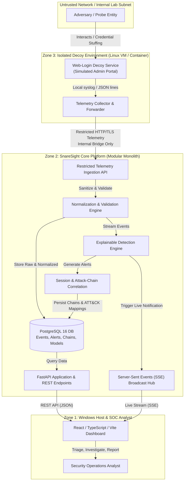
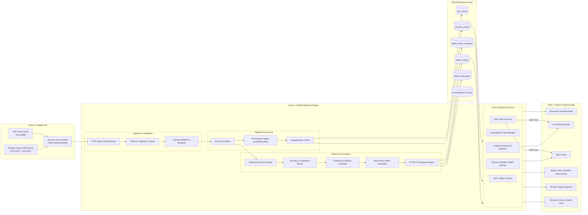

# SnareSight: System Architecture Specification
**Document ID:** ARCH-001  
**Status:** Approved Architecture Baseline  
**Classification:** Internal Technical Architecture  

---

## 1. Executive Summary & Objective

SnareSight is a deception-driven cybersecurity threat detection and Security Operations Center (SOC) platform. Its primary objective is to deploy controlled, isolated decoy services (honeypots), monitor adversary interactions, ingest and normalize raw security telemetry, evaluate deterministic behavioral detection rules, correlate related activity into attack chains, map verified observations to MITRE ATT&CK techniques, and present high-integrity security intelligence to analysts via a real-time SOC dashboard.

---

## 2. High-Level Context Diagram (C4 Level 1)

---

## 3. Detailed Component-Level Diagram (C4 Level 2)

---

## 4. Architectural Style: Modular Monolith

SnareSight adopts a **Modular Monolith** architecture for its core backend services:
* **Single Deployment Unit:** Deployed as a unified Python FastAPI service running within Windows development or containerized environments.
* **Strict Logical Boundaries:** Internal subsystems (`ingestion`, `detection`, `correlation`, `intelligence`, `investigations`, `reporting`) interact exclusively through explicit Python interfaces and dependency injection.
* **No Premature Microservice Overhead:** Eliminates network serialization delays, distributed transaction failure modes, and service orchestration complexity, ensuring rapid, reliable execution on standard development hardware.

