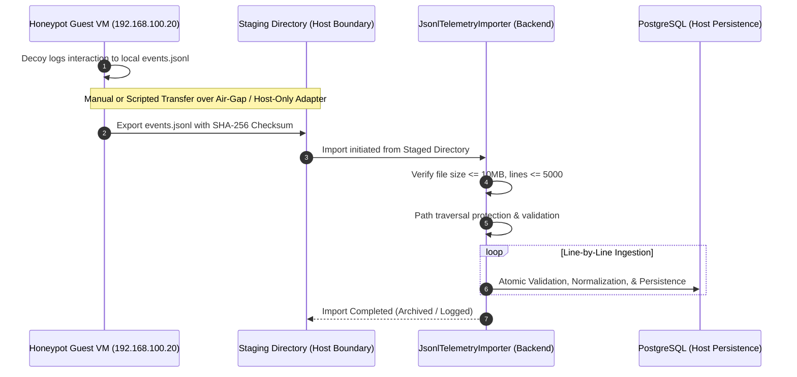

# Telemetry Transfer Guide

**Document ID:** ARCH-TRN-001  
**Classification:** Operational Security Procedure  
**Scope:** SnareSight Phase 3 — Event Pipeline & Database (P13)  
**Status:** IMPLEMENTED  

---

## 1. Security Principles for Telemetry Transfer

The primary threat vector in honeypot deployments is the possibility of lateral movement or network enumeration from a compromised honeypot guest into the host operations center or core database infrastructure.

To neutralize this vector, SnareSight enforces the following transfer rules:
1. **Zero Database Connections:** Honeypot decoys running on the Linux guest virtual machine (`192.168.100.20`) possess **no network routes, firewall openings, or database client drivers** to communicate directly with PostgreSQL on the host or any corporate network segment.
2. **Local Honeypot Buffering:** Honeypots record events strictly to a local append-only JSONL log (`events.jsonl`) inside the isolated Linux guest filesystem (`/opt/snaresight/logs/` or local working decoy dir).
3. **Controlled Transfer Modality:** Data transfer out of the honeypot environment must only occur through pre-authorized, monitored channels.



---

## 2. Ingestion Modality A: Controlled JSONL File Import

The `JsonlTelemetryImporter` class provides offline, forensic batch file processing.

### Directory Restrictions and Path Traversal Safeguards
To eliminate arbitrary file reads or local file inclusion attacks:
- The importer verifies paths against an authorized staging boundary (`C:\Projects\SnareSight\honeypot-lab` and `C:\Projects\SnareSight\backend\staging`).
- Windows directory traversal strings (`..`, `/`, `\`) resolving outside authorized directories are rejected with an explicit security violation.
- Sensitive system paths (`/etc/`, `C:\Windows\`, `C:\Users\`) are prohibited.

### Execution Command via Python CLI / Script
```python
from app.db.session import SessionLocal
from app.ingestion.importer import JsonlTelemetryImporter
from app.ingestion.processor import EventProcessor

session = SessionLocal()
processor = EventProcessor(session=session)
importer = JsonlTelemetryImporter(processor=processor)

result = importer.import_file("C:/Projects/SnareSight/honeypot-lab/web-decoy/events.jsonl")
print(f"Accepted: {result['accepted']}, Duplicates: {result['duplicate']}, Rejected: {result['rejected']}")
```

### Resource and Safety Constraints
| Parameter | Enforcement Limit | Violation Handling |
| :--- | :--- | :--- |
| Max File Size | 10.0 MB | Aborts import prior to reading (`FILE_SIZE_EXCEEDED`) |
| Max Lines | 5,000 lines | Stops reading at 5000th record (`LINE_LIMIT_EXCEEDED`) |
| Read Mechanism | Streamed line-by-line | Constant memory consumption (no full-file buffer) |
| Line Parsing | Independent `json.loads` | Corrupt line rejected without aborting remainder |

---

## 3. Ingestion Modality B: Authenticated REST API Gateway

For real-time forwarding from approved collectors, the backend provides an authenticated batch endpoint.

### Endpoint Specification
- **Path:** `POST /api/v1/ingestion/events/batch`
- **Authentication:** `X-API-Key: <SNARESIGHT_API_KEY>` header.
- **Content-Type:** `application/json`
- **Request Body:**
```json
{
  "source_id": "WEB-001",
  "batch_id": "9b1deb4d-3b7d-4bad-9bdd-2b0d7b3dcb6d",
  "events": [
    {
      "raw_event_id": "3c518cfd-4d7a-4299-a417-6ffce4db6835",
      "timestamp": "2026-10-31T12:00:00Z",
      "schema_version": "1.0",
      "source": { "source_id": "WEB-001", "decoy_id": "WEB-001" },
      "data_provenance": "controlled_test",
      "session_id": "sess_882910ab",
      "event_type": "honeypot.login_attempt",
      "client": { "ip": "192.168.100.50", "port": 49210 },
      "interaction": {
        "method": "POST",
        "path": "/login",
        "username_attempted": "admin"
      }
    }
  ]
}
```

### Response Codes & Contract
- **200 OK:** Batch processed successfully (contains per-event status array, accepted, duplicate, and rejected counts).
- **401 Unauthorized:** Missing or invalid `X-API-Key` header.
- **422 Unprocessable Entity:** Malformed batch JSON structure.

