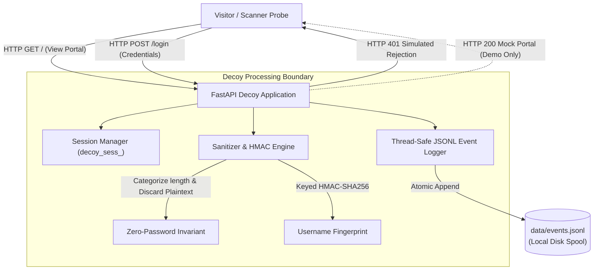

# SnareSight: Web-Login Decoy Architecture Specification
**Document ID:** ARCH-DEC-001  
**Phase:** 2 — Lab Isolation and Honeypot  
**Status:** Approved Component Architecture Baseline  

---

## 1. Architectural Role & Boundary

The Web-Login Decoy (`ApexCore Logistics Portal`) operates as a low-interaction honeypot simulating an enterprise web authentication boundary.

---

## 2. Inviolable Architectural Constraints

* **No Real Database:** The decoy does not import SQLAlchemy, psycopg2, or connect to PostgreSQL.
* **No Outbound Network Sockets:** The decoy makes zero outbound HTTP requests, external DNS queries, or telemetry transfers.
* **Non-Wildcard Binding:** Enforces `127.0.0.1` binding during offline development; raises validation errors if configured with `0.0.0.0` or `::`.
* **Zero Command Execution:** Contains no calls to `os.system`, `subprocess`, `exec()`, or `eval()`.

