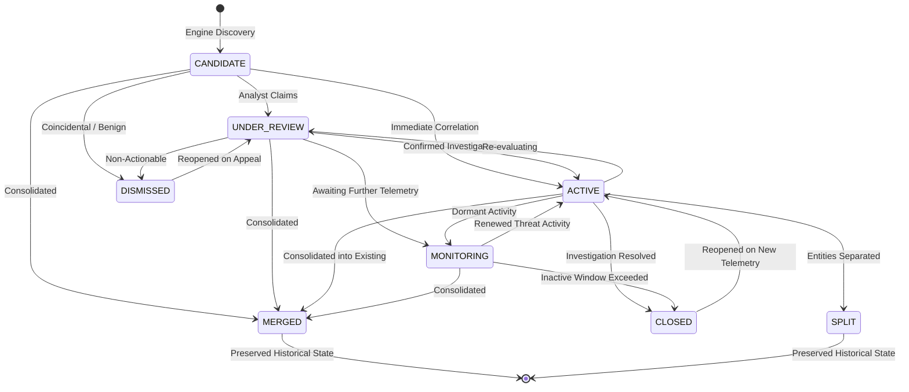

# Investigation Cluster Lifecycle State Machine

## Lifecycle States
Every investigation cluster progresses through a strictly validated state machine managed by `ClusterLifecycleManager` (`backend/app/modules/campaign_intelligence/lifecycle.py`):

---

## State Definitions

- **`CANDIDATE`**: Automatically generated by the clustering engine upon detecting correlating telemetry. Requires analyst triage.
- **`UNDER_REVIEW`**: An analyst is actively inspecting the evidence, validating relationships, and assessing threat context.
- **`ACTIVE`**: Verified investigation group under active monitoring and containment planning.
- **`MONITORING`**: Temporarily parked cluster where recent activity has ceased, but persistence or dormant recurrence is anticipated.
- **`CLOSED`**: Completed investigation with resolved findings or documented operational conclusions.
- **`DISMISSED`**: Evaluated by an analyst and deemed coincidental background noise, benign scanner traffic, or false correlation.
- **`MERGED`**: Non-destructive terminal state indicating all entities and evidence were consolidated into another cluster.
- **`SPLIT`**: Non-destructive terminal state indicating the cluster was segmented into more granular groupings.

---

## Valid Transitions Table

| Current State | Permitted Target States |
|:---|:---|
| `CANDIDATE` | `UNDER_REVIEW`, `ACTIVE`, `DISMISSED`, `MERGED` |
| `UNDER_REVIEW` | `ACTIVE`, `MONITORING`, `DISMISSED`, `MERGED` |
| `ACTIVE` | `UNDER_REVIEW`, `MONITORING`, `CLOSED`, `MERGED`, `SPLIT` |
| `MONITORING` | `ACTIVE`, `CLOSED`, `MERGED` |
| `CLOSED` | `ACTIVE` (Reopened) |
| `DISMISSED` | `UNDER_REVIEW` (Reconsidered) |
| `MERGED` | *(Terminal - Historical Record)* |
| `SPLIT` | *(Terminal - Historical Record)* |

Any attempt to execute an invalid transition raises a `400 Bad Request` HTTP exception.

---

## Audit Trail Invariant
Every state transition records an entry in `cluster_audit_logs` containing:
- `cluster_id`
- `action` (`"STATUS_CHANGE"`)
- `previous_state`
- `new_state`
- `performed_by` (authenticated user or system identifier)
- `notes` (mandatory rationale for closures and dismissals)
- `created_at` timestamp

