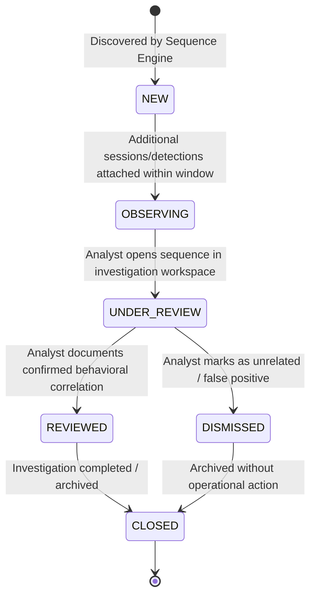

# SnareSight Behavioral Sequence & Multi-Session Correlation Architecture

> **OPERATIONAL CAUTION & SCOPE BOUNDARY**  
> A **Behavioral Sequence** is an analytical candidate grouping of suspicious observations based on available honeypot telemetry, detection rules, and configured correlation policies.  
> It does **NOT** establish common human identity, prove malicious intent, demonstrate causation, confirm a successful compromise, or perform threat actor attribution.  
> All sequences are presented to SOC analysts as candidates requiring review.

---

## 1. System Overview

SnareSight Phase 5 Task P22 introduces multi-session behavioral correlation. While Task P21 bounded telemetry within individual decoy interaction sessions (`ActivitySession`), Task P22 analyzes relationships across multiple sessions over time to uncover structured attack progressions (e.g. initial credential probing in Session 1, web directory discovery in Session 2, and exploitation attempts in Session 3).

```mermaid
flowchart TD
    subgraph P21 ["Phase 5 - Task P21: Session Correlation"]
        E1[Security Event #1] --> S1[Activity Session 1<br/>SSH-001 (10:00 UTC)]
        E2[Security Event #2] --> S1
        E3[Security Event #3] --> S2[Activity Session 2<br/>WEB-001 (10:45 UTC)]
        E4[Security Event #4] --> S3[Activity Session 3<br/>WEB-001 (11:15 UTC)]
    end

    subgraph P16P20 ["Detections & ATT&CK Mappings"]
        S1 -.-> D1[Alert: SSH Brute Force<br/>T1110.001]
        S2 -.-> D2[Alert: Path Enumeration<br/>T1083]
        S3 -.-> D3[Alert: Path Traversal<br/>T1083 / T1190]
    end

    subgraph P22Engine ["Phase 5 - Task P22: Sequence Discovery Engine"]
        S1 & S2 & S3 --> Eval[Cross-Session Evaluator]
        D1 & D2 & D3 --> Eval
        Eval --> Patterns{Behavioral Patterns<br/>Window: 86400s}
        Patterns -- Match --> Seq[Behavioral Sequence Record<br/>seq-act-20261031-001]
        Seq --> Members[Sequence Members:<br/>Sessions, Events, Detections, Techniques]
        Seq --> Rels[Sequence Relationships:<br/>OBSERVED_BEFORE, SHARED_SOURCE_CONTEXT, BEHAVIORALLY_SIMILAR]
        Seq --> Score[Scoring Engine:<br/>Correlation Confidence & Sequence Relevance]
    end

    subgraph SOC ["Analyst Investigation Workspace"]
        Seq --> UIList[Sequence Queue / Grid]
        UIList --> UIDetail[Multi-Session Timeline & Relationship Graph]
        UIDetail --> UIAssess[Analyst Assessment & Review Audit]
    end
```

---

## 2. Multi-Session Precedence Tiers

Correlation across sessions strictly adheres to a 5-level evidential hierarchy:

1. **Level 1 — Shared Trusted Interaction Identifier:**
   - Evaluates explicit cryptographic or protocol interaction identifiers where supported by telemetry.
   - Confidence: Highest (90–100%).
2. **Level 2 — Trusted Source Context:**
   - Evaluates shared observed source addresses combined with matching target decoy instance, protocol, and temporal proximity.
   - **Critical Invariant:** Source IP alone is NEVER sufficient; it must be corroborated by behavioral evidence.
   - Confidence: High (75–89%).
3. **Level 3 — Behavioral Similarity & Pattern Progression:**
   - Matches documented scenario progressions:
     - Authentication failures followed by enumeration.
     - Enumeration followed by exploitation.
     - Multi-technique progression across sessions.
   - Confidence: Moderate (60–74%).
4. **Level 4 — Temporal Relationship:**
   - Sessions occurring within the configured cross-session correlation window (default: `86400s` / 24 hours).
   - Time proximity alone is insufficient to assert correlation; it acts as a constraint filter.
5. **Level 5 — Insufficient Evidence:**
   - If telemetry signals fail to establish verifiable links, sessions remain isolated. No artificial sequence is created.

---

## 3. Sequence Lifecycle Architecture

A behavioral sequence progresses through controlled lifecycle states:



### Lifecycle States
- **`NEW`:** Automated sequence candidate created upon discovering related multi-session activity.
- **`OBSERVING`:** Sequence is active within its correlation time window; subsequent related sessions may attach automatically.
- **`UNDER_REVIEW`:** Assigned or opened by a SOC analyst for investigation.
- **`REVIEWED`:** Analyst has recorded a structured assessment and documented whether the sequence represents a plausible attack path.
- **`DISMISSED`:** Analyst determined the grouping was coincidence, false correlation (e.g. shared NAT IP), or non-actionable noise.
- **`CLOSED`:** Investigation concluded; sequence is archived.

---

## 4. Relational Data Architecture

To ensure referential integrity, idempotency, and non-destructive analysis, the subsystem introduces 5 dedicated tables:

1. **`behavioral_sequences`:** Master record tracking sequence identifier, title, pattern type, lifecycle status, first/last observed timestamps, confidence, and relevance scores.
2. **`behavioral_sequence_members`:** Polymorphic junction table recording all associated entities (`SESSION`, `EVENT`, `DETECTION`, `ATTACK_MAPPING`) with position and timestamp. Unique constraint prevents duplicate membership.
3. **`behavioral_sequence_relationships`:** Directed edges connecting sequence members with relationship semantics (`OBSERVED_BEFORE`, `SHARED_SOURCE_CONTEXT`, `BEHAVIORALLY_SIMILAR`, `RELATED_DETECTION_PATTERN`, `ANALYST_LINKED`).
4. **`sequence_evidence`:** Field-level evidence traces detailing the specific telemetry values, rule IDs, and provenance justifying each relationship.
5. **`sequence_assessment_history`:** Immutable audit log tracking analyst reviews, status transitions, and analytical notes.

---

## 5. Non-Destructive Principles

- **Zero Mutation:** Underlying `ActivitySessionModel`, `SecurityEventModel`, `AlertModel`, and `AttackDetectionMappingModel` records are never altered.
- **Idempotency:** Re-processing the same session or detection produces identical sequence associations without duplicating rows or creating duplicate sequences.
- **Explainability:** Every sequence relationship exposes human-readable and machine-parseable justification.

