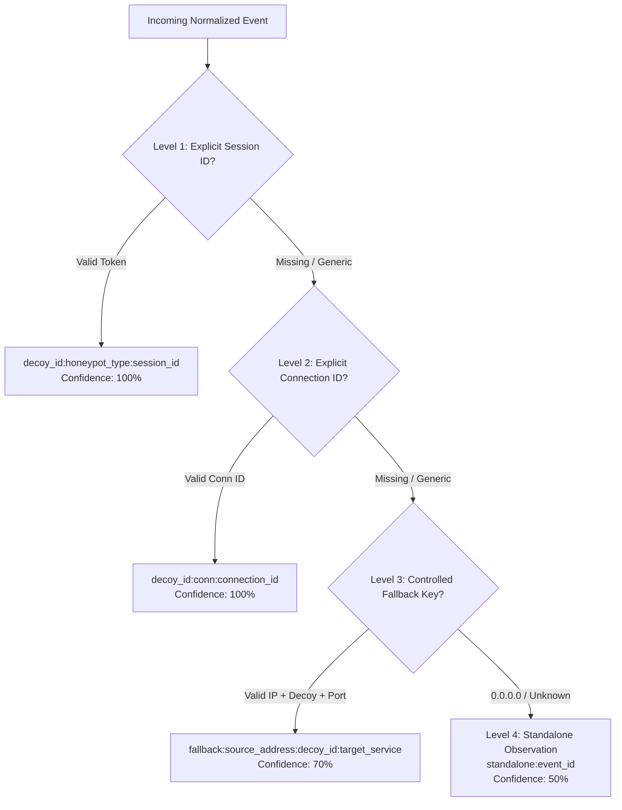

# SnareSight Session Correlation Policy & Boundary Rules

> **OPERATIONAL CAUTION & SCOPE BOUNDARY**  
> Session correlation binds events occurring on a specific decoy service within defined temporal boundaries.  
> **IP address alone is NEVER sufficient to merge sessions.** Cross-honeypot session stitching is strictly prohibited at this layer.  
> Multi-session attack chain correlation is reserved for Phase 5 Task P22; Source Activity Profiling is reserved for Task P23.  
> No threat actor attribution or speculative multi-host activity clustering is performed.

---

## 1. Purpose and Philosophy

The SnareSight Session Correlation Engine groups raw and normalized security telemetry into coherent, auditable `ActivitySession` records. The policy governs:
- When a new activity session is initiated.
- When incoming events attach to an existing session.
- When an active session is closed or marked timed out.
- How clock skew and out-of-order event arrivals are safely handled.

---

## 2. Layered Identity Resolution Hierarchy

Incoming normalized events are evaluated sequentially through four precedence tiers:

### 2.1 Level 1: Explicit Honeypot Session Token
- **Source:** Protocol-native session tokens (e.g. Cowrie SSH/Telnet session identifier, Dionaea session token, web cookie session ID).
- **Format:** `{decoy_id}:{honeypot_type}:{explicit_session_id}`
- **Generic Exclusion:** Tokens matching `unknown`, `none`, `null`, `undefined`, `0`, `-1`, or empty strings are discarded.
- **Trustworthiness:** 100% confidence.

### 2.2 Level 2: Explicit TCP/Connection Identifier
- **Source:** Network connection identifiers provided in sanitized metadata (`connection_id`, `interaction_id`).
- **Format:** `{decoy_id}:conn:{connection_id}`
- **Trustworthiness:** 100% confidence.

### 2.3 Level 3: Controlled Fallback Key
- **Source:** Source IPv4/IPv6, decoy identifier, and target service protocol.
- **Format:** `fallback:{source_address}:{decoy_id}:{target_service}`
- **Strict Invariant:** Source IP address alone is NEVER sufficient. It must be compound-scoped with the specific decoy ID and target service to prevent cross-honeypot or cross-protocol contamination.
- **Trustworthiness:** 70% confidence (`is_trustworthy=False`).

### 2.4 Level 4: Standalone Observation
- **Source:** Events lacking valid IP addresses (`0.0.0.0`), unresolvable telemetry, or corrupted identifiers.
- **Format:** `standalone:{event_id}`
- **Action:** Isolated into a dedicated standalone session to preserve evidence without corrupting existing activity sessions.

---

## 3. Boundary Evaluation Rules & Thresholds

| Boundary Parameter | Default Value | Description |
| :--- | :--- | :--- |
| `policy_version` | `1.0` | Active policy configuration schema version |
| `inactivity_timeout_seconds` | `1800` (30 min) | Max allowed idle time between events before session is marked `TIMED_OUT` |
| `max_session_duration_seconds` | `43200` (12 hr) | Absolute cap on session lifetime from initial observation timestamp |
| `clock_skew_tolerance_seconds` | `300` (5 min) | Max allowable past timestamp for out-of-order / late-arriving telemetry |

### 3.1 Inactivity Window Evaluation
If `(event.observed_at - session.last_activity_at) > inactivity_timeout_seconds`:
1. The existing candidate session is transitioned to `TIMED_OUT`.
2. A `SESSION_TIMEOUT` record is inserted into `session_correlation_history`.
3. A brand new `ActivitySession` is created for the incoming event.

### 3.2 Maximum Duration Evaluation
If `(event.observed_at - session.first_observed_at) > max_session_duration_seconds`:
1. The session is closed with `TIMED_OUT` to prevent indefinite unbounded sessions.
2. A new session is instantiated for subsequent observations.

### 3.3 Explicit Termination
If an incoming event contains an explicit disconnect action (`DISCONNECT`, `LOGOUT`, `TERMINATE`):
1. `session.ended_at` is set to `event.observed_at`.
2. `session.session_status` is transitioned to `CLOSED`.
3. Subsequent events matching the same correlation key initiate a fresh session.

---

## 4. Policy Versioning & Auditability

All correlation policies are persisted in `correlation_policy_versions`. Every correlation decision, session creation, timeout transition, and late-arrival attachment is logged in `session_correlation_history` with:
- `session_id`: Correlated activity session.
- `event_id`: Triggering security event UUID.
- `correlation_action`: Action code (`SESSION_CREATED`, `EVENT_ATTACHED`, `LATE_EVENT_ATTACHED`, `SESSION_TIMEOUT`, `SESSION_CLOSED`).
- `previous_status` & `new_status`: Lifecycle transitions.
- `policy_version`: Policy version in effect.
- `reason`: Machine-readable diagnostic explanation.

