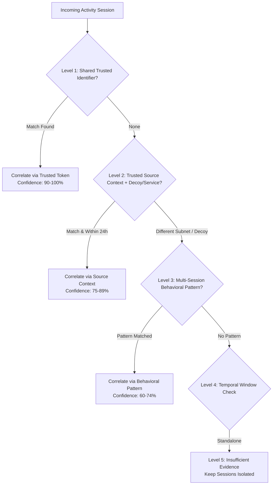

# SnareSight Cross-Session Behavioral Correlation Policy

> **OPERATIONAL CAUTION & SCOPE BOUNDARY**  
> A behavioral sequence is an analytical candidate grouping of suspicious observations based on available evidence and configured correlation policy.  
> It does **NOT** establish common human identity, prove malicious intent, demonstrate causation, or confirm successful compromise.  
> An IP address alone is NEVER sufficient to assert common identity or construct a confirmed attack chain.

---

## 1. Objectives and Principles

Cross-session correlation links related activity sessions observed across one or more honeypot decoys. The policy guarantees:
- **Evidence-First Precedence:** Stronger signals (Level 1 & 2) always take priority over weak contextual resemblances.
- **Bounded Temporal Windowing:** Sessions separated by more than the correlation window (default: 24 hours) will not be grouped.
- **False-Positive Suppression:** High-volume scanning from shared NAT or VPN infrastructure is not combined without matching behavioral patterns.

---

## 2. Multi-Session Precedence Hierarchy

### 2.1 Level 1: Shared Trusted Interaction Identifier
- Validates explicit cryptographic or protocol interaction tokens if available.
- Highest confidence tier (90–100%).

### 2.2 Level 2: Trusted Source Context
- Evaluates identical source IP combined with same decoy target, service, and temporal proximity.
- **Invariant:** IP alone is NEVER sufficient; must be corroborated by behavioral evidence.
- High confidence tier (75–89%).

### 2.3 Level 3: Behavioral Similarity
- Matches recognized multi-session behavioral progressions (see Section 3).
- Moderate confidence tier (60–74%).

### 2.4 Level 4: Temporal Relationships
- Constraint: Sessions must occur within `86400s` (24h) of each other, and total sequence span must not exceed `604800s` (7 days).
- Temporal proximity alone without behavioral alignment is rejected.

### 2.5 Level 5: Insufficient Evidence
- If signals do not meet threshold criteria, sessions remain separate. Artificial sequences are never constructed.

---

## 3. Recognized Multi-Session Behavioral Patterns

| Pattern Code | Name | Required Evidence | Correlation Window | Supported Relationships |
| :--- | :--- | :--- | :---: | :--- |
| `REPEATED_AUTHENTICATION` | Recurring Auth Activity | 2+ sessions with authentication failures (`AUTH-001`, `AUTH-002`) | 24 hours | `OBSERVED_BEFORE`, `SHARED_SOURCE_CONTEXT` |
| `AUTH_THEN_ENUMERATION` | Auth Preceding Discovery | Auth session followed by enumeration session (`AUTH-003`, `WEB-001`) | 24 hours | `OBSERVED_BEFORE`, `BEHAVIORALLY_SIMILAR` |
| `ENUMERATION_THEN_EXPLOIT`| Discovery Preceding Exploit | Enumeration session followed by exploit probe (`WEB-002`, `CMD-001`, `FILE-001`) | 24 hours | `OBSERVED_BEFORE`, `RELATED_DETECTION_PATTERN` |
| `MULTI_TECHNIQUE_PROGRESSION`| ATT&CK Progression | Detections mapping to progressive techniques (`T1110` -> `T1083` -> `T1190`) | 24 hours | `RELATED_DETECTION_PATTERN`, `OBSERVED_BEFORE` |
| `RECURRING_HONEYPOT_TARGET` | Recurring Target Probing | 2+ distinct sessions targeting same decoy instance with detections | 24 hours | `OBSERVED_BEFORE`, `BEHAVIORALLY_SIMILAR` |
| `CROSS_PROTOCOL_INTERACTION`| Multi-Protocol Activity | Corroborated activity across Web and SSH honeypots with detections | 24 hours | `CROSS_PROTOCOL`, `OBSERVED_BEFORE` |

