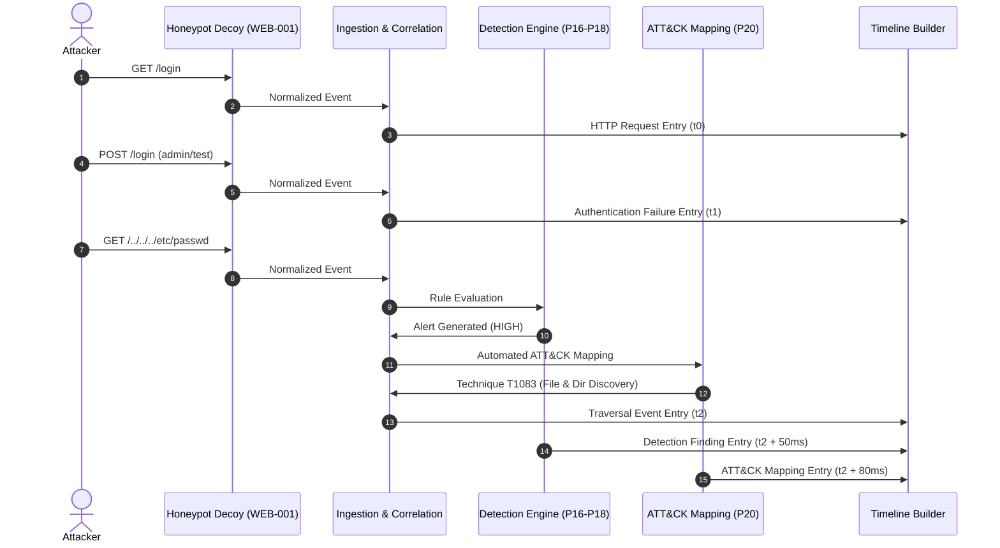

# SnareSight Investigation Timelines

> **OPERATIONAL CAUTION & SCOPE BOUNDARY**  
> Investigation timelines present single-session event sequences, detection alerts, and ATT&CK mappings.  
> Cross-session attack path stitching and multi-stage campaign reconstruction are deferred to Task P22.

---

## 1. Overview and Purpose

An Investigation Timeline provides a unified, deterministic, and chronological view of all activity occurring within a single `ActivitySession`. It merges:
1. **Raw / Normalized Events:** Requests, logins, command executions, session terminations.
2. **Detection Engine Findings:** Alerts and severity ratings triggered by specific events.
3. **MITRE ATT&CK Mappings:** Mapped adversary tactics and techniques associated with the alerts.

---

## 2. Chronological Ordering and Tie-Breaking

To guarantee deterministic presentation across diverse query engines and time resolutions:
1. **Primary Sort:** Event observation timestamp (`timestamp ASC`).
2. **Secondary Tie-Breaker:** Entry type precedence. Underlying telemetry observations precede detection findings; detection findings precede intelligence mappings.
   - Rank 0: Telemetry Events (`HTTP_REQUEST`, `AUTHENTICATION_FAILURE`, etc.)
   - Rank 1: Detection Findings (`DETECTION_GENERATED`)
   - Rank 2: Threat Intelligence (`ATTACK_MAPPING_GENERATED`)
3. **Tertiary Tie-Breaker:** Unique record ID lexicographical order (`entry_id ASC`).

---

## 3. Specialized Entry Classifications

| Entry Type | Trigger Condition | Display Badge |
| :--- | :--- | :--- |
| `HTTP_REQUEST` | HTTP request telemetry | Blue (`REQUEST`) |
| `DIRECTORY_TRAVERSAL` | Request path contains traversal patterns (`../`, `..%2f`) | Amber (`TRAVERSAL`) |
| `AUTHENTICATION_FAILURE` | Category `authentication` with outcome `FAILURE` | Orange (`AUTH_FAIL`) |
| `DECOY_AUTHENTICATION_ACCEPTED` | Simulated credential acceptance on honeypot | Purple (`DECOY_ACCEPTED`) |
| `CONNECTION_CLOSED` | Action in `DISCONNECT`, `LOGOUT`, `TERMINATE` | Slate (`DISCONNECTED`) |
| `DETECTION_GENERATED` | Correlated security alert | Red / Severity colored |
| `ATTACK_MAPPING_GENERATED` | Evidence-backed ATT&CK technique mapping | Violet (`MITRE ATT&CK`) |

---

## 4. Frontend Visual Representation

The timeline is integrated into the SnareSight SOC Investigation Workspace:
- **Left Pane:** Filterable session table with KPI summary metrics (total sessions, active sessions, events correlated).
- **Right Pane:** Split-view timeline drawer displaying:
  - Session header with decoy ID, source IP, duration, and status badge.
  - Operational caution banner.
  - Filter chips for entry categories (Events, Alerts, MITRE ATT&CK).
  - Vertical timeline tree with timestamp, component badge, severity pill, and JSON metadata inspector.

