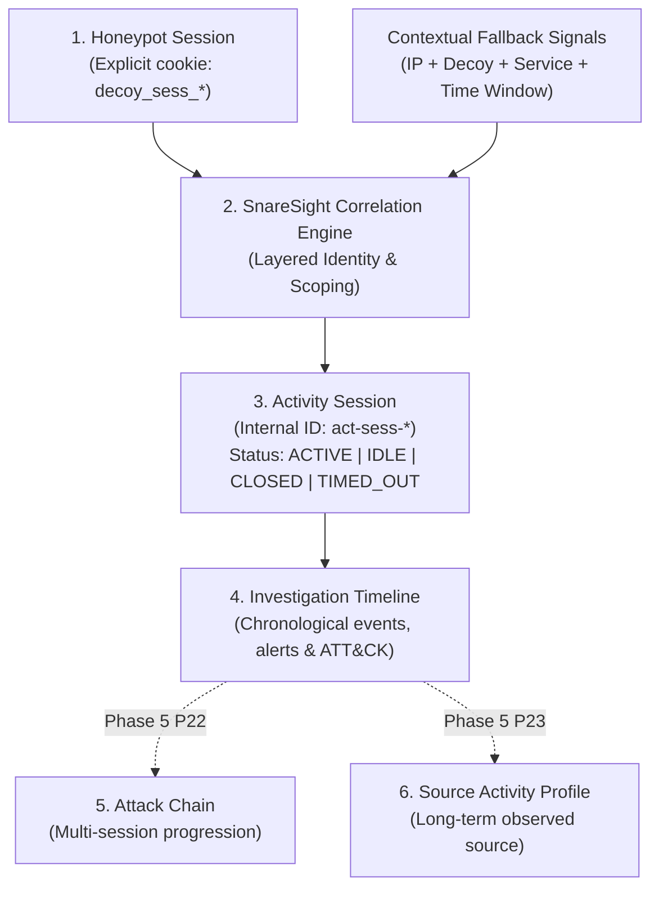

# SnareSight P21 Existing Project Assessment: Session Correlation & Investigation Timelines

## 1. Executive Summary

This assessment audits the existing SnareSight codebase (Phase 4 completed through Task P20) to establish the architectural foundation for Task P21: **Session-Based Event Correlation Engine and Investigation Timelines**.

Task P21 transforms isolated security events collected across honeypot decoys into coherent, chronological activity sessions and timeline representations, without losing original forensic event evidence or incorrectly merging unrelated activity.

---

## 2. Component Audits

### 2.1 P09–P10 Honeypot Telemetry
- **Active Honeypot Decoys:**
  - `WEB-001`: Web Login Honeypot (`honeypot-lab/web-decoy`). Simulates HTTP authentication and web portal endpoints.
  - Generates opaque, unguessable interaction session cookies: `decoy_sess_<uuid4_hex>` via [`DecoySessionManager`](file:///c:/Projects/SnareSight/honeypot-lab/web-decoy/app/services/session_manager.py).
  - Telemetry payload includes: `session_id`, `event_type`, `event_category`, `source_ip`, `source_port`, `http_path`, `http_method`, `user_agent`, `status_code`, `timestamp`.
  - Protocol: HTTP/1.1 over TCP.
  - Deferred Decoys: SSH/Cowrie shell decoy (`CMD-001`) and file-transfer decoy (`FILE-001`) are in draft status and produce no live shell/upload telemetry.

### 2.2 P11–P15 Event Processing Pipeline
- **Raw Events (`raw_events` table):**
  - Schema: `raw_event_id`, `event_type`, `event_category`, `decoy_id`, `session_id`, `observed_at`, `received_at`, `sanitized_payload`, `provenance`.
- **Normalized Events (`security_events` table):**
  - Schema: `event_id`, `raw_event_id`, `session_id` (explicit honeypot session identifier), `decoy_id`, `source_address`, `source_port`, `source_protocol`, `target_service`, `target_port`, `observed_at`, `received_at`, `normalized_at`, `sanitized_metadata`, `provenance`, `deduplication_reference`.
- **Deduplication:** SHA-256 fingerprinting on 7 immutable fields guarantees idempotency.
- **Event Streaming:** Real-time broadcast over Server-Sent Events (`event_publisher`) with thread-safe client queues and disconnect detection.

### 2.3 P16–P18 Threat Detection Engine
- **Rules & Scenarios:** 10 detection rules defined in `app/detection/scenario_catalogue.py`.
- **Session Evaluation:** `SessionEvaluator` aggregates events by `session_id` within a time window (e.g. `AUTH-001` threshold 3 failures).
- **Alerts (`alerts` and `alert_evidence` tables):**
  - Alerts store `alert_id`, `detection_rule_id`, `detection_rule_version`, `severity`, `confidence`, `source_address`, `decoy_id`, `first_observed_at`, `last_observed_at`.
  - Many-to-many junction table `alert_evidence` links supporting normalized events to alerts.

### 2.4 P19–P20 MITRE ATT&CK Framework & Evidence Mappings
- **Catalogue:** Official Enterprise ATT&CK v14.1 STIX 2.1 catalogue in PostgreSQL (`attack_tactics`, `attack_techniques`, `attack_subtechniques`, `attack_relationships`).
- **Detection Mappings:** `attack_detection_mappings` links alerts to techniques (e.g. `AUTH-001` -> `T1110.001`), with explainable confidence (0–100), evidence links (`attack_mapping_evidence`), and analyst reviews (`attack_mapping_reviews`).

### 2.5 Existing Database Sessions Table
- In P11/P12, [`SessionModel`](file:///c:/Projects/SnareSight/backend/app/db/models/session.py) (`sessions` table) was created as a basic table for honeypot visitor sessions.
- In P21, we extend session correlation with dedicated activity session models:
  - `activity_sessions`: Internal activity sessions with compound identity, correlation method, status lifecycle, and summary counters.
  - `activity_session_events`: Junction table mapping normalized events to activity sessions with ordering and late-arrival flags.
  - `session_correlation_history`: Audit trail of session creation, event association, and status changes.
  - `correlation_policy_versions`: Configurable policy versioning for timeouts and boundaries.

---

## 3. Correlation Scope & Conceptual Distinctions

### Critical Scope Boundaries:
1. **Honeypot Session vs Activity Session:**
   - A honeypot session is reported by the decoy sensor (e.g. cookie).
   - An activity session is constructed by SnareSight, scoping explicit identifiers with decoy instance and type, or synthesizing controlled fallback sessions when explicit identifiers are absent.
2. **Investigation Timeline vs Attack Chain:**
   - Timeline is a chronological view of events, alerts, and ATT&CK mappings within a single session.
   - Attack-chain correlation across multiple sessions belongs to Task P22.
3. **No Unsafe Merging:**
   - An IP address alone is **never** a sufficient session identifier.
   - Separate sessions are maintained rather than merging activity without trustworthy evidence.

