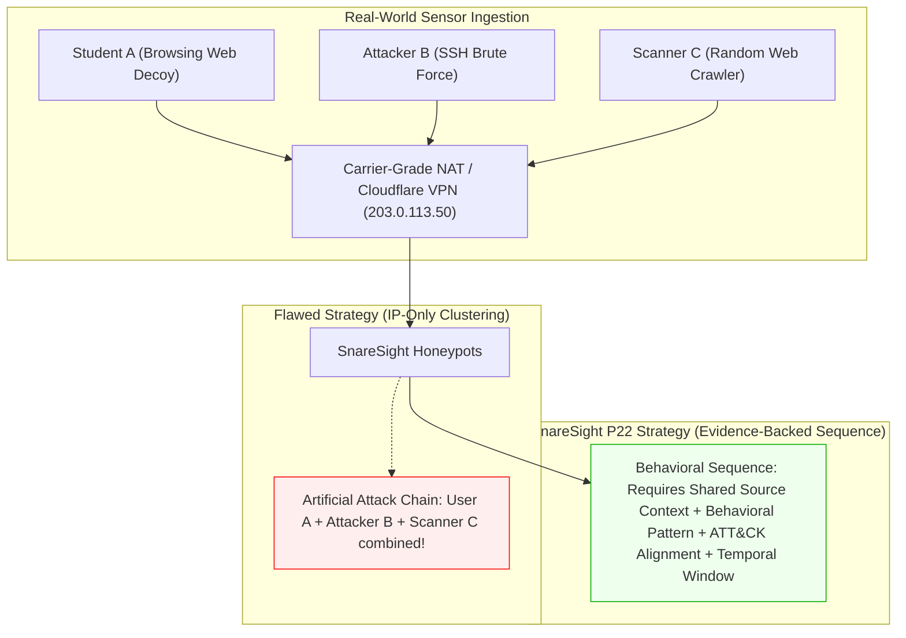

# SnareSight P22 Existing Project Assessment & Multi-Session Correlation Capabilities

**Project:** SnareSight — Deception-Driven Threat Detection and Security Operations Platform  
**Task:** Phase 5 — Task P22: Multi-Session Attack-Chain Correlation and Behavioral Sequence Analysis  
**Date:** October 31, 2026  
**Author:** Principal Cybersecurity Detection Engineer & Security Data Architect  

---

## 1. Executive Assessment & Baseline Verification

Before designing the multi-session behavioral correlation subsystem, a rigorous audit of completed tasks **P01 through P21** was conducted across the SnareSight codebase.

### 1.1 Verified Capabilities (P01–P21)
1. **Telemetry & Decoy Layer (P07–P10):**
   - Cowrie SSH/Telnet decoy generates protocol-native session IDs, source IPs, client SSH software versions, usernames, and simulated command interactions.
   - Web Login & Application Decoy (`WEB-001`, `WEB-002`) produces HTTP telemetry containing path, method, headers, user-agent, session cookies, query params, and status codes.
2. **Ingestion & Normalization Pipeline (P11–P14):**
   - Validates, deduplicates (SHA-256 idempotency fingerprint), sanitizes sensitive data (zero password storage), and persists immutable `RawEventModel` and `SecurityEventModel` records.
3. **Detection Engine & Scenarios (P16–P18):**
   - 8 production detection scenarios: `AUTH-001` (Brute Force), `AUTH-002` (Decoy Auth Accepted), `AUTH-003` (User Enumeration), `WEB-001` (Path Traversal), `WEB-002` (Exploit Probing), `CMD-001` (Recon Commands), `FILE-001` (Suspicious Transfers), and `BEHAV-001` (Multi-Category Suspicious Behavior).
   - Generates explainable `AlertModel` records with calibrated severity (`INFO` to `CRITICAL`), confidence (0–100), and evidence linkages via `AlertEvidenceModel`.
4. **MITRE ATT&CK Framework Integration (P19–P20):**
   - Complete Enterprise ATT&CK v14.1 catalogue (14 tactics, 638 techniques, 2,367 relationships) loaded in PostgreSQL.
   - Evidence-based mapping engine maps alerts to techniques (`AttackDetectionMappingModel`) with explicit rationale, confidence levels (`LOW`, `MODERATE`, `HIGH`), and analyst review workflows (`PENDING`, `ACCEPTED`, `REJECTED`, `NEEDS_MORE_EVIDENCE`).
5. **Session Correlation Subsystem (P21):**
   - Implements single-decoy `ActivitySessionModel` (`activity_sessions`) using 4-tier precedence (`EXPLICIT_SESSION_ID`, `EXPLICIT_CONNECTION_ID`, `CONTEXTUAL_FALLBACK`, `STANDALONE`).
   - Tracks session boundaries (1800s idle timeout, 43200s max duration, 300s clock skew tolerance for late arrivals).
   - Builds chronological single-session `SessionTimeline` investigation records.
   - Exposes REST APIs (`/api/v1/sessions/*`) and SOC investigation workspace.
   - 310 total automated tests passing with 0 failures and 0 errors.

---

## 2. Available Cross-Session Correlation Signals

An empirical review of fields persisted in PostgreSQL identifies which signals can legitimately be used for multi-session sequence analysis:

| Telemetry Signal | Source Model | Field Name | Cross-Session Reliability | Evaluation & Usage Scope |
| :--- | :--- | :--- | :---: | :--- |
| **Activity Session ID** | `ActivitySessionModel` | `session_id` | Authoritative | Primary unit of single-decoy interaction. |
| **Observed Source Address** | `ActivitySessionModel` | `source_address` | Moderate | IPv4/IPv6 client address. **Critical Constraint:** IP alone NEVER proves common human identity or operator; subject to NAT, VPNs, proxies, and DHCP reassignment. Must be corroborated by behavioral evidence. |
| **Decoy Identifier** | `ActivitySessionModel` | `decoy_id` | Authoritative | Specific honeypot instance targeted (e.g. `WEB-001`, `SSH-001`). |
| **Target Service / Protocol**| `ActivitySessionModel` | `target_service`, `protocol` | Authoritative | Identifies service modality (`HTTP`, `SSH`, `TCP`). |
| **Session Temporal Window** | `ActivitySessionModel` | `first_observed_at`, `last_activity_at` | High | Wall-clock interaction duration for chronological ordering. |
| **Detection Findings** | `AlertModel` | `alert_id`, `detection_rule_id`, `severity` | High | Specific behavioral rule triggers occurring across sessions. |
| **ATT&CK Technique Mappings**| `AttackDetectionMappingModel` | `technique_id`, `subtechnique_id` | High | Standardized adversary tactic/technique classifications. |
| **Event Categories / Actions**| `ActivitySessionEventModel` | `event_category`, `action`, `outcome`| High | Behavioral signals (e.g. authentication failures followed by path traversal). |
| **Sanitized Metadata Signals**| `SecurityEventModel` | `sanitized_metadata` | Moderate | HTTP user-agent, requested paths, error codes, SSH client versions. Useful for behavioral fingerprinting. |

### 2.1 Explicitly Unavailable or Unreliable Telemetry
- **Host Process Identifiers:** Honeypots run in isolated containers or virtual machines; client processes on adversary machines are invisible.
- **Client Internal IP / MAC:** Hidden behind public Internet routing.
- **Plaintext Passwords / Keystrokes:** SnareSight strictly sanitizes credentials; correlation on passwords or canary tokens is forbidden.
- **Human Identity / Threat Actor Attribution:** No telemetry provides cryptographic proof of the individual operator.

---

## 3. Operational Risk & False-Positive Boundaries

Multi-session correlation introduces significant operational risks if not strictly constrained:

### Key Guardrails
1. **IP Alone Is Never Sufficient:** A shared IP address without behavioral corroboration within a plausible correlation window must NOT form an attack sequence.
2. **Explainability Requirement:** Every behavioral sequence relationship must store explicit diagnostic rationale, supporting record references, and confidence factors.
3. **Analyst Review Required:** A behavioral sequence is an analytical candidate (`ATTACK_CHAIN_CANDIDATE`), never an automated declaration of compromise or attribution.
4. **Non-Destructive Invariant:** Original sessions, events, alerts, and ATT&CK mappings remain unmodified.

---

## 4. Proposed P22 Subsystem Architecture

To support multi-session behavioral analysis, P22 introduces:

1. **Relational Models:**
   - `behavioral_sequences`: Top-level sequence container with status, timestamps, relevance scores, and metadata.
   - `behavioral_sequence_members`: References to linked sessions, events, detections, and ATT&CK mappings.
   - `behavioral_sequence_relationships`: Directional relationships (`OBSERVED_BEFORE`, `SHARED_SOURCE_CONTEXT`, `BEHAVIORALLY_SIMILAR`, `RELATED_DETECTION_PATTERN`, etc.).
   - `sequence_evidence`: Supporting field-level evidence traces.
   - `sequence_assessment_history`: Analyst review and lifecycle audit log.
2. **Behavioral Discovery Engine (`SequenceEngine`):**
   - Configurable correlation windows (e.g. 24 hours).
   - Detection of 6 multi-session patterns (Repeated Auth, Auth -> Enumeration, Enumeration -> Exploitation, Multi-Technique Progression, Recurring Honeypot Target, Validated Cross-Protocol).
3. **Dual Scoring Model:**
   - `correlation_confidence`: Evidential strength of the linkage between sessions (0–100).
   - `sequence_relevance`: Operational priority/significance of the combined activity for investigation (0–100).
4. **FastAPI Endpoints:** REST APIs under `/api/v1/sequences`.
5. **React SOC Workspace:** Multi-session sequence list, split-view timeline across sessions, visual node-edge relationship diagram, and analyst assessment modal.

