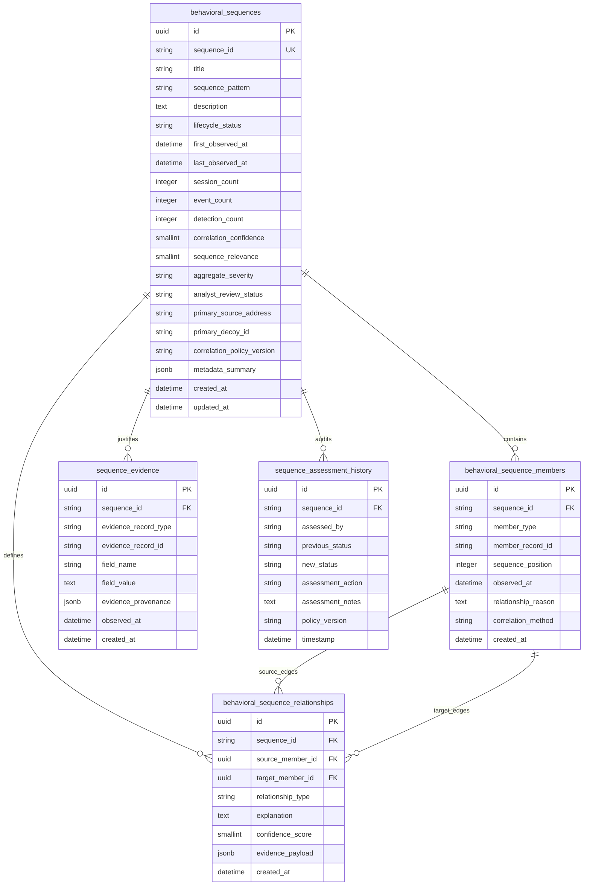

# SnareSight Behavioral Sequence Data Model & Schema Reference

> **OPERATIONAL CAUTION & SCOPE BOUNDARY**  
> The `behavioral_sequences` schema captures analytical candidate groupings of multi-session honeypot activity.  
> It does **NOT** establish human identity or prove malicious intent.  
> Original `security_events`, `activity_sessions`, and `alerts` remain immutable authoritative evidence.

---

## 1. Entity-Relationship Overview

---

## 2. Table Specifications

### 2.1 `behavioral_sequences`
Master record for candidate behavioral attack chains.
- Primary Key: `id` (UUID)
- Unique: `sequence_id` (e.g. `seq-20261031-abc12345`)
- Lifecycle Constraints: `lifecycle_status IN ('NEW', 'OBSERVING', 'UNDER_REVIEW', 'REVIEWED', 'CLOSED', 'DISMISSED')`
- Review Status Constraints: `analyst_review_status IN ('UNREVIEWED', 'CONFIRMED_PROGRESSION', 'DISMISSED_COINCIDENCE', 'INCONCLUSIVE')`
- Score Bounds: `correlation_confidence >= 0 AND correlation_confidence <= 100`, `sequence_relevance >= 0 AND sequence_relevance <= 100`.

### 2.2 `behavioral_sequence_members`
Polymorphic association linking `SESSION`, `EVENT`, `DETECTION`, and `ATTACK_MAPPING` records.
- Unique Constraint: `(sequence_id, member_type, member_record_id)` prevents duplicate member assignment.
- Type Constraint: `member_type IN ('SESSION', 'EVENT', 'DETECTION', 'ATTACK_MAPPING')`.

### 2.3 `behavioral_sequence_relationships`
Directed graph edges connecting sequence members with explicit semantic relationship types:
- `OBSERVED_BEFORE`: Chronological precedence constraint.
- `SAME_TRUSTED_INTERACTION`: Shared interaction token.
- `SHARED_SOURCE_CONTEXT`: Matching source IP, decoy, or protocol context.
- `BEHAVIORALLY_SIMILAR`: Categorical alignment.
- `RELATED_DETECTION_PATTERN`: Sequential rule detections.
- `ANALYST_LINKED`: Manual association created during investigation.

### 2.4 `sequence_evidence`
Audit trace preserving field-level telemetry values (e.g. `source_address`, `detection_rule_id`, `technique_id`) and provenance.

### 2.5 `sequence_assessment_history`
Append-only log documenting analyst decisions, review notes, policy versions, and status changes.

