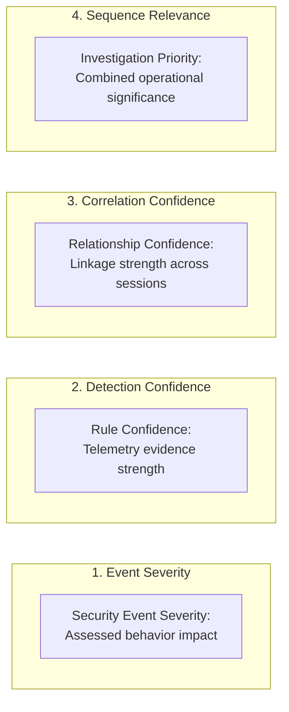

# SnareSight Sequence Scoring and Relevance Model

> **OPERATIONAL CAUTION & SCOPE BOUNDARY**  
> Sequence scores represent **analytical confidence in relationship linkage** and **operational investigation priority**.  
> They do **NOT** represent the probability of human identity attribution, attacker identification, or confirmed breach.

---

## 1. Distinct Scoring Dimensions

SnareSight maintains complete independence between four separate scoring concepts:



1. **Event Severity (`CRITICAL`, `HIGH`, `MEDIUM`, `LOW`, `INFO`):** Assesses the inherent risk of the isolated observed behavior.
2. **Detection Confidence (`0–100`):** Assesses how strongly the detection rule's conditions match the telemetry evidence.
3. **Correlation Confidence (`0–100`):** Assesses how strongly the available signals link distinct sessions together into a common sequence.
4. **Sequence Relevance (`0–100`):** Assesses how urgently a SOC analyst should investigate the combined multi-session progression.

---

## 2. Mathematical Formulation & Weighting

### 2.1 Correlation Confidence Calculation
Baseline score: `50` (Contextual candidate)
- `+30`: Shared trusted interaction token (Level 1)
- `+15`: Shared source address context across same decoy instance (Level 2)
- `+10`: Corroborated by 2+ detection findings across the sessions
- `+10`: Corroborated by 1+ evidence-backed ATT&CK technique mappings
- **Bounding:** Clamped between `10` and `100`.

### 2.2 Sequence Relevance Calculation
Baseline score: `30`
- **Severity Impact:**
  - `CRITICAL` alert: `+40`
  - `HIGH` alert: `+30`
  - `MEDIUM` alert: `+20`
  - `LOW` alert: `+10`
- **Behavioral Pattern Weight:**
  - `MULTI_TECHNIQUE_PROGRESSION`: `+25`
  - `ENUMERATION_THEN_EXPLOIT`: `+25`
  - `AUTH_THEN_ENUMERATION`: `+20`
  - `CROSS_PROTOCOL_INTERACTION`: `+20`
  - `REPEATED_AUTHENTICATION`: `+15`
  - `RECURRING_HONEYPOT_TARGET`: `+15`
- **Session Volume:** `min(session_count * 5, 15)`
- **Bounding:** Clamped between `10` and `100`.

---

## 3. Factor Explanations

Every score calculation produces an audit payload:
```json
{
  "correlation_confidence": 85,
  "sequence_relevance": 95,
  "aggregate_severity": "HIGH",
  "confidence_factors": [
    "+15: Shared source address context corroborated across sessions",
    "+10: Corroborated by 2 detection findings",
    "+10: Corroborated by 1 evidence-backed ATT&CK mappings"
  ],
  "relevance_factors": [
    "+30: Includes HIGH severity detection finding",
    "+25: Pattern complexity weight for MULTI_TECHNIQUE_PROGRESSION",
    "+10: Scaled across 2 correlated sessions"
  ],
  "disclaimer": "Scores represent analytical confidence in relationship linkage and operational investigation priority. They do NOT represent probability of human identity attribution."
}
```

