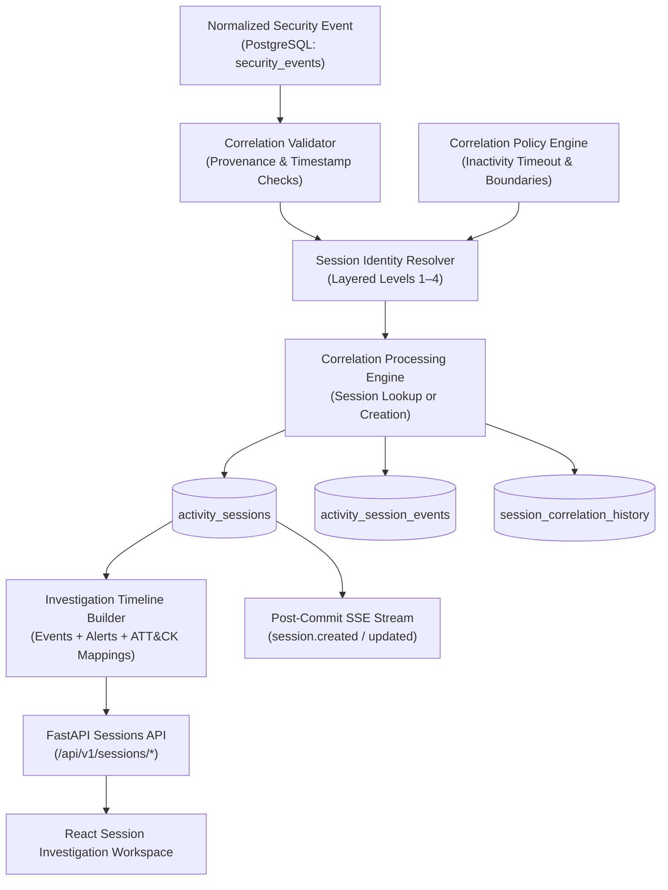
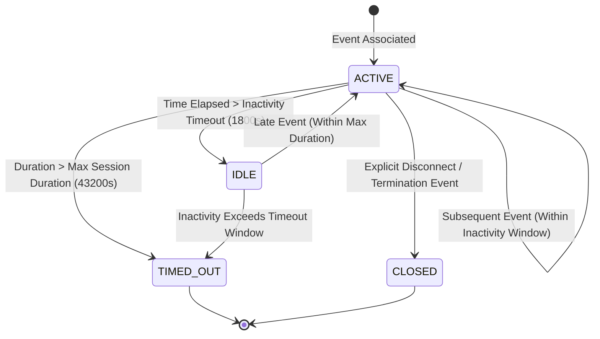

# SnareSight Session Correlation Architecture

> [!WARNING]
> **CRITICAL OPERATIONAL NOTICE:**
> A correlated activity session is a grouping of observations based on available identifiers and correlation policy. It does not establish that every event came from the same human, prove malicious intent, or demonstrate completion of an attack.

---

## 1. High-Level Architecture

The SnareSight Session Correlation Engine transforms disjointed security events into chronological, contextual activity sessions for SOC analysts.

---

## 2. Layered Correlation Strategy

The engine applies a strict hierarchical resolution strategy:

### Level 1: Explicit Honeypot Session Identifier
- **Trigger:** Telemetry contains a non-empty, trustworthy session token from a registered honeypot (e.g. `decoy_sess_*`).
- **Compound Scoping:** An explicit session ID is never assumed to be globally unique. It is scoped by honeypot instance and type:
  $$\text{Key} = \text{decoy\_id} \mathbin{\Vert} \text{honeypot\_type} \mathbin{\Vert} \text{explicit\_session\_id}$$
- **Method Tag:** `EXPLICIT_SESSION_ID`

### Level 2: Explicit Connection Identifier
- **Trigger:** Telemetry contains a reliable connection or TCP socket interaction identifier (e.g. `conn_*`).
- **Compound Scoping:** Scoped by honeypot instance and connection lifecycle.
- **Method Tag:** `EXPLICIT_CONNECTION_ID`

### Level 3: Controlled Fallback Correlation
- **Trigger:** Explicit session and connection identifiers are absent, empty, or generic (`"UNKNOWN"`).
- **Compound Scoping:** Evaluates contextual signals:
  $$\text{Key} = \text{source\_address} \mathbin{\Vert} \text{decoy\_id} \mathbin{\Vert} \text{target\_service}$$
- **Boundary Check:** Reuses an existing `ACTIVE` or `IDLE` fallback session only if:
  $$\Delta t_{\text{inactivity}} = t_{\text{event}} - t_{\text{last\_activity}} \le T_{\text{inactivity}} \quad (1800\text{s})$$
  $$\Delta t_{\text{duration}} = t_{\text{event}} - t_{\text{start}} \le T_{\text{max\_duration}} \quad (43200\text{s})$$
- **Invariance Rule:** An IP address by itself is **never** used to merge sessions without decoy and service context within the sliding window.
- **Method Tag:** `CONTEXTUAL_FALLBACK`

### Level 4: No Reliable Correlation
- **Trigger:** Telemetry lacks required contextual attributes or violates timestamp validity.
- **Action:** Retained as an isolated observation with method `STANDALONE`.

---

## 3. Session Lifecycle State Machine

- **`ACTIVE`:** New observations arriving within inactivity threshold.
- **`IDLE`:** No activity observed within `inactivity_timeout_seconds` (1800s), but eligible to reactivate if an event arrives within `max_session_duration_seconds`.
- **`CLOSED`:** Explicit session termination event observed (e.g. logout or connection close).
- **`TIMED_OUT`:** Exceeded maximum session duration or idle window elapsed without reconnect.
- **`UNKNOWN`:** Incomplete boundary telemetry.

