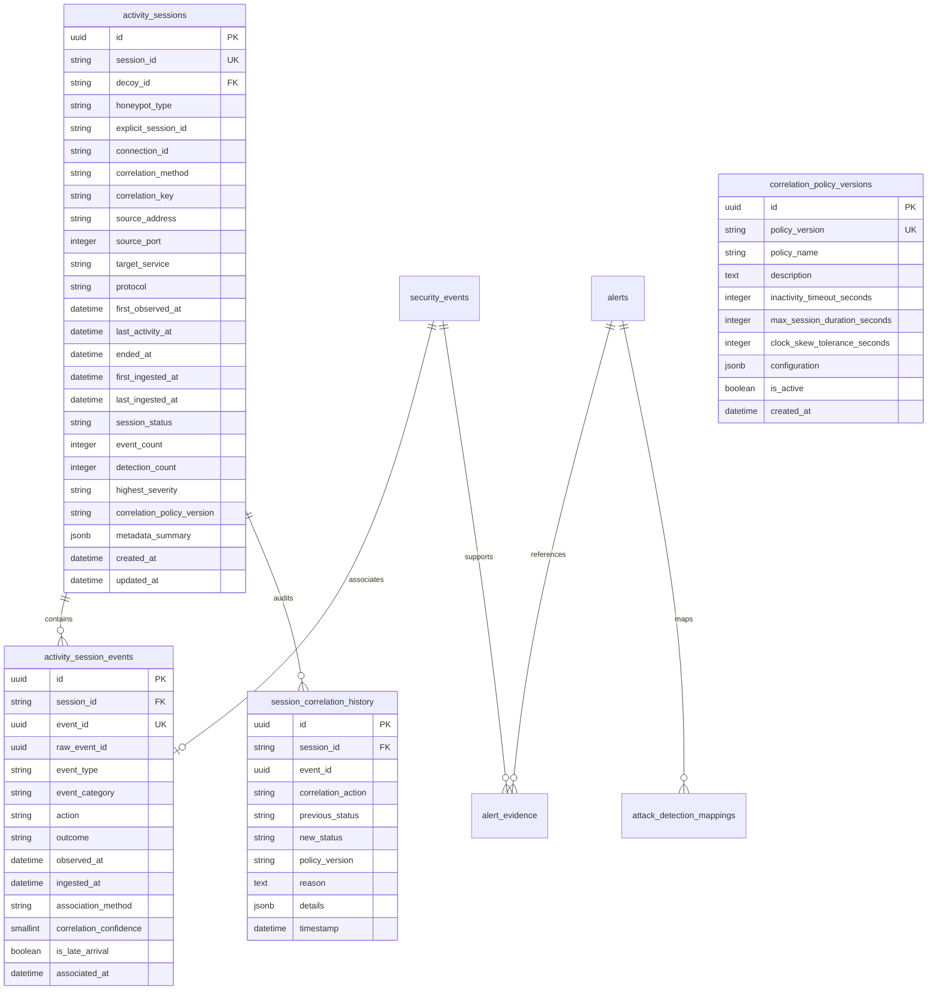

# SnareSight Session Correlation Data Model & Schema Reference

> **OPERATIONAL CAUTION & SCOPE BOUNDARY**  
> The `activity_sessions` data model captures single-decoy interaction sessions and chronological timelines.  
> Cross-honeypot session merging and multi-stage attack graph reconstruction are strictly out of scope for P21.

---

## 1. Entity-Relationship Overview

---

## 2. Table Specifications

### 2.1 `activity_sessions`
Represents an active, idle, timed out, or closed interaction session on a specific decoy honeypot.

| Column | Type | Constraints | Description |
| :--- | :--- | :--- | :--- |
| `id` | `UUID` | Primary Key, Default UUID | Internal surrogate primary key |
| `session_id` | `VARCHAR(64)` | Unique, Indexed, Non-Null | External session reference (e.g. `act-sess-abc12345`) |
| `decoy_id` | `VARCHAR(64)` | Indexed, Non-Null | Reference to honeypot decoy instance (e.g. `SSH-001`) |
| `honeypot_type` | `VARCHAR(32)` | Non-Null | Decoy classification (`SSH_DAEMON`, `WEB_LOGIN`, `DIONAEA`) |
| `explicit_session_id` | `VARCHAR(64)` | Nullable, Indexed | Native honeypot session token if present |
| `connection_id` | `VARCHAR(64)` | Nullable | Underlying TCP/socket connection identifier |
| `correlation_method` | `VARCHAR(32)` | Non-Null | Tier used (`EXPLICIT_SESSION_ID`, `EXPLICIT_CONNECTION_ID`, `CONTEXTUAL_FALLBACK`, `STANDALONE`) |
| `correlation_key` | `VARCHAR(128)` | Indexed, Non-Null | Compound lookup key |
| `source_address` | `VARCHAR(45)` | Indexed, Non-Null | Client IPv4 or IPv6 address |
| `source_port` | `INTEGER` | Nullable | Client source ephemeral port |
| `target_service` | `VARCHAR(32)` | Non-Null | Decoy service name (`SSH`, `HTTP`, `SMB`) |
| `protocol` | `VARCHAR(16)` | Non-Null | Transport protocol (`TCP`, `UDP`) |
| `first_observed_at` | `TIMESTAMPTZ` | Indexed, Non-Null | Timestamp of earliest event in session |
| `last_activity_at` | `TIMESTAMPTZ` | Indexed, Non-Null | Timestamp of latest event in session |
| `ended_at` | `TIMESTAMPTZ` | Nullable | Timestamp of session termination |
| `first_ingested_at` | `TIMESTAMPTZ` | Non-Null | Earliest pipeline ingestion timestamp |
| `last_ingested_at` | `TIMESTAMPTZ` | Non-Null | Latest pipeline ingestion timestamp |
| `session_status` | `VARCHAR(32)` | Check (`ACTIVE`, `IDLE`, `CLOSED`, `TIMED_OUT`) | Current lifecycle state |
| `event_count` | `INTEGER` | Non-Null, Default 1 | Total security events correlated |
| `detection_count` | `INTEGER` | Non-Null, Default 0 | Total alerts triggered by session events |
| `highest_severity` | `VARCHAR(16)` | Nullable | Highest alert severity observed (`CRITICAL`, `HIGH`, `MEDIUM`, `LOW`, `INFO`) |
| `correlation_policy_version`| `VARCHAR(16)` | Non-Null, Default '1.0' | Correlation policy schema version |
| `metadata_summary` | `JSONB` | Non-Null, Default `{}` | High-level diagnostic and operational summaries |
| `created_at` | `TIMESTAMPTZ` | Non-Null, Default NOW | Record creation timestamp |
| `updated_at` | `TIMESTAMPTZ` | Nullable | Record last update timestamp |

### 2.2 `activity_session_events`
Junction table linking individual normalized `security_events` to an `activity_session`.
- **Idempotency Guarantee:** `event_id` is marked `UNIQUE`. An event cannot be correlated to multiple sessions.
- **Out-of-Order Tracking:** `is_late_arrival` is set to `TRUE` if the event timestamp preceded the session's existing `first_observed_at`.

### 2.3 `session_correlation_history`
Append-only operational audit log recording lifecycle transitions, boundary evaluations, and policy actions.

### 2.4 `correlation_policy_versions`
Configuration table managing temporal windows, timeouts, and clock skew tolerances.

