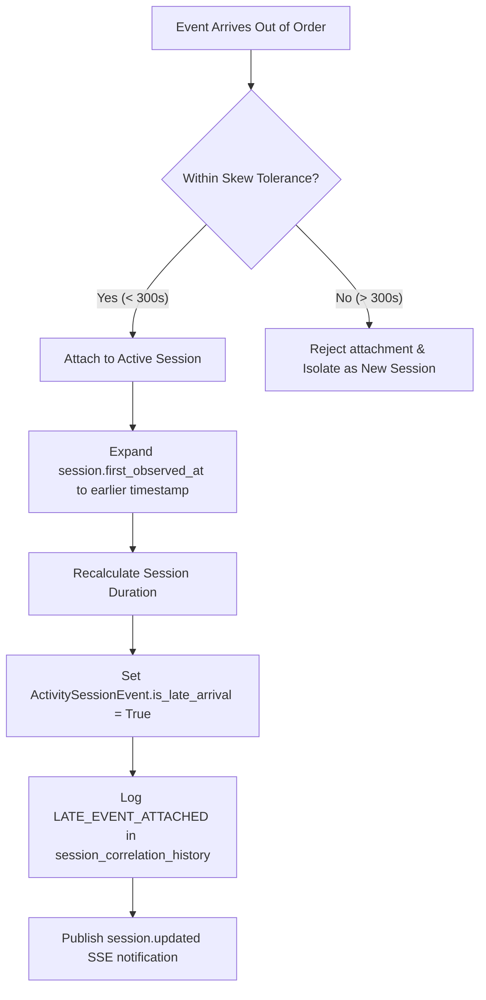

# SnareSight Timestamp and Late Event Handling

> **OPERATIONAL CAUTION & SCOPE BOUNDARY**  
> Timestamp reconciliation applies strictly within the boundaries of a single decoy session.  
> Out-of-order events are attached without rewriting original telemetry or modifying historical event IDs.

---

## 1. Dual-Timestamp Model

Every security event in SnareSight tracks two distinct temporal coordinates:
1. **`observed_at` (Honeypot Observation Time):** The wall-clock timestamp recorded at the honeypot collector when the client interaction actually occurred.
2. **`received_at` / `ingested_at` (Pipeline Ingestion Time):** The timestamp assigned by the central ingestion service upon receiving and committing the event.

Investigation timelines are sequenced strictly according to `observed_at`, preserving true adversarial interaction order regardless of network latency or collector buffering delays.

---

## 2. Clock Skew and Drift Tolerances

Distributed honeypot sensors may experience minor clock synchronization drift. SnareSight enforces a configurable clock skew tolerance:

- **Default Skew Window:** `300 seconds` (5 minutes).
- **Forward Drift:** Events with `observed_at` exceeding central server time by more than skew tolerance are flagged as temporal anomalies.
- **Backward Skew:** Events arriving out-of-order within the skew tolerance of an active session are classified as late arrivals.

---

## 3. Late-Arriving Event Reconciliation Workflow

When an event arrives whose `observed_at` is earlier than the candidate session's current `first_observed_at`:

### 3.1 Non-Destructive Invariant
- **Original Telemetry Integrity:** The underlying `security_events` record is never rewritten or mutated.
- **Evidence Auditability:** The `is_late_arrival` boolean flag on `activity_session_events` immediately signals to SOC analysts that the event arrived delayed or out of sequence.
- **Audit Logging:** An explicit entry `LATE_EVENT_ATTACHED` is written to `session_correlation_history` recording the prior and new session start times.

