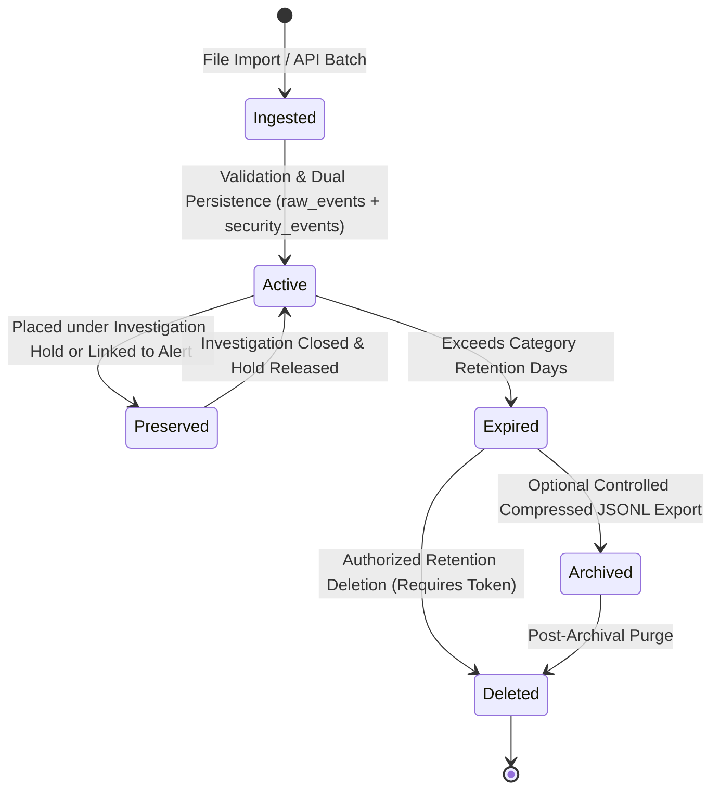

# Data Lifecycle Management

**Document ID:** DB-LIFE-001  
**Classification:** Operational Security Reference  
**Scope:** SnareSight Phase 3 — Event Pipeline & Database (P14)  
**Status:** IMPLEMENTED  

---

## 1. Lifecycle Stages

Security telemetry in SnareSight moves through four distinct lifecycle stages:

---

## 2. Retention Execution Controls

The [`RetentionService`](file:///c:/Projects/SnareSight/backend/app/retention/service.py) enforces the following operational safeguards:

1. **Dry-Run by Default:** Calling `preview_retention()` returns candidate counts by category without executing any SQL `DELETE` statements (`TEST RET-005`).
2. **Mandatory Authorization Token:** Executing actual deletion requires `execute_retention(db, authorization_token="CONFIRM_RETENTION_DELETION", initiated_by=...)`. Without this token, a `PermissionError` is raised (`TEST RET-009`).
3. **Preservation Hold Exclusion:** Any record under an active hold or referenced in `alert_evidence` is excluded from deletion candidates (`TEST RET-006`, `RET-007`).
4. **Foreign Key Protection:** Raw events referenced by active security events cannot be deleted (`ON DELETE RESTRICT`), maintaining forensic referential integrity (`TEST RET-012`).
5. **Bounded Batches:** Cleanup processes in bounded chunks (500 records per transaction) to prevent long table locks or transaction log exhaustion.
6. **Immutable Audit Record:** Every execution records an audit entry with initiated timestamp, initiator, mode, and affected counts (`TEST RET-010`).

