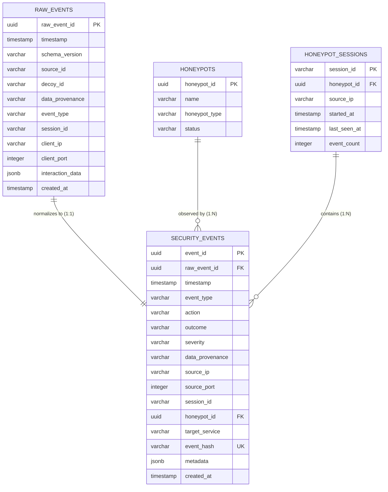

# Event Persistence Specification

**Document ID:** DB-PERSIST-001  
**Classification:** Database Architecture & Implementation Spec  
**Scope:** SnareSight Phase 3 — Event Pipeline & Database (P13)  
**Status:** IMPLEMENTED  

---

## 1. Overview and Relational Schema

SnareSight guarantees forensic evidence preservation through dual-tier persistence: every validated honeypot event produces exactly one row in `raw_events` and one corresponding row in `security_events`.

---

## 2. Table Schemas & Storage Constraints

### `raw_events` Table
| Column | Type | Constraints | Description |
| :--- | :--- | :--- | :--- |
| `raw_event_id` | `UUID` | PRIMARY KEY | Unique identifier for incoming raw event |
| `timestamp` | `TIMESTAMP WITH TIME ZONE` | NOT NULL | Observation timestamp reported by collector |
| `schema_version` | `VARCHAR(16)` | NOT NULL | Telemetry contract version (e.g. `1.0`) |
| `source_id` | `VARCHAR(64)` | NOT NULL | Identifier of the submitting sensor/agent |
| `decoy_id` | `VARCHAR(64)` | NOT NULL | Identifier of the targeted decoy deployment |
| `data_provenance`| `VARCHAR(32)` | NOT NULL | Audit provenance tag |
| `event_type` | `VARCHAR(64)` | NOT NULL | Raw event type identifier |
| `session_id` | `VARCHAR(64)` | NOT NULL | Attacker session correlation token |
| `client_ip` | `VARCHAR(45)` | NOT NULL | Attacker IPv4 or IPv6 address |
| `client_port` | `INTEGER` | NULL | Attacker source TCP/UDP port |
| `interaction_data`| `JSONB` | NOT NULL | Sanitized protocol-specific payload |
| `created_at` | `TIMESTAMP WITH TIME ZONE` | NOT NULL, DEFAULT NOW | Ingestion engine receipt timestamp |

### `security_events` Table
| Column | Type | Constraints | Description |
| :--- | :--- | :--- | :--- |
| `event_id` | `UUID` | PRIMARY KEY | Unique identifier for normalized security event |
| `raw_event_id` | `UUID` | NOT NULL, FK to `raw_events(raw_event_id)`, ON DELETE RESTRICT | Foreign key link to raw forensic record |
| `timestamp` | `TIMESTAMP WITH TIME ZONE` | NOT NULL | Event timestamp |
| `event_type` | `VARCHAR(64)` | NOT NULL | Normalized event category |
| `action` | `VARCHAR(64)` | NOT NULL | Standardized action descriptor |
| `outcome` | `VARCHAR(32)` | NOT NULL, CHECK in (`success`,`failure`,`blocked`,`observed`) | Standardized interaction outcome |
| `severity` | `VARCHAR(16)` | NOT NULL, CHECK in (`critical`,`high`,`medium`,`low`,`info`) | Normalized triage severity |
| `data_provenance`| `VARCHAR(32)` | NOT NULL | Preserved provenance classification |
| `source_ip` | `VARCHAR(45)` | NOT NULL | Attacker IP address |
| `source_port` | `INTEGER` | NULL | Attacker source port |
| `session_id` | `VARCHAR(64)` | NOT NULL | Session correlation token |
| `honeypot_id` | `UUID` | NULL, FK to `honeypots(honeypot_id)` | Linked decoy entity |
| `target_service` | `VARCHAR(64)` | NOT NULL | Decoy service classification |
| `event_hash` | `VARCHAR(64)` | NOT NULL, UNIQUE | SHA-256 idempotency fingerprint |
| `metadata` | `JSONB` | NOT NULL, DEFAULT `{}` | Extra normalized context |
| `created_at` | `TIMESTAMP WITH TIME ZONE` | NOT NULL, DEFAULT NOW | Database insert timestamp |

---

## 3. Forensic Deletion Restrictions

To preserve chain-of-custody, `raw_events` enforces `ON DELETE RESTRICT` for foreign keys in `security_events`. Raw evidence rows cannot be dropped while downstream security event records exist, preventing accidental data loss during operational maintenance.

