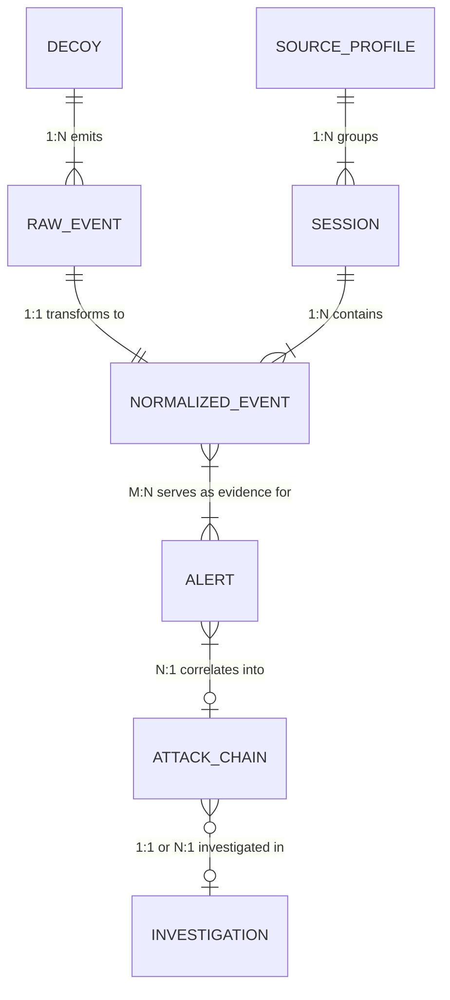

# SnareSight — Event Relationships & Entity Graph

**Document ID:** `SNARESIGHT-RELATIONSHIPS-001`  
**Classification:** Confidential — Internal Cybersecurity Engineering  
**Authority:** Principal Data Architect & Systems Modeler  

---

## 1. Entity Relationship Overview

SnareSight coordinates nine distinct identifier types across the data lifecycle: from raw telemetry observation through normalization, threat detection, correlation, and SOC investigation.

---

## 2. Identifier Generation Authority & Conventions

| Identifier Name | Format / Regex | Generation Authority | Lifecycle Stage | Description |
| :--- | :--- | :--- | :--- | :--- |
| `raw_event_id` | UUIDv4 (`^[0-9a-f-]{36}$`) | Honeypot / Collector | Honeypot Capture | Immutable primary key for original telemetry line. |
| `event_id` | UUIDv4 (`^[0-9a-f-]{36}$`) | Ingestion Normalizer | Pipeline Normalization | Primary key for universal Normalized Security Event. |
| `alert_id` | UUIDv4 (`^[0-9a-f-]{36}$`) | Detection Engine | Threat Detection | Primary key for actionable Security Alert. |
| `session_id` | `^decoy_sess_[a-f0-9]{32}$` | Decoy Session Manager | Client Interaction | 128-bit unguessable correlation token. |
| `interaction_id`| `^req_[a-f0-9]{16}$` | Decoy HTTP Layer | Request Processing | Granular per-request transaction identifier. |
| `decoy_id` | `^[A-Z0-9_-]+$` | Static Deployment Config| Service Initialization | Fixed honeypot deployment tag (e.g. `WEB-001`). |
| `observed_source_id`| `^src_[a-f0-9]{16}$` | Ingestion / Analytics | Entity Resolution | Synthetic entity grouping related IP/fingerprints. |
| `attack_chain_id`| UUIDv4 (`^[0-9a-f-]{36}$`) | Correlation Engine | Multi-Stage Correlation | Correlated attack narrative spanning multiple alerts. |
| `investigation_id`| UUIDv4 (`^[0-9a-f-]{36}$`) | SOC Analyst Workflow | Incident Response Case | Case file tracking forensic triage and containment. |
| `simulation_run_id`| `^sim_[a-zA-Z0-9_-]+$` | QA Test Harness | Test / Demo Execution | Test execution run trace identifier. |

---

## 3. Strict Identity Boundary Rule

> **CRITICAL INVARIANT:** An IP address (`source_address`) is an **observed network endpoint**, NEVER a verified person or physical identity.  
> 1. IP addresses are subject to DHCP reassignment, NAT pooling, proxies, VPNs, and botnet relaying.
> 2. SnareSight associates activity with an `observed_source_id` (a synthetic profile), strictly avoiding speculative real-world attribution.
> 3. Identity correlation is heuristic and probabilistic, preserved within the `confidence` score.

---

## 4. Entity Multiplicity & Cardinality Contracts

### 4.1 Raw Event to Normalized Event (Strict 1:1)
- Each valid `Raw Event` produces exactly one `Normalized Event`.
- The `Normalized Event` stores a mandatory foreign key `raw_event_id` pointing back to its originating record.
- In the event of a validation rejection, a Raw Event produces a rejected processing record instead of a Normalized Event.

### 4.2 Session to Normalized Events (1:N)
- A client session (`session_id`) groups multiple sequential interactions (e.g., initial `PAGE_VISIT` followed by multiple `AUTH_FAILURE` events).
- `previous_event_id` creates a doubly-linked temporal timeline within a session for step-by-step replay in the SOC dashboard.

### 4.3 Normalized Events to Security Alert (N:1 or N:M)
- A single behavioral rule may evaluate a sliding window of events (e.g., 10 `AUTH_FAILURE` events in 60 seconds).
- The resulting `Security Alert` references the exact list of supporting event IDs in its `related_event_ids` array.
- A single high-severity event (e.g., severe command injection) can also generate an alert (1:1).

### 4.4 Alerts to Attack Chain (N:1)
- The Correlation Engine groups multiple related alerts (e.g., an initial `RECONNAISSANCE` alert followed by a `BRUTE_FORCE` alert and a subsequent `COMMAND_INJECTION` alert) under an `attack_chain_id`.
- Visualized as a directed acyclic graph (DAG) in the frontend SOC dashboard using React Flow.

### 4.5 Attack Chain to Investigation (1:1 or N:1)
- When a SOC analyst escalates an attack chain for formal forensic triage, an `Investigation` case record is initialized with an `investigation_id`.
- The case links to the underlying chain, alerts, and supporting normalized events.

