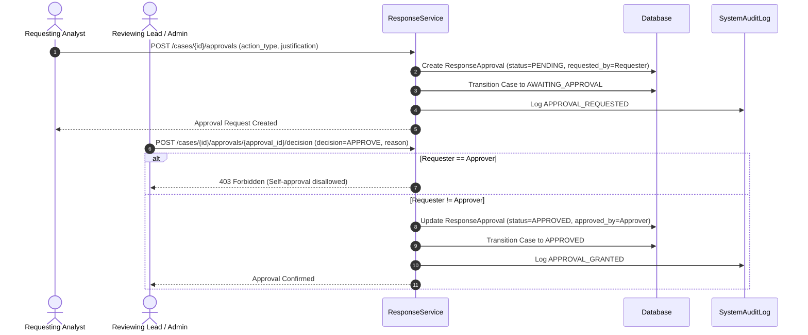

# Approval Workflow & Separation of Duties

## 1. Overview & Regulatory Rationale

In high-consequence security operations, automated or unilateral containment actions pose significant risk of denial of service, false accusation, or investigative disruption. SnareSight enforces a rigorous **Separation of Duties** and **Dual-Custody Approval Gate** mechanism (`backend/app/modules/response/service.py`).

No controlled defensive action can be executed without an explicitly approved `ResponseApproval` request.

---

## 2. Separation of Duties Policy

1. **Role-Based Authorization:**
   - Any SOC analyst with role `operator`, `analyst`, or `admin` can **request** an action.
   - Only users with role `admin` or an independent senior analyst designated by policy can **approve** or **reject** an action.
2. **Self-Approval Prohibition:**
   - The user who creates an approval request (`requested_by`) cannot approve their own request (`approved_by`).
   - If a user attempts to approve their own request, the system raises `403 Forbidden` (`Requester cannot approve their own action request`).
3. **Mandatory Operational Justification:**
   - Every approval request requires a clear explanation of operational necessity (`justification`).
   - Every decision (approval or rejection) requires an explicit reason (`decision_reason`).

---

## 3. Dual-Custody Approval Lifecycle

---

## 4. Controlled Action Catalog

The approval gate guards the following safe application actions:

| Action Identifier | Description | Reversible |
| :--- | :--- | :--- |
| `HONEYPOT_SENSITIVITY_BOOST` | Elevates detection sensitivity, lowering alert thresholds on specified decoy sensors. | Yes |
| `CREDENTIAL_CANARY_ROTATION` | Deprecates observed canary credentials and issues fresh decoy tokens into honeypot forms. | Yes |
| `SESSION_ISOLATION` | Routes future connections from an attacker IP or fingerprint into an isolated sandbox environment. | Yes |
| `TELEMETRY_SAMPLE_RATE_MAX` | Increases logging detail from sampled mode to 100% full packet / event capture. | Yes |

---

## 5. Pre-Execution Validation Checks

Before an approved action is executed by the system:
1. **Approval State Verification:** The associated approval ID must be in `APPROVED` status.
2. **Idempotency Guard:** The system verifies that the action has not already been executed for this case.
3. **Parameter Boundary Check:** Action parameters are validated to ensure only approved honeypot resources are targeted.

