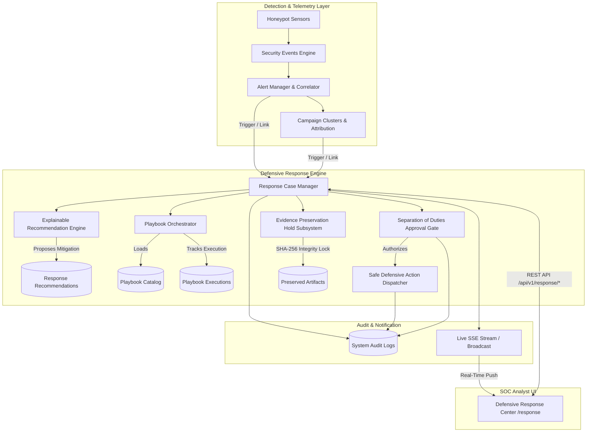

# SnareSight Defensive Response Architecture

## 1. Overview & System Purpose

The **SnareSight Defensive Response Subsystem** is an analyst-guided threat mitigation, response case management, and incident handling workflow engine. Designed specifically for deception-driven security operations, it links telemetry, alerts, attack sequences, and threat campaigns to governed containment and evidence preservation actions.

In strict compliance with SnareSight architectural constraints:
- **Analyst-Guided (No Autonomous Retaliation):** Every significant defensive action requires explicit human analyst review or dual-custody approval.
- **Deception & Internal Application Focus:** Actions manipulate honeypot configuration, session isolation, telemetry verbosity, and canary tokens. The engine **never** conducts offensive operations, packet blasting, or arbitrary remote command execution.
- **Explainability:** All automated recommendations cite deterministic telemetry facts, rule definitions, confidence metrics, and reversal guidance.
- **Chain of Custody:** Retention preservation holds cryptographically freeze evidence records (alerts, events, sessions, payloads) with SHA-256 integrity hashes to safeguard investigation data against automated retention pruning.

---

## 2. Component Architecture Diagram

---

## 3. Core Database Entities

The Defensive Response schema is implemented in `backend/app/db/models/response.py` across 9 tables:

1. **`response_cases`**: Core incident handling case record tracking status (`OPEN`, `INVESTIGATING`, `AWAITING_APPROVAL`, `RESOLVED`, etc.), priority (`P1_CRITICAL` through `P5_INFO`), severity, assigned analyst, primary alert/cluster references, resolution categorization, and timestamps.
2. **`case_relationships`**: Links response cases to heterogeneous security entities (`ALERT`, `EVENT`, `SESSION`, `SOURCE_PROFILE`, `CAMPAIGN_CLUSTER`) with relationship reason and confidence scores.
3. **`case_notes`**: Chronological analyst notes, forensic findings, action summaries, and liaison observations.
4. **`response_recommendations`**: Rule-generated mitigation proposals containing deterministic rule ID, rationale, triggering evidence payload, supporting event IDs, impact analysis, and reversal guidance.
5. **`playbook_definitions`**: Declarative catalog of non-destructive incident handling procedures (`PB-AUTH-FAILURES`, `PB-WEB-ENUM`, `PB-MULTI-SESSION`, `PB-CAMPAIGN-INVESTIGATION`, `PB-EVIDENCE-PRESERVE`).
6. **`playbook_executions`**: Live state of playbook instances tracking progress step-by-step, completed step results, and overall outcomes.
7. **`response_approvals`**: Dual-custody approval requests enforcing separation of duties. Captures requester identity, justification, designated action type, and approver verdict.
8. **`response_actions`**: Immutable execution log of dispatched safe application-level defensive actions (`HONEYPOT_SENSITIVITY_BOOST`, `CREDENTIAL_CANARY_ROTATION`, `SESSION_ISOLATION`, `TELEMETRY_SAMPLE_RATE_MAX`).
9. **`evidence_preservation_holds`**: Cryptographic retention holds attaching to alert, event, session, or payload records, accompanied by SHA-256 integrity hashes to prevent retention policy deletion.

---

## 4. Interaction with Existing SnareSight Subsystems

- **Alert Management (`/api/v1/alerts`):** Incident response cases can be spawned directly from triggered alerts. Primary alert IDs are indexed and queryable.
- **Campaign Investigations (`/api/v1/campaigns`):** Clustered threats spanning multiple honeypot sessions can be assigned to response cases for cohesive incident tracking.
- **Audit System (`/api/v1/audit`):** Every mutation (case state transition, recommendation decision, approval grant/rejection, action execution, and evidence hold creation/release) is logged to `system_audit_logs`.
- **Live Notifications (`/api/v1/dashboard/live-stream`):** Response lifecycle events trigger SSE notifications, providing instant visibility to SOC analysts without manual polling.

