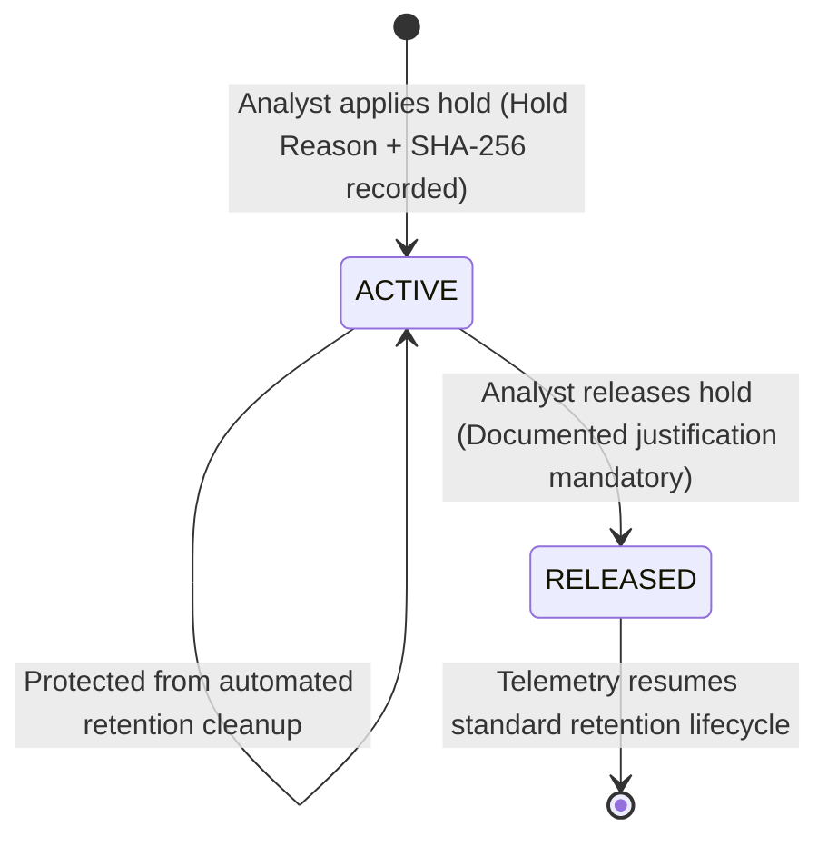

# Evidence Preservation Holds & Chain of Custody

## 1. Overview & Purpose

In production security platforms, background data pruning jobs periodically purge aged events, sessions, and alerts to manage storage capacity. However, when an incident is undergoing active investigation, forensic review, or legal scrutiny, premature data pruning can destroy vital evidence.

The SnareSight **Evidence Preservation Hold** subsystem (`backend/app/modules/response/service.py`) provides cryptographic retention locking on individual records or clusters of telemetry.

---

## 2. Integrity Hash Computation (SHA-256)

When an evidence hold is registered, SnareSight computes an immutable SHA-256 hash across the evidence identifier, case ID, evidence type, and applying analyst timestamp:

$$\text{Integrity Hash} = \text{SHA256}(\text{evidence\_identifier} \,\|\, \text{case\_id} \,\|\, \text{evidence\_type} \,\|\, \text{timestamp})$$

This cryptographic digest guarantees:
- **Tamper Evidence:** Any subsequent modification to the underlying artifact or hold record invalidates the stored checksum.
- **Chain of Custody:** The hash serves as a verifiable identifier for export to legal teams, incident response liaisons, or regulatory authorities.

---

## 3. Evidence Types Supported

| Evidence Type | Target Entity | Typical Preservation Scenario |
| :--- | :--- | :--- |
| **`ALERT`** | `AlertModel` record | High-priority detection alert triggering case escalation. |
| **`EVENT`** | `SecurityEventModel` record | Specific failed login event, HTTP exploit probe, or port scan packet. |
| **`SESSION`** | `SessionModel` record | Entire interactive honeypot session stream and command sequence. |
| **`PAYLOAD`** | Captured exploit bytes | Raw binary or ASCII string payload captured during an injection attempt. |
| **`TRACE`** | Sequence / Correlation graph | Correlated multi-stage attack sequence linking multiple honeypots. |

---

## 4. Lifecycle of an Evidence Preservation Hold

---

## 5. Hold Application & Release Constraints

- **Creation Requirements:**
  - `evidence_type`: Must be one of `ALERT`, `EVENT`, `SESSION`, `PAYLOAD`, `TRACE`.
  - `evidence_identifier`: Target record identifier or UUID.
  - `hold_reason`: Mandatory plain-text justification for the retention lock.
- **Release Requirements:**
  - Only authorized analysts or admins can release a hold.
  - Mandatory `release_justification` documenting why preservation is no longer necessary (e.g., litigation resolved, signature extracted, case closed).
  - Released holds remain in the database with status `RELEASED`, timestamp, and releaser identity for complete audit accountability.

