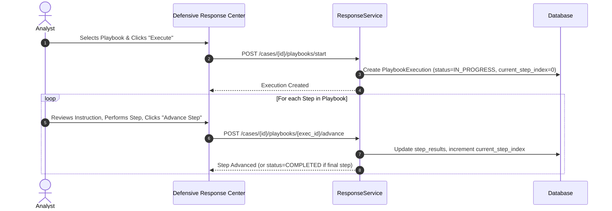

# Standard Defensive Playbooks Catalog

## 1. Overview & Operational Principles

SnareSight provides five standardized, non-destructive **Defensive Response Playbooks** (`backend/app/modules/response/playbooks.py`). Each playbook defines a structured sequence of investigation and containment steps designed to guide SOC analysts through deception-focused incident handling.

Every playbook is governed by the following operational constraints:
- **Zero Destructive Actions:** No commands modify external networks, firewalls, or host OS shells.
- **Strict Step Sequencing:** Steps are validated sequentially. Step results and analyst notes are tracked in the execution history.
- **Audit Logging:** Initiating, advancing, completing, or cancelling playbooks writes an immutable entry to `system_audit_logs`.

---

## 2. Playbook Definitions Catalog

### 1. `PB-AUTH-FAILURES`: Credential Abuse & Brute Force Handling
- **Identifier:** `PB-AUTH-FAILURES` (Version 1.0)
- **Title:** Credential Abuse and Honeypot Authentication Response
- **Description:** Investigates credential stuffing, password spraying, or targeted authentication attacks against deception endpoints.
- **Steps:**
  1. `STEP-01` (**Identify Targeted Decoy Accounts**): Query session logs for usernames and passwords submitted by attacker.
  2. `STEP-02` (**Assess Credential Novelty**): Check if attempted credentials match known corporate leak lists or generic dictionaries.
  3. `STEP-03` (**Rotate Decoy Canaries**): Deploy fresh canary credentials into the honeypot authentication responder.
  4. `STEP-04` (**Apply Evidence Hold**): Lock failed authentication event telemetry against automated pruning.
  5. `STEP-05` (**Evaluate Threat Attribution**): Correlate source IP against external threat feeds and source profile history.

---

### 2. `PB-WEB-ENUM`: Web Enumeration & Directory Probing Handling
- **Identifier:** `PB-WEB-ENUM` (Version 1.0)
- **Title:** Web Enumeration and Vulnerability Scanning Containment
- **Description:** Structured response to automated web vulnerability scanners, crawler bots, and directory fuzzers.
- **Steps:**
  1. `STEP-01` (**Profile Scanning Tool**): Analyze User-Agent strings, request headers, and request rates to classify scanner tooling (e.g., Nikto, Gobuster, sqlmap).
  2. `STEP-02` (**Identify Targeted Deception Traps**): Determine which fake endpoints or honey-tokens were accessed.
  3. `STEP-03` (**Activate Deception Latency**): Introduce artificial response delay on targeted virtual web routes.
  4. `STEP-04` (**Preserve Request Payloads**): Place retention hold on URI query parameters and POST body captures.
  5. `STEP-05` (**Summarize Reconnaissance Scope**): Document the breadth of paths probed and generate an analyst summary note.

---

### 3. `PB-MULTI-SESSION`: Multi-Session Attacker Correlation
- **Identifier:** `PB-MULTI-SESSION` (Version 1.0)
- **Title:** Multi-Session Attacker Correlation & Source Isolation
- **Description:** Procedures for correlating distributed or repeated sessions originating from the same threat actor fingerprint.
- **Steps:**
  1. `STEP-01` (**Correlate Client Fingerprints**): Match TLS JA3/JA4 fingerprints and TCP window signatures across sessions.
  2. `STEP-02` (**Trace Temporal Sequence**): Reconstruct the chronological attack sequence across honeypot sensors.
  3. `STEP-03` (**Isolate Threat Actor Sessions**): Route future traffic from actor fingerprint to an isolated high-interaction sandbox.
  4. `STEP-04` (**Preserve Session Telemetry**): Cryptographically lock all associated session records.
  5. `STEP-05` (**Document Campaign Linkage**): Link all related sessions to a shared campaign cluster.

---

### 4. `PB-CAMPAIGN-INVESTIGATION`: Coordinated Campaign Incident Handling
- **Identifier:** `PB-CAMPAIGN-INVESTIGATION` (Version 1.0)
- **Title:** Advanced Campaign Investigation and Threat Group Profiling
- **Description:** Complete incident handling protocol for multi-vector threat campaigns spanning several deception assets.
- **Steps:**
  1. `STEP-01` (**Aggregate Campaign Scope**): Verify all clustered alerts, sessions, and source profiles.
  2. `STEP-02` (**Map MITRE ATT&CK Techniques**): Tag observed behaviors against MITRE techniques (T1110, T1078, T1059).
  3. `STEP-03` (**Place Campaign Evidence Hold**): Apply batch retention hold on entire cluster dataset.
  4. `STEP-04` (**Formulate Containment Strategy**): Submit defensive action requests for honeypot sensitivity elevation.
  5. `STEP-05` (**Compile Executive Incident Report**): Draft comprehensive incident summary and remediation report.

---

### 5. `PB-EVIDENCE-PRESERVE`: Fast-Track Evidence Preservation
- **Identifier:** `PB-EVIDENCE-PRESERVE` (Version 1.0)
- **Title:** Fast-Track Telemetry Evidence Preservation Hold
- **Description:** Rapid preservation procedure to prevent telemetry deletion during active litigation, compliance, or external reporting.
- **Steps:**
  1. `STEP-01` (**Select Artifacts for Custody**): Identify specific alerts, events, PCAP traces, or session streams.
  2. `STEP-02` (**Compute SHA-256 Checksums**): Generate cryptographic integrity hashes for all selected records.
  3. `STEP-03` (**Register Retention Hold**): Write immutable records to `evidence_preservation_holds`.
  4. `STEP-04` (**Verify Hold Exemption**): Confirm telemetry retention daemon marks records as non-prunable.
  5. `STEP-05` (**Generate Chain-of-Custody Manifest**): Export signed evidence manifest with analyst timestamp.

---

## 3. Playbook Execution Workflow

