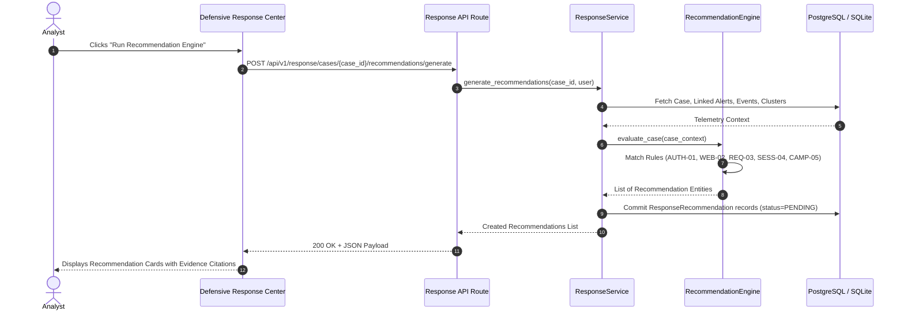

# Rule-Based Recommendation Engine & Explainable Evidence Citations

## 1. Overview & Core Philosophy

The SnareSight **Recommendation Engine** (`backend/app/modules/response/recommendation_engine.py`) generates explainable defensive recommendations for open and investigating response cases. 

Unlike black-box automated systems, every proposal generated by SnareSight adheres to three core tenets:
1. **Explainable Rationale:** Plain-text description of the observed pattern and why mitigation is recommended.
2. **Deterministic Evidence Citation:** Concrete links to triggering alerts, event IDs, threshold metrics, and session timestamps.
3. **Reversal Guidance & Impact Assessment:** Explicit documentation of what operational consequences the action will have, and exactly how the action can be safely reverted.

---

## 2. Recommendation Rule Catalog

The engine evaluates 5 specialized heuristic rules across deception telemetry:

### 1. `REC-RULE-AUTH-01`: Honeypot Authentication Abuse Containment
- **Trigger Condition:** Response case linked to `CREDENTIAL_ACCESS`, `BRUTE_FORCE`, or `AUTH_FAILURE` alerts with $\ge 3$ failed attempts.
- **Proposed Action:** `CREDENTIAL_CANARY_ROTATION` or `HONEYPOT_SENSITIVITY_BOOST`.
- **Potential Impact:** Generates novel decoy credentials, marks targeted accounts for elevated alerting. Zero legitimate user impact (deception environment only).
- **Reversal Guidance:** Restore baseline honeypot credential set via sensor configuration rollback.

### 2. `REC-RULE-WEB-02`: High-Volume Web Enumeration & Directory Probing Mitigation
- **Trigger Condition:** Case linked to `DISCOVERY`, `RECONNAISSANCE`, or `WEB_SCAN` alerts with high request frequency.
- **Proposed Action:** `DECEPTION_RESPONSE_DELAY` or `TARPIT_SESSION`.
- **Potential Impact:** Introduces artificial jitter and progressive latency (1000–3000ms) on scanner sessions to exhaust crawler resources.
- **Reversal Guidance:** Remove rate limiting / delay flags on the affected web sensor endpoints.

### 3. `REC-RULE-REQ-03`: Exploit Payload & Injection Probing Containment
- **Trigger Condition:** Detection of SQLi, command injection, path traversal, or remote file inclusion attempts in telemetry.
- **Proposed Action:** `PAYLOAD_QUARANTINE_AND_HOLD`.
- **Potential Impact:** Freezes captured payload bytes under an evidence preservation hold. Preserves raw network trace without blocking attacker reconnaissance.
- **Reversal Guidance:** Release preservation hold once signature extraction and analysis are completed.

### 4. `REC-RULE-SESS-04`: Multi-Session Attacker Correlation & Source Isolation
- **Trigger Condition:** Source IP or fingerprint correlated across multiple concurrent honeypot sessions.
- **Proposed Action:** `SESSION_ISOLATION`.
- **Potential Impact:** Segregates subsequent connections from this fingerprint into dedicated sandbox containers with deep packet logging.
- **Reversal Guidance:** Revoke isolation flag in the session router to re-route source traffic to standard honeypot nodes.

### 5. `REC-RULE-CAMP-05`: Coordinated Threat Campaign Triage & Evidence Lock
- **Trigger Condition:** Case linked to an active `CampaignCluster` or multi-sensor campaign.
- **Proposed Action:** `CAMPAIGN_EVIDENCE_PRESERVATION_HOLD`.
- **Potential Impact:** Applies cryptographic SHA-256 preservation holds across all campaign telemetry, preventing retention policy pruning.
- **Reversal Guidance:** Explicit analyst hold release with documented closure justification.

---

## 3. Recommendation Evaluation Flow

---

## 4. Analyst Acceptance and Rejection Workflow

Analysts review recommendations and can either:
- **Accept (`ACCEPT`):** Sets recommendation status to `ACCEPTED`. If the underlying action requires dual-custody approval, an approval request is automatically queued. If pre-approved, the action is marked ready for execution.
- **Reject (`REJECT`):** Requires the analyst to submit a justification string. The recommendation is marked `REJECTED`, preserving the reason in the audit log for model calibration.

