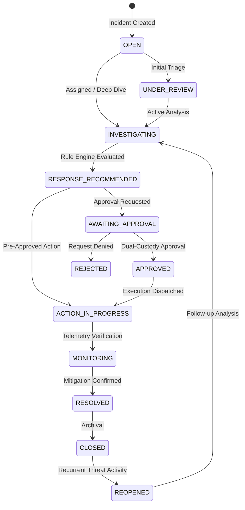

# Response Case Lifecycle & State Machine

## 1. Overview

Every defensive response operation in SnareSight is tracked inside a **Response Case**. Cases transition through a controlled finite-state machine (FSM) ensuring clear analyst ownership, audit trails, and containment gating.

---

## 2. State Transition Diagram

---

## 3. Lifecycle States & Semantics

| State | Purpose | Required User / Permission | Next Valid States |
| :--- | :--- | :--- | :--- |
| **`OPEN`** | Case logged via alert trigger, campaign escalation, or analyst creation. | `operator`, `analyst`, `admin` | `UNDER_REVIEW`, `INVESTIGATING`, `CLOSED` |
| **`UNDER_REVIEW`** | Preliminary triage examining telemetry correlation and initial hypotheses. | `analyst`, `admin` | `INVESTIGATING`, `CLOSED` |
| **`INVESTIGATING`** | Active forensic exploration, linking sessions, events, profiles, and clusters. | `analyst`, `admin` | `RESPONSE_RECOMMENDED`, `AWAITING_APPROVAL`, `RESOLVED` |
| **`RESPONSE_RECOMMENDED`** | Recommendation engine generated actionable containment proposals. | System / `analyst` | `AWAITING_APPROVAL`, `ACTION_IN_PROGRESS`, `INVESTIGATING` |
| **`AWAITING_APPROVAL`** | Defensive action request submitted; awaiting dual-custody authorization. | `analyst`, `admin` | `APPROVED`, `REJECTED` |
| **`APPROVED`** | Senior analyst or admin authorized execution of proposed action. | `admin` (or separate analyst) | `ACTION_IN_PROGRESS` |
| **`REJECTED`** | Approval denied; analyst must adjust mitigation proposal. | `admin` / reviewer | `INVESTIGATING`, `CLOSED` |
| **`ACTION_IN_PROGRESS`** | Controlled application action dispatched (e.g., canary rotation, session isolation). | System | `MONITORING`, `RESOLVED` |
| **`MONITORING`** | Post-action observation period confirming attacker deception engagement. | `analyst`, `admin` | `RESOLVED`, `INVESTIGATING` |
| **`RESOLVED`** | Threat contained, attributed, or confirmed false positive with rationale. | `analyst`, `admin` | `CLOSED`, `REOPENED` |
| **`CLOSED`** | Investigation permanently concluded and archived. | `analyst`, `admin` | `REOPENED` |
| **`REOPENED`** | Subsequent attacker activity detected on previously resolved entities. | `analyst`, `admin` | `INVESTIGATING` |

---

## 4. Priority & Severity Classification

### Case Priorities
- **`P1_CRITICAL`**: Active credential compromise attempts against deception assets or high-volume exploitation attempts.
- **`P2_HIGH`**: Coordinated multi-session probing, rapid directory enumeration, or known tool signatures.
- **`P3_MEDIUM`**: Isolated probing, reconnaissance, or low-frequency suspicious honeypot hits.
- **`P4_LOW`**: Routine port scanning or benign Internet noise.
- **`P5_INFO`**: Informational tracking, test telemetry, or policy validation.

### Case Severities
- `CRITICAL`, `HIGH`, `MEDIUM`, `LOW`, `INFO`.

---

## 5. Audit Logging & SSE Events

Every state transition invokes `audit_service.log_event` with:
- `event_type`: `RESPONSE_CASE_STATUS_CHANGED`
- `details`: Old status, new status, transition reason, resolution category (if applicable).
- `sse_publisher`: Broadcasts `response_case_updated` event to connected browser clients.

