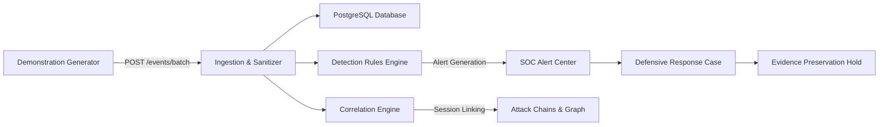

# SnareSight End-to-End Demonstration Scenarios

**Document ID:** DOC-DEMO-002  
**Project:** SnareSight — Deception-Driven Threat Detection Platform  
**Phase:** 8 — Testing, Demonstration & Evaluation (P36 / 40)  
**Date:** October 31, 2026  
**Safety Classification:** ISOLATED LAB BENCHMARK  

---

## 1. Overview & Demonstration Architecture

The SnareSight Demonstration Lab allows SOC leads, security evaluators, and system architects to observe the complete telemetry-to-investigation lifecycle in real time without generating real-world threats or modifying production infrastructure.

---

## 2. The 6 Safe Demonstration Scenarios

### Scenario A: Repeated Login Failures (Credential Stuffing Probe)
- **Objective:** Demonstrate detection of brute-force and rapid credential testing against a login decoy.
- **Triggered Rule:** `AUTH-001` ("Repeated Authentication Failures").
- **MITRE Technique:** T1110 (Brute Force / Password Guessing).
- **Synthetic Characteristics:** Single session ID (`decoy_sess_*`), single attacker source IP (`198.51.100.45`), repeated authentication failure attempts with `password_present: True` and hashed username fingerprint.
- **Expected Outcome:** Rule fires after 3 failures; creates high/medium-confidence alert; surfaces in Alert Center with explainable breakdown.

### Scenario B: Username Enumeration Probing
- **Objective:** Demonstrate detection of account discovery attacks probing multiple distinct usernames on a web portal decoy.
- **Triggered Rule:** `AUTH-003` ("Username Enumeration Probing").
- **MITRE Technique:** T1087 (Account Discovery).
- **Synthetic Characteristics:** Single session, attacker IP (`203.0.113.88`), sequential attempts with distinct username fingerprints (`admin`, `service_account`, `root`, `deploy_key`).
- **Expected Outcome:** Rule threshold (>= 3 distinct fingerprints in 300s window) is met; alert created linking all associated fingerprint observations.

### Scenario C: Suspicious Web Path Requests & Directory Traversal
- **Objective:** Demonstrate real-time detection of directory traversal sequences and endpoint enumeration against web honeypots.
- **Triggered Rules:** `WEB-001` ("Web Path Enumeration Probing") and `WEB-002` ("Suspicious Directory Traversal Request").
- **MITRE Technique:** T1595 (Active Scanning) / T1083 (File and Directory Discovery).
- **Synthetic Characteristics:** Benign requests (`/`, `/about`, `/login`) mixed with safe traversal indicators (`/../../etc/passwd`, `/assets/..%2f..%2fconfig.json`).
- **Expected Outcome:** Path traversal rule triggers immediately on pattern match; path enumeration triggers upon reaching 3 distinct paths.

### Scenario D: Multi-Session Behavioral Association
- **Objective:** Demonstrate cross-session correlation where an attacker operates across multiple distinct sessions and decoy vectors.
- **Triggered Rules:** `BEHAV-001` ("Multi-Category Suspicious Interaction") and Correlation Engine IP graph linking.
- **MITRE Technique:** T1595 / T1110 combined multi-stage interaction.
- **Synthetic Characteristics:** Shared source IP (`198.51.100.99`) generates Session 1 (web path reconnaissance) and Session 2 (authentication probing) within a 10-minute correlation window.
- **Expected Outcome:** Correlation engine maps both sessions into a unified attacker profile; multi-category detection alert is raised.

### Scenario E: Analyst Investigation & Response Workflow
- **Objective:** Demonstrate the end-to-end operational journey of a SOC analyst investigating an alert, escalating to a response case, and preserving forensic evidence.
- **Workflow Steps:**
  1. High-severity alert is selected from the Alert Management Center.
  2. Analyst adds triage assessment justification and priority assignment (`P2_HIGH`).
  3. Escalated to an active Defensive Response Case (`/api/v1/response/cases`).
  4. Legal evidence preservation hold applied (`POST /api/v1/response/cases/{case_id}/holds`).
- **Expected Outcome:** Case tracked with full audit log; evidence marked with retention hold preventing automated expiration or demo cleanup deletion.

### Scenario F: Operational Failure & Isolated Sandbox Recovery
- **Objective:** Demonstrate platform self-monitoring, sensor degradation alerting, and non-destructive disaster recovery verification.
- **Workflow Steps:**
  1. Sensor heartbeat latency anomaly or missed heartbeat simulated.
  2. Platform diagnostics report surfaces sensor degradation.
  3. Sensor heartbeat recovered with normal metrics.
  4. Platform resilience backup initiated (`POST /api/v1/resilience/backups`).
  5. Automated sandbox restore test executed (`POST /api/v1/resilience/backups/{id}/restore-test`) against isolated in-memory/sandbox database.
- **Expected Outcome:** Zero impact on active telemetry tables; diagnostic health reflects recovery; backup digest verified.

---

## 3. Dataset Size Options

| Tier | Event Count | Ingestion Batches | Execution Target | Typical Use Case |
| :--- | :--- | :--- | :--- | :--- |
| **Small** | ~25 events | 1 batch | < 1.0 second | Quick interactive UI testing and walkthroughs |
| **Medium** | ~100 events | 1–2 batches | < 2.5 seconds | Comprehensive multi-scenario regression and rule evaluation |
| **Large** | ~500 events | 2–5 batches | < 8.0 seconds | High-throughput stress test, correlation load, and export verification |

---

## 4. Deterministic Seeding

All scenarios accept an optional integer seed (default: `42`). When the seed is specified, generated timestamps, IP addresses, session identifiers, and randomized order remain identical across runs, ensuring repeatable demonstrations and scientific evaluation consistency.

