# SnareSight: Database & Data Model Reference

**Document Version:** 1.0.0  
**Phase:** 8 — Testing, Demonstration & Project Handover  
**Date:** October 2026  
**ORM:** SQLAlchemy 2.0 (Declarative Base)  
**Database Engine:** PostgreSQL 16  
**Migration Tool:** Alembic  

---

## 1. Architectural Overview

SnareSight utilizes PostgreSQL 16 as its relational single source of truth. The data model is strictly normalized across 15 operational domains, guaranteeing referential integrity, immutable audit logging, and explicit foreign key relationships.

### Design Principles:
* **UUID & Integer Primary Keys:** Core operational entities use UUID strings or auto-incrementing BigIntegers for scale and uniqueness.
* **Foreign Key Constraints:** Foreign keys enforce data integrity with explicit `ON DELETE CASCADE` or `ON DELETE RESTRICT` semantics.
* **Immutable Audit Trail:** Tables such as `event_audit_logs`, `alert_audit_logs`, and `system_audit_logs` are write-only.
* **Evidence Retention Holds:** Records linked to active `evidence_preservation_holds` are programmatically protected from automated pruning.

---

## 2. Entity-Relationship Diagram (ERD)

```mermaid
erDiagram
    SENSORS ||--o{ SENSOR_CREDENTIALS : "has"
    SENSORS ||--o{ SENSOR_HEARTBEATS : "reports"
    SENSORS ||--o{ SECURITY_EVENTS : "ingests"
    
    SECURITY_EVENTS ||--o{ ACTIVITY_SESSION_EVENTS : "grouped into"
    SECURITY_EVENTS ||--o{ ALERT_EVIDENCE : "evidences"
    
    ACTIVITY_SESSIONS ||--o{ ACTIVITY_SESSION_EVENTS : "contains"
    ACTIVITY_SESSIONS ||--o{ BEHAVIORAL_SEQUENCE_MEMBERS : "part of"
    ACTIVITY_SESSIONS ||--o{ SOURCE_PROFILE_SESSIONS : "associated with"
    
    DETECTION_RULES ||--o{ ALERTS : "triggers"
    ALERTS ||--o{ ALERT_EVIDENCE : "supported by"
    ALERTS ||--o{ ALERT_NOTES : "annotated with"
    
    ATTACK_TECHNIQUES ||--o{ ATTACK_SUBTECHNIQUES : "hierarchical"
    ATTACK_TECHNIQUES ||--o{ TECHNIQUE_MAPPINGS : "maps"
    
    SOURCE_PROFILES ||--o{ SOURCE_PROFILE_SESSIONS : "aggregates"
    SOURCE_PROFILES ||--o{ SOURCE_PROFILE_FEATURES : "fingerprinted by"
    
    INVESTIGATION_CLUSTERS ||--o{ CLUSTER_MEMBERSHIPS : "contains"
    INVESTIGATION_CLUSTERS ||--o{ CLUSTER_EVIDENCE : "references"
    
    RESPONSE_CASES ||--o{ CASE_ACTIONS : "executes"
    RESPONSE_CASES ||--o{ EVIDENCE_PRESERVATION_HOLDS : "protects"
    RESPONSE_CASES ||--o{ CASE_NOTES : "documents"
    
    USERS ||--o{ SYSTEM_AUDIT_LOGS : "generates"
    DATABASE_BACKUPS ||--o{ RESTORE_TEST_RECORDS : "validated by"

    SENSORS {
        string id PK
        string name
        string sensor_type
        string status
        timestamp last_heartbeat
    }

    SECURITY_EVENTS {
        string id PK
        timestamp timestamp
        string source_ip
        int destination_port
        string honeypot_type
        string event_category
        string payload_hash
    }

    ALERTS {
        string id PK
        string title
        string severity
        int severity_score
        int confidence_score
        string status
        timestamp created_at
    }

    ACTIVITY_SESSIONS {
        string id PK
        string session_token
        string source_ip
        timestamp start_time
        timestamp end_time
        int event_count
    }

    SOURCE_PROFILES {
        string id PK
        string source_ip
        int total_sessions
        int threat_score
        string classification
    }

    RESPONSE_CASES {
        string id PK
        string title
        string status
        string priority
        string assigned_analyst
        boolean retention_hold
    }
```



---

## 3. Core Database Table Specifications

### 3.1 Telemetry & Honeypot Ingestion

#### `sensors`
Stores metadata and registration status for decoy honeypots.
* `id` (`VARCHAR(64)`, PK): Unique sensor identifier (e.g., `sensor-web-01`).
* `name` (`VARCHAR(128)`, NOT NULL): Human-readable sensor name.
* `sensor_type` (`VARCHAR(32)`, NOT NULL): Decoy category (`web_login`, `cowrie_ssh`, `smb`).
* `ip_address` (`VARCHAR(45)`, NOT NULL): Internal decoy IP address.
* `status` (`VARCHAR(32)`, NOT NULL): `HEALTHY`, `DEGRADED`, `OFFLINE`, `MAINTENANCE`.
* `last_heartbeat` (`TIMESTAMP WITH TIME ZONE`): Timestamp of most recent ping.
* `created_at` (`TIMESTAMP WITH TIME ZONE`, default `NOW()`).

#### `security_events`
Canonical normalized table storing validated deception telemetry.
* `id` (`VARCHAR(64)`, PK): Deterministic or UUID event identifier.
* `sensor_id` (`VARCHAR(64)`, FK -> `sensors.id`): Source sensor.
* `timestamp` (`TIMESTAMP WITH TIME ZONE`, NOT NULL, INDEXED): Time of interaction.
* `source_ip` (`VARCHAR(45)`, NOT NULL, INDEXED): Remote attacker IP address.
* `source_port` (`INTEGER`): Source ephemeral port.
* `destination_port` (`INTEGER`, NOT NULL): Decoy service port (e.g. 80, 2222).
* `protocol` (`VARCHAR(16)`, NOT NULL): `TCP`, `UDP`, `HTTP`, `SSH`.
* `honeypot_type` (`VARCHAR(32)`, NOT NULL): Decoy type.
* `event_category` (`VARCHAR(64)`, NOT NULL): `AUTHENTICATION`, `RECONNAISSANCE`, `EXPLOITATION`.
* `payload_hash` (`VARCHAR(64)`): SHA-256 hash of raw input payload.
* `raw_payload` (`TEXT`): Redacted payload (Zero-Password invariant applied).
* `metadata_json` (`JSONB`): Structured attributes (HTTP headers, user-agents, commands).

---

### 3.2 Detection, Scoring & Alerts

#### `detection_rules`
Defines active behavioral threat detection rules.
* `id` (`VARCHAR(64)`, PK): Rule ID (e.g. `RUL-001`).
* `name` (`VARCHAR(128)`, NOT NULL): Rule name (e.g. `Web Login Brute Force`).
* `description` (`TEXT`): Technical detection narrative.
* `severity_base` (`INTEGER`, NOT NULL): Baseline severity weight (1–100).
* `confidence_base` (`INTEGER`, NOT NULL): Baseline confidence weight (1–100).
* `is_enabled` (`BOOLEAN`, default `TRUE`).
* `mitre_technique_id` (`VARCHAR(32)`): Mapped ATT&CK technique (e.g. `T1110.001`).

#### `alerts`
Security incident notifications raised by detection rules.
* `id` (`VARCHAR(64)`, PK): Alert UUID.
* `rule_id` (`VARCHAR(64)`, FK -> `detection_rules.id`): Originating rule.
* `title` (`VARCHAR(256)`, NOT NULL): Alert headline.
* `severity` (`VARCHAR(16)`, NOT NULL): `LOW`, `MEDIUM`, `HIGH`, `CRITICAL`.
* `severity_score` (`INTEGER`, NOT NULL): Calculated impact score (0–100).
* `confidence_score` (`INTEGER`, NOT NULL): Calculated certainty score (0–100).
* `source_ip` (`VARCHAR(45)`, NOT NULL, INDEXED): Offending source IP.
* `status` (`VARCHAR(32)`, NOT NULL, default `'NEW'`): `NEW`, `TRIAGED`, `INVESTIGATING`, `RESOLVED`, `FALSE_POSITIVE`.
* `created_at` (`TIMESTAMP WITH TIME ZONE`, default `NOW()`).
* `updated_at` (`TIMESTAMP WITH TIME ZONE`, default `NOW()`).

#### `alert_evidence`
Junction table linking specific forensic events to alerts.
* `id` (`BIGSERIAL`, PK): Unique link ID.
* `alert_id` (`VARCHAR(64)`, FK -> `alerts.id`, ON DELETE CASCADE).
* `event_id` (`VARCHAR(64)`, FK -> `security_events.id`, ON DELETE CASCADE).

---

### 3.3 Correlation, Sessions & Attack Chains

#### `activity_sessions`
Represents an intruder session grouped by source IP and temporal proximity.
* `id` (`VARCHAR(64)`, PK): Session identifier.
* `source_ip` (`VARCHAR(45)`, NOT NULL, INDEXED).
* `start_time` (`TIMESTAMP WITH TIME ZONE`, NOT NULL).
* `end_time` (`TIMESTAMP WITH TIME ZONE`): Concluded or rolling timestamp.
* `event_count` (`INTEGER`, default 0).
* `targeted_honeypots` (`JSONB`): Array of attacked sensors.

#### `behavioral_sequences`
Represents multi-stage attack chains connecting distinct techniques into a cohesive narrative.
* `id` (`VARCHAR(64)`, PK): Sequence UUID.
* `title` (`VARCHAR(256)`, NOT NULL).
* `phase_count` (`INTEGER`, default 1).
* `mitre_tactics` (`JSONB`): Observed tactics in chronological sequence.
* `risk_score` (`INTEGER`): Cumulative chain risk score.

---

### 3.4 Threat Intelligence & Profiling

#### `source_profiles`
Persistent behavioral dossiers on attacking IP addresses.
* `id` (`VARCHAR(64)`, PK): Profile ID.
* `source_ip` (`VARCHAR(45)`, UNIQUE, NOT NULL, INDEXED).
* `first_seen` (`TIMESTAMP WITH TIME ZONE`, NOT NULL).
* `last_seen` (`TIMESTAMP WITH TIME ZONE`, NOT NULL).
* `total_sessions` (`INTEGER`, default 0).
* `threat_score` (`INTEGER`, default 0): Aggregated risk score (0–100).
* `observed_techniques` (`JSONB`): Set of observed ATT&CK technique IDs.
* `behavior_tags` (`JSONB`): Tags (e.g. `["BRUTE_FORCER", "SCANNER"]`).

---

### 3.5 Defensive Response & Incident Cases

#### `response_cases`
SOC analyst incident tracking workspace.
* `id` (`VARCHAR(64)`, PK): Case ID (e.g. `CASE-2026-001`).
* `title` (`VARCHAR(256)`, NOT NULL).
* `status` (`VARCHAR(32)`, NOT NULL): `OPEN`, `INVESTIGATING`, `CONTAINED`, `CLOSED`.
* `priority` (`VARCHAR(16)`, NOT NULL): `P1_CRITICAL`, `P2_HIGH`, `P3_MEDIUM`, `P4_LOW`.
* `assigned_analyst` (`VARCHAR(128)`).
* `retention_hold` (`BOOLEAN`, default `FALSE`, INDEXED): When TRUE, exempt from automated data pruning.
* `created_at` (`TIMESTAMP WITH TIME ZONE`, default `NOW()`).

#### `response_actions`
Defensive mitigation commands and scripts.
* `id` (`VARCHAR(64)`, PK): Action ID.
* `case_id` (`VARCHAR(64)`, FK -> `response_cases.id`, ON DELETE CASCADE).
* `action_type` (`VARCHAR(64)`, NOT NULL): `FIREWALL_BLOCK`, `CREDENTIAL_REVOKE`, `HONEYPOT_RECONFIGURE`.
* `command_text` (`TEXT`): Executable script (e.g. `iptables -A INPUT -s ... -j DROP`).
* `status` (`VARCHAR(32)`, default `'RECOMMENDED'`): `RECOMMENDED`, `APPROVED`, `EXECUTED`, `CANCELLED`.

---

### 3.6 Resilience, Self-Monitoring & Backups

#### `database_backups`
Tracks automated and manual database snapshots.
* `id` (`VARCHAR(64)`, PK): Backup record ID.
* `filename` (`VARCHAR(256)`, NOT NULL).
* `backup_size_bytes` (`BIGINT`, NOT NULL).
* `sha256_checksum` (`VARCHAR(64)`, NOT NULL).
* `created_at` (`TIMESTAMP WITH TIME ZONE`, default `NOW()`).

#### `restore_test_records`
Audits isolated, dry-run schema and restore validation tests.
* `id` (`VARCHAR(64)`, PK): Test run ID.
* `backup_id` (`VARCHAR(64)`, FK -> `database_backups.id`).
* `status` (`VARCHAR(32)`, NOT NULL): `SUCCESS`, `FAILURE`.
* `verification_duration_ms` (`INTEGER`).
* `verified_at` (`TIMESTAMP WITH TIME ZONE`, default `NOW()`).

---

## 4. Alembic Migration History & Lineage

The database schema is versioned using Alembic. The migration chain is linear and unbroken:

```
[base]
  │
  ▼
p01_initial_schema (Initial baseline schema, sensors, events, rules, alerts)
  │
  ▼
p24_campaign_clusters (Campaign grouping & investigation clusters)
  │
  ▼
p27_event_investigations (Event-level investigative features)
  │
  ▼
p28_alert_triage_center (Alert triage statuses & assignment)
  │
  ▼
p30_security_reports (Executive security report metadata)
  │
  ▼
p31_security_hardening (Security headers, user RBAC, revoked tokens, audit logs)
  │
  ▼
p32_defensive_response (Incident cases, response actions, retention holds)
  │
  ▼
p33_sensor_management (Sensor credentials, health monitoring, heartbeats)
  │
  ▼
p34_operational_resilience (Backups, restore test verification, DR checklists)
  [head]
```

