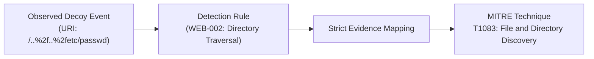

# SnareSight: Threat Detection Engine & MITRE ATT&CK Mapping Reference

**Document Version:** 1.0.0  
**Phase:** 8 — Testing, Demonstration & Project Handover  
**Date:** October 2026  
**Status:** COMPLETE & AUTHORITATIVE  

---

## 1. Threat Detection Philosophy & Explainability

SnareSight implements a **deterministic, rule-based threat detection engine** designed for high explainability and low operational false positives.

### Core Detection Principles:
1. **Zero Black-Box Detections:** Every alert raised by SnareSight is traced directly to concrete, human-auditable logic. The platform rejects opaque machine learning classifiers for primary alert generation.
2. **Honeypot Invariant:** In a properly isolated environment, any interaction with a decoy sensor is inherently unauthorized. Detection rules determine the *nature*, *intent*, and *sophistication* of the intruder, not whether the event was benign or malicious.
3. **Decoupled Scoring:** Alerts compute two independent dimensions: **Severity** (potential asset impact, 0–100) and **Confidence** (evidentiary certainty, 0–100).

---

## 2. The 10 Catalogue Detection Rules

The SnareSight threat engine includes 10 standardized detection rules registered in the `RuleRegistry`:

| Rule ID | Rule Name | Category | Detection Type | Evaluation Mode | Default Severity | Status |
|---|---|---|---|---|---|---|
| **`AUTH-001`** | Repeated Authentication Failures | AUTHENTICATION | THRESHOLD (3 fails / 300s) | SESSION | MEDIUM (45) | ACTIVE |
| **`AUTH-002`** | Decoy Authentication Accepted | AUTHENTICATION | SINGLE_EVENT | EVENT | HIGH (75) | ACTIVE |
| **`AUTH-003`** | Username Enumeration Probing | RECONNAISSANCE | THRESHOLD (3 users / 300s) | SESSION | MEDIUM (50) | ACTIVE |
| **`WEB-001`** | Web Path Enumeration Probing | RECONNAISSANCE | THRESHOLD (3 paths / 300s) | SESSION | LOW (30) | ACTIVE |
| **`WEB-002`** | Suspicious Directory Traversal Request | EXPLOITATION | SINGLE_EVENT (Regex/String) | EVENT | HIGH (80) | ACTIVE |
| **`CMD-001`** | Command Discovery Interaction | COMMAND_EXECUTION | SINGLE_EVENT | EVENT | MEDIUM (60) | DEFERRED |
| **`FILE-001`** | File Transfer Interaction | APPLICATION | SINGLE_EVENT | EVENT | MEDIUM (55) | DEFERRED |
| **`WEB-003`** | Repeated Suspicious Request Patterns | APPLICATION | THRESHOLD (3 matches / 300s) | SESSION | MEDIUM (50) | ACTIVE |
| **`BEHAV-001`** | Multi-Category Suspicious Interaction | APPLICATION | CORRELATION (Auth + Web) | SESSION | HIGH (85) | ACTIVE |
| **`BEHAV-002`** | Unusual HTTP Method Interaction | APPLICATION | SINGLE_EVENT (Method check) | EVENT | MEDIUM (40) | ACTIVE |

### Detailed Rule Specifications

#### `AUTH-001`: Repeated Authentication Failures
* **Trigger:** $\ge 3$ authentication failure events from the same source IP / session within a rolling 300-second window.
* **Forensic Rationale:** Indicates automated password guessing or brute force dictionary attacks.
* **Mapped ATT&CK:** `T1110.001` (Password Guessing).

#### `AUTH-002`: Decoy Authentication Interaction Accepted
* **Trigger:** Single authentication success on a honeypot trap account.
* **Forensic Rationale:** The intruder successfully guessed or supplied credentials for a trap account. (Note: Honeypot acceptance is simulated and does NOT represent access to production).
* **Mapped ATT&CK:** `T1078` (Valid Accounts).

#### `AUTH-003`: Username Enumeration Probing
* **Trigger:** $\ge 3$ distinct username fingerprints tested within a 300-second window.
* **Forensic Rationale:** Intruder systematically tests whether common usernames (`admin`, `root`, `deploy`) exist.
* **Mapped ATT&CK:** `T1087.002` (Account Discovery: Domain Account).

#### `WEB-001`: Web Path Enumeration Probing
* **Trigger:** $\ge 3$ distinct HTTP request paths probed within 300 seconds.
* **Forensic Rationale:** Common vulnerability scanning tool behavior (e.g., Nikto, DirBuster, Gobuster).
* **Mapped ATT&CK:** `T1595.002` (Active Scanning: Vulnerability Scanning).

#### `WEB-002`: Suspicious Directory Traversal Request
* **Trigger:** HTTP request URI contains directory traversal indicators (`../`, `..%2f`, `%2e%2e/`, `..\`).
* **Forensic Rationale:** Attacker attempts arbitrary file read outside the web document root.
* **Mapped ATT&CK:** `T1083` (File and Directory Discovery).

#### `BEHAV-001`: Multi-Category Suspicious Interaction
* **Trigger:** A single intruder session combines both authentication probing and application/web traversal probing.
* **Forensic Rationale:** Demonstrates an active intruder progressing through multiple stages of an intrusion lifecycle.
* **Mapped ATT&CK:** Multi-Phase Tactic Chain (`Reconnaissance` $\to$ `Credential Access`).

---

## 3. Dual-Metric Scoring Engine

SnareSight scores every detection using two orthogonal 0–100 integer scores:

### 3.1 Severity Score (Impact Assessment, 0–100)
Severity represents the **potential harm** if the observed behavior were directed at a live production system:
$$\text{Severity} = \text{Clamp}_{0}^{100}\left(\text{BaseWeight} + \text{TargetWeight} + \text{MultiVectorBonus}\right)$$

* **TargetWeight:** Web decoy login endpoint (+10), SSH administrative shell (+20).
* **MultiVectorBonus:** Intruder touching multiple decoy services in the same session (+15).

| Severity Range | Label | SOC Action Requirement |
|---|---|---|
| **0 – 39** | LOW | Logged for trend analytics; no immediate analyst page. |
| **40 – 69** | MEDIUM | Displayed in triage queue; 4-hour SLA. |
| **70 – 89** | HIGH | Elevated priority; analyst investigation within 30 minutes. |
| **90 – 100** | CRITICAL | Immediate alert banner; automated firewall block recommendation. |

### 3.2 Confidence Score (Evidentiary Certainty, 0–100)
Confidence represents the **degree of evidentiary certainty** that the observed interaction is malicious and intentional:
$$\text{Confidence} = \text{Clamp}_{0}^{100}\left(\text{BaseFidelity} + \text{EvidenceCountFactor} + \text{SignaturePrecision}\right)$$

* **BaseFidelity:** Honeypot baseline starts at 60 (since honeypot traffic has zero benign business purpose).
* **EvidenceCountFactor:** Multiple repeated attempts increase confidence (+5 per supporting event, up to +25).
* **SignaturePrecision:** Explicit attack strings (e.g. `../../etc/passwd` or `id; whoami`) provide +15 confidence.

---

## 4. Alert Deduplication & Suppression Windows

To prevent alert flooding during high-volume automated attacks:
* **Suppression Window:** When a rule triggers for a given `(rule_id, source_ip)` pair, an active alert is created.
* **Deduplication:** Subsequent matching events within a **10-minute suppression window** do not generate duplicate alert entries. Instead, the existing alert's `event_count` is incremented, `last_seen` timestamp is updated, and confidence is incrementally boosted.
* **Suppression History:** All suppressed occurrences are tracked in `alert_suppression_history` for full auditability.

---

## 5. Evidence-Grounded MITRE ATT&CK Mapping Policy

SnareSight enforces strict evidentiary discipline when aligning detections with the MITRE ATT&CK framework:

### Prohibitions Against Speculative Attribution
1. **Zero Unverified Techniques:** SnareSight **never** maps a technique merely because an attacker "might" perform it next. Mappings are generated only when verified forensic telemetry satisfies the technique's detection criteria.
2. **Sub-Technique Specificity:** When telemetry satisfies a specific sub-technique (e.g., `T1110.001` for password guessing), it is mapped to that sub-technique rather than a vague parent technique.
3. **Analyst Review Gate:** Automated mappings can be reviewed, verified, or disputed by human analysts via `/api/v1/attack/mappings/{id}/review`, ensuring human-in-the-loop governance.

