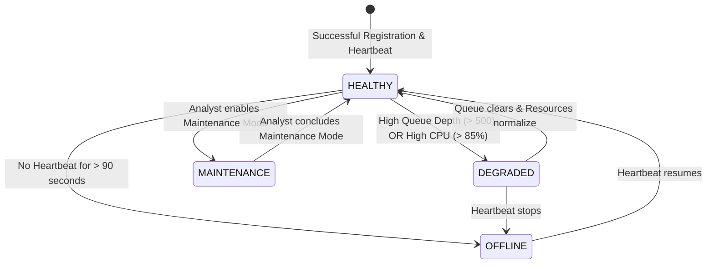

# SnareSight: Honeypot & Decoy Sensor Operations Manual

**Document Version:** 1.0.0  
**Phase:** 8 — Testing, Demonstration & Project Handover  
**Date:** October 2026  
**Audience:** Security Engineers, Honeypot Operators, and SOC Administrators  

---

## 1. Honeypot Architecture & Supported Decoys

SnareSight relies on isolated decoy sensors to capture unauthorized adversary interaction. The platform currently supports two primary decoy types:

| Decoy Type | Emulated Service | Default Port | Captured Telemetry | Associated ATT&CK Techniques |
|---|---|---|---|---|
| **Web Login Decoy** | Corporate Admin / SSO Portal | HTTP 8080 / 80 | HTTP requests, form submissions, URI paths, user-agents, headers. | T1110 (Brute Force), T1083 (Path Traversal), T1059 (Command Injection) |
| **Cowrie SSH Decoy** | Linux Bastion / Terminal | SSH 2222 / 22 | Terminal input, attempted credentials, shell commands, download attempts. | T1078 (Default Accounts), T1059.004 (Unix Shell), T1595 (Reconnaissance) |

---

## 2. Mandatory Network Isolation Invariants

To eliminate the risk of honeypots being used as attack pivots or staging grounds against corporate infrastructure, SnareSight mandates five isolation invariants:

### Invariant 1: Isolated Virtual Subnet (Host-Only / Private NAT)
* Decoy sensors must run on dedicated virtual network interfaces (e.g., VirtualBox Host-Only Adapter, VMware VMnet, or private Linux bridge `br-decoys`).
* **Absolute Ban on Bridged Networking:** Decoy adapters must **never** be bridged directly to the host's physical network adapter or public Internet.

### Invariant 2: Ingress-Only Forwarding
* The honeypot subnet must allow ingress traffic from simulated attackers, but **strictly deny all egress traffic** to private corporate internal networks (e.g., `10.0.0.0/8`, `172.16.0.0/12`, `192.168.0.0/16`).
* The forwarder agent must use a single, firewalled outbound HTTP path to the SnareSight backend port (8000).

### Invariant 3: Zero Local Execution
* Decoy services must emulate shell and web environments. Downloaded scripts, ELF binaries, or base64 blobs must be saved to a quarantined write-only volume and **never executed**.

---

## 3. Sensor Authentication & Key Management

All communications between decoy sensors and the SnareSight backend are authenticated using cryptographically secure tokens.

### 3.1 Initial Sensor Registration
1. In the SOC Dashboard, navigate to **Sensor Management** > **Register New Sensor**.
2. Specify the sensor hostname, service type (`web_login` or `cowrie_ssh`), and internal IP.
3. The platform generates a unique `sensor_id` (e.g., `sensor-web-01`) and an initial `X-Sensor-Key` secret token.
4. Export the key securely to the decoy sensor forwarder configuration.

### 3.2 Sensor Key Rotation Runbook
To rotate a compromised or scheduled sensor key without service interruption:
1. Issue key rotation via API:
   ```bash
   curl -X POST "http://127.0.0.1:8000/api/v1/sensors/sensor-web-01/credentials/rotate" \
     -H "Authorization: Bearer <ADMIN_TOKEN>"
   ```
2. The response supplies the new active token while maintaining a 15-minute grace period for the retiring token.
3. Update `/etc/snaresight-forwarder/config.json` on the decoy sensor.
4. Revoke the old token explicitly:
   ```bash
   curl -X POST "http://127.0.0.1:8000/api/v1/sensors/sensor-web-01/credentials/{old_key_id}/revoke" \
     -H "Authorization: Bearer <ADMIN_TOKEN>"
   ```

---

## 4. Credential Redaction & Zero-Password Invariant

In compliance with data protection laws and cybersecurity best practices, SnareSight enforces the **Zero-Password Storage Invariant**:

* **Attacker Credential Ingestion:** When an attacker submits credentials (e.g., `admin:Password123!`):
  1. The sensor forwarder or backend normalizer intercepts the password field.
  2. The plaintext password is substituted with a salted SHA-256 hash:
     $$\text{Hash} = \text{SHA256}(\text{password} \mathbin{\Vert} \text{system\_salt})$$
  3. The raw payload stores `password=REDACTED` and retains the hash for dictionary attack pattern analysis.
* **Prohibition:** Plaintext passwords are never persisted to the `security_events` database table or displayed in SOC dashboard views.

---

## 5. Sensor Heartbeat & Health Monitoring

Each decoy sensor executes a background health forwarder emitting a periodic telemetry heartbeat every 30 seconds:

```bash
curl -X POST "http://127.0.0.1:8000/api/v1/sensors/heartbeat" \
  -H "X-Sensor-Key: sensor-token-12345" \
  -H "Content-Type: application/json" \
  -d '{
    "sensor_id": "sensor-web-01",
    "status": "HEALTHY",
    "cpu_usage_pct": 2.8,
    "memory_usage_mb": 142.5,
    "queue_depth": 0
  }'
```

### Sensor Health State Machine



* **HEALTHY:** Last heartbeat received within 60 seconds; normal resource utilization.
* **DEGRADED:** Heartbeats arriving, but internal queue is backlogged or CPU/memory limits exceeded.
* **OFFLINE:** No heartbeat received for > 90 seconds. Triggers an `OPERATIONAL_ALERT` and alerts SOC analysts via SSE.
* **MAINTENANCE:** Sensor intentionally silenced for updates; alerts are suppressed.

---

## 6. Sensor Troubleshooting & Runbooks

### Issue 1: Sensor Reports OFFLINE in Dashboard
* **Symptom:** Sensor status pill turns Red (`OFFLINE`).
* **Root Cause Diagnostics:**
  1. Check if the decoy VM is running: `ping <sensor_ip>`.
  2. Verify forwarder agent service status: `systemctl status snaresight-forwarder`.
  3. Check forwarder log file: `tail -n 50 /var/log/snaresight/forwarder.log`.
  4. Test HTTP connectivity to backend: `curl -I http://127.0.0.1:8000/health`.
* **Remediation:** If network connectivity is healthy, verify whether the `X-Sensor-Key` was rotated or expired. Restart the forwarder service: `sudo systemctl restart snaresight-forwarder`.

### Issue 2: Telemetry Event Ingestion Rejections (HTTP 422)
* **Symptom:** Forwarder reports `422 Unprocessable Entity`.
* **Remediation:** Inspect payload schema. Ensure `timestamp` is valid ISO 8601, `destination_port` is an integer, and `honeypot_type` matches registered sensor type.

---

## 7. Decoy Sensor Decommissioning Runbook

To safely retire an active decoy sensor:
1. Place sensor in Maintenance Mode via API or UI to prevent false-positive offline alerts.
2. Stop the local forwarder agent and honeypot daemon on the decoy VM:
   ```bash
   sudo systemctl stop snaresight-forwarder
   sudo systemctl stop cowrie
   ```
3. Archive historical sensor metadata in the backend:
   ```bash
   curl -X POST "http://127.0.0.1:8000/api/v1/sensors/sensor-web-01/status" \
     -H "Authorization: Bearer <ADMIN_TOKEN>" \
     -H "Content-Type: application/json" \
     -d '{"status": "DECOMMISSIONED"}'
   ```
4. Revoke all active API credentials for the sensor.
5. Safely power down and destroy the virtual machine disk image.

