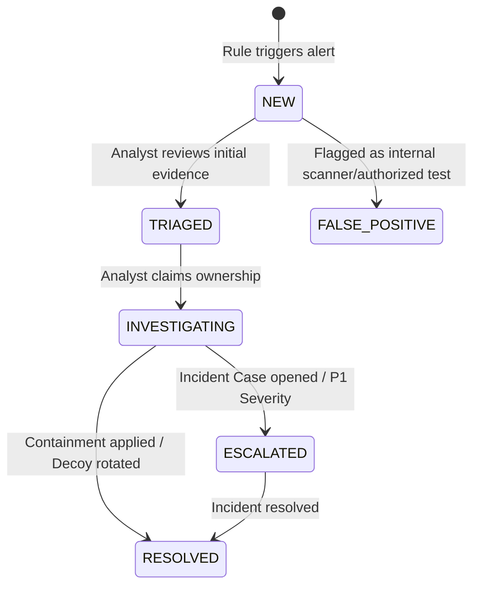

# SnareSight: SOC Analyst User Manual & Operational Playbook

**Document Version:** 1.0.0  
**Phase:** 8 — Testing, Demonstration & Project Handover  
**Date:** October 2026  
**Target Persona:** Tier-1 and Tier-2 Security Operations Center (SOC) Analysts  

---

## 1. Introduction & Analyst Mental Model

Welcome to the SnareSight SOC Operations platform. As an analyst operating SnareSight, keep the foundational mental model in mind:

> **The Deception Advantage:** Unlike perimeter firewalls or endpoint logs that contain 99.9% benign traffic, **SnareSight receives zero legitimate user traffic**. Any activity recorded by SnareSight sensors represents an unauthorized entity scanning, probing, or attacking your decoy perimeter.
>
> Your role is not to separate benign from malicious traffic, but to **triage attack severity**, **reconstruct intrusion progression**, **profile threat actors**, and **coordinate defensive containment**.

---

## 2. Accessing the Dashboard & Authentication

1. Open your modern web browser (Chrome, Firefox, Edge, Safari) and navigate to `http://localhost:5173` (or production URL).
2. Enter your analyst credentials on the login screen:
   * **Username:** `analyst@snaresight.local`
   * **Password:** Provided by your administrator during onboarding.
3. Upon successful authentication, your JWT bearer token is stored securely in session storage, and you are directed to the **Overview Dashboard**.

---

## 3. Navigating the SOC Dashboard Overview

The Overview view provides real-time situational awareness across your deception infrastructure:

* **Executive KPI Cards (Top Banner):**
  * **Active Alerts:** Total unaddressed alerts requiring triage.
  * **Mean Time to Detect (MTTD):** Real-time ingestion-to-alert latency (typically $< 100\text{ ms}$).
  * **Active Attack Sessions:** Total active intruder sessions observed in the last 24 hours.
  * **Decoy Sensor Health:** Ratio of healthy vs degraded/offline sensors (e.g., `4/4 Online`).
* **Real-Time Alert Feed:** Continuously updated via Server-Sent Events (SSE). New detections appear instantly at the top without page refreshes.
* **Threat Activity Chart:** Recharts time-series visualizer showing event ingestion volume categorized by honeypot type (`web_login`, `cowrie_ssh`).
* **Decoy Grid:** Status cards for each deployed honeypot showing CPU, memory, and last heartbeat timestamp.

---

## 4. Alert Triage Workflow & Status Transitions

When a detection rule fires, an alert enters the triage pipeline. Analysts navigate to the **Alerts** page to manage incidents.

### 4.1 Step-by-Step Alert Triage Procedure
1. **Filter by Severity:** In the alert queue, filter by `HIGH` and `CRITICAL` alerts first.
2. **Open Alert Drawer:** Click on an alert row to expand the forensic detail drawer.
3. **Inspect the Dual Scores:**
   * **Severity (Impact):** Indicates the danger if directed at production (e.g. 80/100).
   * **Confidence (Certainty):** Indicates forensic evidence strength (e.g. 95/100).
4. **Examine Evidence Events:** Click **Evidence Items** to review the exact HTTP requests or SSH commands that triggered the rule.
5. **Set Triage Decision:**
   * Click **Acknowledge** to indicate you are triaging the alert.
   * Assign the alert to yourself or a teammate.
   * Select **Start Investigation** to transition status to `INVESTIGATING`.

---

## 5. Session Correlation & Attack-Chain Analysis

### 5.1 Using Session Explorer
Individual decoy hits often belong to a larger multi-stage intrusion attempt. 
1. Navigate to **Sessions** in the primary navigation menu.
2. The Session Explorer aggregates events from the same source IP within rolling time windows.
3. Click a session to view its **Chronological Timeline**:
   * Visualizes the attacker's progression from port scan $\to$ path enumeration $\to$ credential brute-force $\to$ command injection.

### 5.2 Interactive Attack-Chain Graph (React Flow)
1. In the session or investigation view, click **View Attack Chain Graph**.
2. An interactive directed acyclic graph (DAG) renders the intrusion sequence:
   * **Nodes:** Represent observed techniques and stages (colored by MITRE Tactic).
   * **Edges:** Represent temporal sequence and transition between techniques.
3. Drag, zoom, and click individual nodes to inspect supporting event payloads and timestamp deltas.

---

## 6. MITRE ATT&CK Matrix Navigation

1. Navigate to **MITRE ATT&CK** in the navigation menu.
2. The interactive matrix displays the 14 Enterprise Tactics with heat-mapped technique cells:
   * **Cell Color Intensity:** Reflects the frequency of observed telemetry mapped to that technique.
3. Click any technique (e.g., `T1110.001 - Password Guessing`):
   * A side panel displays the formal ATT&CK description.
   * Lists all SnareSight detection rules mapped to this technique.
   * Shows every forensic event in the database supporting this technique.
   * Allows analysts to click **Verify Mapping** or **Flag Dispute**.

---

## 7. Threat Actor Profiling & Source Intelligence

1. Navigate to **Threat Profiles**.
2. Search or click on an offending Source IP (e.g., `192.168.56.105`).
3. The Source Dossier details:
   * **Threat Score (0–100):** Algorithmic threat score based on frequency, targeted ports, and observed techniques.
   * **Observed Decoys:** Lists all honeypots probed by this IP.
   * **Behavioral Tags:** Automatic tags such as `BRUTE_FORCER`, `RECON_SCANNER`, `DIR_TRAVERSER`.
   * **Similar Sources:** Heuristically identified related IPs exhibiting similar user-agent strings, timing jitter, or password dictionaries.

---

## 8. Incident Response Cases & Defensive Containment

When an intrusion warrants containment or formal tracking:

### 8.1 Opening an Incident Case
1. Navigate to **Case Management** and click **New Incident Case** (or click **Escalate to Case** directly from an alert).
2. Enter Case Title, Severity, and narrative summary.
3. Link related alerts, sessions, and source profiles to the case.
4. **Apply Legal / Forensic Retention Hold:** If the incident involves legal reporting or law enforcement handover, toggle **Retention Hold = True**. This ensures automated background pruning will never delete linked events.

### 8.2 Generating Containment Firewall Rules
1. Inside the Case view, open the **Defensive Actions** tab.
2. Click **Generate Firewall Containment**.
3. Select your target infrastructure format:
   * **iptables:** `sudo iptables -A INPUT -s <ATTACKER_IP> -j DROP`
   * **UFW:** `sudo ufw deny from <ATTACKER_IP> to any`
   * **AWS Security Group:** CLI command to revoke ingress.
4. Click **Copy Script** to execute on perimeter firewalls.
5. Record the containment execution in the case notes.

---

## 9. Executive Reporting & Audit Logs

1. Navigate to **Reports** > **Generate New Report**.
2. Select report type:
   * **Executive Summary:** High-level KPI trends, MTTD, top targeted decoys, and risk scores.
   * **Forensic Investigation Dossier:** Deep technical export of an individual case including raw event hashes and MITRE matrices.
3. Choose format: **JSON** (for SIEM integration) or **Markdown/PDF** (for leadership briefings).
4. Click **Download Report**.
5. All report generation actions are automatically recorded in the immutable **Audit Log** (`/audit`).

