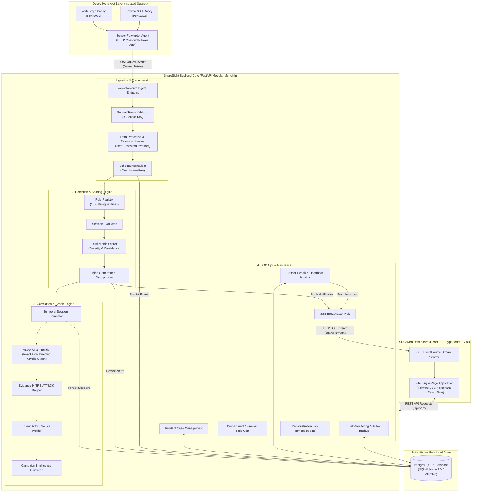
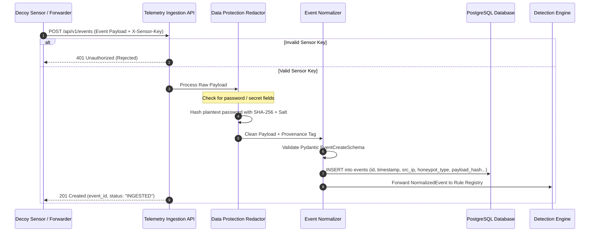
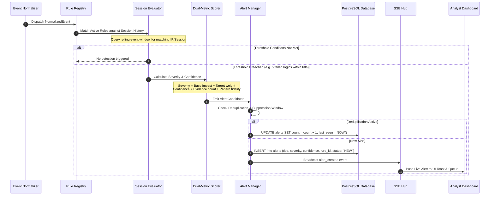
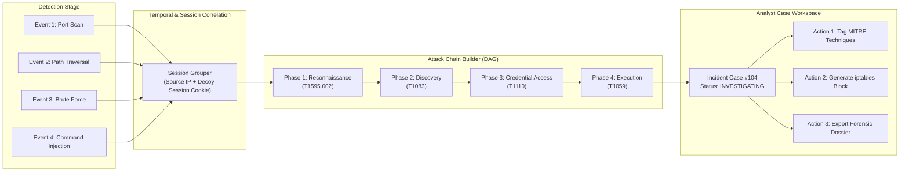
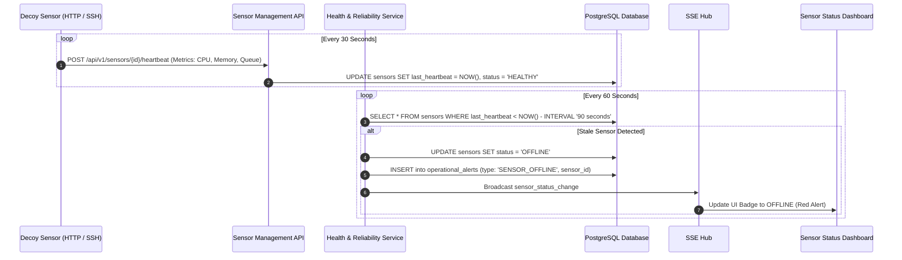

# SnareSight: System Architecture & Design Specification

**Document Version:** 1.0.0  
**Phase:** 8 — Testing, Demonstration & Project Handover  
**Date:** October 2026  
**Status:** COMPLETE & AUTHORITATIVE  

---

## 1. Architectural Philosophy & Principles

SnareSight is designed as a **Modular Monolith** web application. This architecture balances domain separation, maintainability, and operational simplicity without the operational overhead of microservices, distributed queues (e.g., Kafka, RabbitMQ), or caching clusters (e.g., Redis).

### Core Architectural Decisions:
1. **Single Deployable Process:** The backend runs as a single FastAPI Python process containing well-defined domain modules.
2. **Relational Consistency:** PostgreSQL 16 acts as the authoritative single source of truth for telemetry, detections, sessions, audit records, and operational state.
3. **Real-Time Reactive Push via SSE:** Server-Sent Events (SSE) provide lightweight, unidirectional streaming over standard HTTP without WebSockets overhead.
4. **Decoupled Frontend:** React 18 single-page application built with TypeScript, Tailwind CSS, Lucide React, and React Flow.
5. **Strict Boundary Defense:** Decoy honeypots run in isolated subnets with zero direct access to production or corporate networks.

---

## 2. Overall Component Architecture

The diagram below details the primary subsystems, communication boundaries, and data storage layers across the SnareSight platform:

---

## 3. Telemetry Ingestion & Normalization Lifecycle

The ingestion pipeline guarantees that incoming decoy interactions are strictly validated, authenticated, sanitized, and stored with immutable provenance:

---

## 4. Detection Engine, Scoring, and Alert Lifecycle

SnareSight evaluates normalized events against 10 explainable catalogue rules using stateful temporal session evaluation:

---

## 5. Session Correlation, Attack-Chain Graphing & Case Workflow

Correlated detections are assembled into visual graph structures and analyst-driven incident cases:

---

## 6. Sensor-to-Backend Communication & Health Monitoring

The sensor management subsystem continuously assesses sensor health and detects packet-loss or dropped connections:

---

## 7. Database Architecture & Alembic Evolution

The persistence layer is managed by SQLAlchemy 2.0 ORM with Alembic schema versioning:

* **Strict Migration Lineage:** Migrations form an unbroken chain from baseline schema `p01_initial_schema` to `p34_operational_resilience`.
* **Zero Orphan Tables:** Every relationship uses explicit foreign keys with appropriate cascade or `RESTRICT` rules.
* **Audit Trail Immutability:** Audit log tables are append-only; updates and deletions are programmatically rejected.
* **Retention Holds:** Investigative cases and forensic evidence can be flagged with a `retention_hold = True` boolean, preventing automated pruning policies from deleting records during compliance or legal holds.

