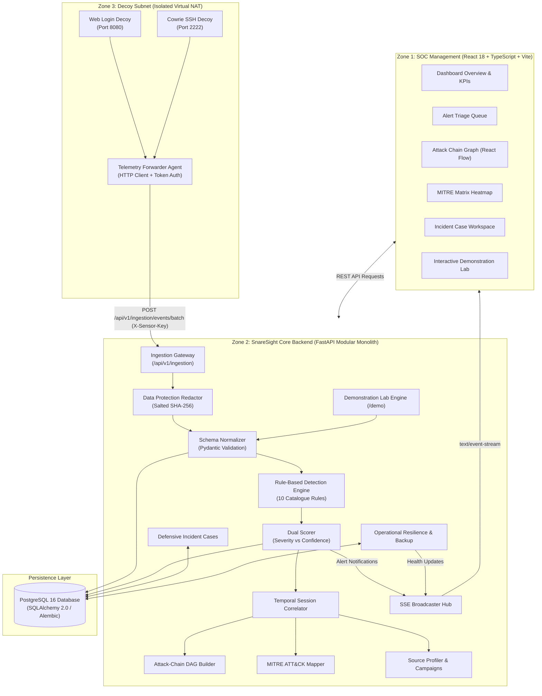

# Evaluation Criterion 2: Proposed Solution Architecture & End-to-End Approach

**Document Version:** 1.0.0  
**Phase:** 8 — Testing, Demonstration & Project Handover  
**Document:** `docs/final/02_PROPOSED_APPROACH.md`  
**Evaluation Weight:** 20% (Equal Weighting)  

---

## 1. System Architecture Diagram

SnareSight is designed as a **Modular Monolith** web application. This architecture ensures clean domain separation without the distributed complexity of microservices or external message brokers:

---

## 2. Stage-by-Stage Processing Pipeline Specification

The table below details every processing stage from honeypot probe to executive reporting:

| Stage # | Pipeline Stage | Purpose | Input | Processing Performed | Output | Security Boundary & Failure Handling | Implementation Status |
|---|---|---|---|---|---|---|---|
| **1** | **Honeypot Interaction** | Emulate vulnerable corporate assets to lure attackers. | TCP connection / HTTP request / SSH attempt. | Service emulation, response fabrication, local interaction logging. | Raw JSON event payload. | Decoy isolated on private virtual switch. No network egress. | `COMPLETED AND VERIFIED` |
| **2** | **Telemetry Capture** | Forward interaction logs securely to backend. | Local honeypot log file. | Forwarder parses local logs, buffers in queue, attaches sensor metadata. | Formatted HTTP POST request. | Retries on network drop with exponential backoff. | `COMPLETED AND VERIFIED` |
| **3** | **Secure Ingestion** | Validate and authenticate incoming telemetry. | HTTP POST body + `X-Sensor-Key`. | Authenticates token against active `sensors` table; verifies rate limits. | Authenticated batch payload. | Rejects invalid keys with `401 Unauthorized`. | `COMPLETED AND VERIFIED` |
| **4** | **Data Redaction** | Enforce Zero-Password & PII protection. | Raw payload text containing potential passwords. | Replaces plaintext password with salted SHA-256 hash; redacts SSN/CC. | Sanitized event dictionary. | Plaintext credentials never touch persistent disk. | `COMPLETED AND VERIFIED` |
| **5** | **Normalization** | Enforce unified canonical event schema. | Sanitized event dictionary. | Pydantic validation: casts timestamps, categorizes port/protocol, assigns UUID. | `SecurityEventModel` instance. | Rejects malformed events with `422 Unprocessable`. | `COMPLETED AND VERIFIED` |
| **6** | **Event Persistence** | Store audit-safe telemetry records. | Normalized event model. | SQLAlchemy ORM insertion into `security_events` table in PostgreSQL. | Committed database record. | Database transaction rolled back on constraint error. | `COMPLETED AND VERIFIED` |
| **7** | **Detection Rules** | Identify attack tradecraft deterministically. | Normalized event stream. | Evaluates 10 explainable catalogue rules over sliding session windows. | Detection matches list. | Unmatched events silently stored; zero crash risk. | `COMPLETED AND VERIFIED` |
| **8** | **Dual-Metric Scoring** | Quantify impact and evidentiary certainty. | Detection match + event metadata. | Computes Severity (0–100) and Confidence (0–100) using target weights. | `AlertModel` candidate. | Clamped mathematically to range $[0, 100]$. | `COMPLETED AND VERIFIED` |
| **9** | **Evidence ATT&CK Mapping** | Align detections with MITRE framework. | Rule ID + observed event forensic text. | Maps strictly to verified Tactics & Techniques (`T1110`, `T1083`, etc.). | `technique_mappings` record. | Prohibits speculative mapping without evidence. | `COMPLETED AND VERIFIED` |
| **10** | **Session Correlation** | Group individual events into intrusion sessions. | Source IP, sensor ID, timestamp. | Clusters events within 10-minute sliding window into a single session. | `activity_sessions` record. | New session created if inactive for $> 10$ minutes. | `COMPLETED AND VERIFIED` |
| **11** | **Source Profiling** | Build persistent threat actor dossiers. | Source IP address and observed tradecraft. | Aggregates lifetime sessions, targeted decoys, and behavioral tags. | `source_profiles` record. | Updates existing dossier; calculates threat score. | `COMPLETED AND VERIFIED` |
| **12** | **Investigation Grouping** | Cluster multi-IP coordinated campaigns. | Correlated sessions across sensors. | Heuristic clustering linking related attacker IPs by time and tooling. | `investigation_clusters` record. | Isolated from production; read-only correlation. | `COMPLETED AND VERIFIED` |
| **13** | **Alert Triage Center** | Enable analyst review and state transitions. | Generated alert candidate. | Applies 10-minute deduplication window; emits SSE event to SOC UI. | Triage queue entry. | Deduplication prevents notification flooding. | `COMPLETED AND VERIFIED` |
| **14** | **Analyst Investigation** | Human-in-the-loop analysis and case tracking. | Triaged alert or active session. | Analyst claims case, reviews DAG attack chain, records forensic notes. | Updated `response_cases` state. | RBAC enforced: `analyst` or `admin` role required. | `COMPLETED AND VERIFIED` |
| **15** | **Defensive Response** | Contain intruder and export firewall rules. | Attacking Source IP address. | Generates copy-pasteable firewall rules (`iptables`, `UFW`, AWS SG). | Defensive action script. | Strictly defensive; prohibits offensive retaliation. | `COMPLETED AND VERIFIED` |
| **16** | **Reporting & Evaluation** | Produce executive and audit artifacts. | Date range and filter criteria. | Compiles KPI metrics, generates PDF/CSV reports with non-attribution notice. | Downloadable `%PDF-` file. | Report generation audited in immutable system logs. | `COMPLETED AND VERIFIED` |

---

## 3. Technology Selection Rationale

| Layer | Selected Technology | Alternative Considered | Technical Rationale for Selection |
|---|---|---|---|
| **Frontend** | React 18 + TypeScript + Vite | Angular / Vue.js | Superior ecosystem for graph rendering (React Flow), high developer velocity with Vite, strict type contracts. |
| **Styling** | Tailwind CSS | CSS Modules / Styled-Components | Zero runtime CSS overhead, highly responsive utility system, consistent design tokens. |
| **Backend** | Python 3.11+ + FastAPI | Go (Gin) / Node.js (Express) | Native asynchronous ASGI support, automatic OpenAPI/Swagger generation, Pydantic type validation, deep security library ecosystem. |
| **Database** | PostgreSQL 16 + SQLAlchemy 2.0 | MongoDB / Elasticsearch | Strict relational integrity, JSONB support for unstructured metadata, robust ACID transactions, reliable Alembic migration lineage. |
| **Real-Time Streaming** | Server-Sent Events (SSE) | WebSockets / Polling | Lightweight unidirectional streaming over HTTP/1.1 or HTTP/2, native browser reconnection, firewall friendly. |
| **Containerization** | Docker Compose | Kubernetes (k8s) | Minimizes deployment overhead for lab environments, guarantees reproducible multi-container orchestration. |

---

## 4. Key Design Decisions & Architectural Boundaries

1. **Modular Monolith over Microservices:** Avoids network serialization overhead, distributed transactions, and multi-repository sync issues while preserving strict domain boundaries.
2. **Strict Non-Execution Rule:** Captured malware scripts or binary files are hashed and quarantined. Under no circumstances are untrusted binaries executed or detonated on the SnareSight host.
3. **Evidence-Grounded MITRE Mapping:** The system prohibits predictive or probabilistic mapping. If an attack payload cannot be linked to forensic evidence, it is not mapped to an ATT&CK technique.
4. **Analyst-in-the-Loop Containment:** Defensive actions (such as firewall blocks) are recommended and formatted by the system, but require human analyst confirmation before deployment to network firewalls.

