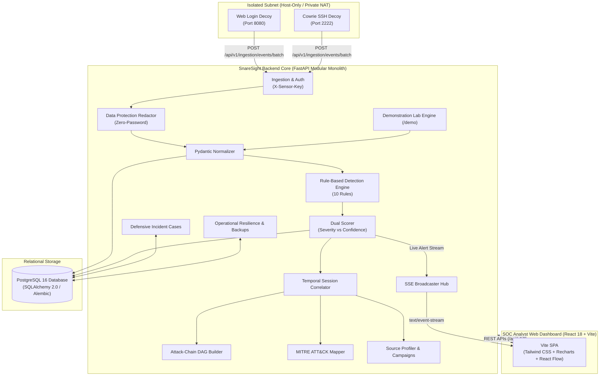

# SnareSight: Primary Project Handover Dossier & Maintainer Guide (P40)

**Document Version:** 1.0.0  
**Phase:** 8 — Testing, Demonstration & Project Handover (Final Prompt 40/40)  
**Document:** `docs/final/FINAL_PROJECT_HANDOVER.md`  
**Classification:** Primary Project Handover Reference  
**Audience:** Successor Maintainers, Developers, SREs, and Academic Mentors  
**Date:** October 2026  

---

## 1. Project Overview

**SnareSight** is a browser-based, deception-driven threat detection and security operations platform. Developed across 40 engineering prompts, the system converts unauthorized interaction with isolated honeypot decoys into structured, explainable, and actionable threat intelligence.

In contrast to conventional perimeter security tools (WAFs, firewalls, IDSs) that inspect millions of benign corporate transactions, SnareSight receives **zero legitimate user traffic**. Because legitimate employees have no business need to interact with decoy assets, every recorded interaction is unauthorized by definition, establishing an exceptionally high-fidelity detection baseline with near-zero false positives.

---

## 2. Project Objectives & Non-Goals

### Core Objectives:
1. Deploy realistic, isolated decoy services within private enterprise lab subnets.
2. Ingest interaction telemetry securely with strict provenance tracking.
3. Enforce data protection via salted SHA-256 password redaction at ingestion.
4. Apply deterministic threat detection across 10 explainable catalogue rules.
5. Calculate independent Severity (0–100 impact) and Confidence (0–100 certainty) scores.
6. Correlate events into temporal sessions and reconstruct interactive attack-chain DAGs.
7. Map verified tradecraft to the MITRE ATT&CK® Enterprise matrix with human review gates.
8. Enable SOC analyst triage, case investigation, and automated firewall rule generation (`iptables`, `UFW`).
9. Provide operational resilience via health probes, automated backups, and dry-run restore validation.

### Explicit Non-Goals (What SnareSight is NOT):
* **NOT a Generic SIEM Replacement:** Does not ingest benign corporate syslog or endpoint heartbeat feeds.
* **NOT an Antivirus / EDR Agent:** Does not install desktop kernel hooks.
* **NOT a Malware Sandbox:** Does not detonate or execute captured binaries (Zero-Execution rule).
* **NOT an Offensive Retaliation Tool:** Prohibits automated hack-backs or active port scanning.
* **NOT Proof of Legal Physical Identity:** IP profiles cluster network telemetry, not verified human individuals.

---

## 3. Actual System Architecture

The platform is designed as a **Modular Monolith** web application:



---

## 4. Technology Stack

* **Frontend:** React 18.3, TypeScript 5.6, Vite 6.4, Tailwind CSS 3.4, Lucide React, Recharts 2.12, React Flow (@xyflow/react 12.3).
* **Backend:** Python 3.11+, FastAPI 0.115, Pydantic v2.9, Uvicorn 0.32, ReportLab 5.1, AnyIO.
* **Database & ORM:** PostgreSQL 16 (or SQLite in-memory for testing), SQLAlchemy 2.0.35, Alembic 1.13.
* **Real-Time Push:** Server-Sent Events (SSE) via `sse-starlette 2.1`.
* **Testing:** Pytest 8.3, Vitest 2.1, Playwright.
* **Packaging:** Docker, Docker Compose, Nginx.

---

## 5. Repository Structure

```
SnareSight/
├── backend/                              # Python FastAPI Modular Monolith
│   ├── app/                              # Application source code
│   │   ├── api/                          # HTTP controllers (ingestion, health, stream)
│   │   ├── core/                         # Configuration, database engine, security
│   │   ├── db/                           # SQLAlchemy base & 42 declarative models
│   │   ├── detection/                    # Threat engine, 10 catalogue rules, scoring
│   │   ├── correlation/                  # Temporal sessions & attack chains
│   │   ├── modules/                      # 15 domain service modules
│   │   └── main.py                       # Central FastAPI ASGI entrypoint
│   ├── migrations/                       # Alembic migrations (p01 to p34)
│   ├── tests/                            # 532 Pytest unit & integration tests
│   ├── alembic.ini                       # Migration configuration
│   ├── pyproject.toml                    # Python project configuration & dependencies
│   ├── requirements.txt                  # Pip dependency specification
│   └── Dockerfile                        # Multi-stage production container
├── frontend/                             # React 18 + TypeScript + Vite SOC Dashboard
│   ├── src/                              # Components, pages, services, styles
│   ├── tests/                            # Vitest unit test suite (9 tests)
│   ├── package.json                      # Node dependencies & npm scripts
│   ├── vite.config.ts                    # Vite build & proxy configuration
│   └── Dockerfile                        # Multi-stage Node + Nginx container
├── honeypot-lab/                         # Isolated decoy services (web-decoy)
├── docs/                                 # Authoritative documentation library
│   ├── documentation/                    # 13 technical reference manuals
│   ├── final/                            # 15 academic review & evaluation documents
│   └── README.md                         # Master documentation index
├── docker-compose.yml                    # Multi-container orchestration
├── .env.example                          # Sanitized environment template
├── CONTRIBUTING.md                       # Developer guidelines & coding standards
└── README.md                             # Project landing page & quickstart
```

---

## 6. Developer Setup & Environment Configuration

### Prerequisites
* Python 3.11+
* Node.js 20+ or 22+ & npm
* PostgreSQL 16 (or Docker)
* Git

### Step 1: Environment Variables
Create the backend `.env` file from `.env.example`:
```powershell
cd c:\Projects\SnareSight\backend
Copy-Item .env.example .env
```
Key configuration settings:
```ini
ENVIRONMENT=development
APP_NAME=SnareSight
HOST=127.0.0.1
PORT=8000
POSTGRES_SERVER=127.0.0.1
POSTGRES_PORT=5432
POSTGRES_DB=snaresight
POSTGRES_USER=postgres
POSTGRES_PASSWORD=postgres
SECRET_KEY=change-this-in-production-secure-random-token-32-chars-min
ACCESS_TOKEN_EXPIRE_MINUTES=480
SENSOR_SHARED_SECRET=sensor-auth-secret-token-key-2026
DATA_RETENTION_DAYS=90
```

---

## 7. Database Initialization & Alembic Migrations

1. Ensure PostgreSQL is running on port 5432 and database `snaresight` exists:
   ```sql
   CREATE DATABASE snaresight;
   ```
2. Apply all versioned migrations up to the latest revision:
   ```powershell
   cd c:\Projects\SnareSight\backend
   .\.venv\Scripts\alembic.exe upgrade head
   ```
3. Verify head revision:
   ```powershell
   .\.venv\Scripts\alembic.exe current
   # Output: p34_operational_resilience (head)
   ```

---

## 8. Application Startup

### Option A: Quickstart via Docker Compose (Recommended)
```bash
docker compose up --build -d
docker compose ps
# Dashboard: http://localhost:5173 (or port 80)
# API Docs: http://localhost:8000/docs
```

### Option B: Native Development Terminals
* **Terminal 1: Backend:**
  ```powershell
  cd c:\Projects\SnareSight\backend
  .\.venv\Scripts\uvicorn app.main:app --host 127.0.0.1 --port 8000 --reload
  ```
* **Terminal 2: Frontend:**
  ```powershell
  cd c:\Projects\SnareSight\frontend
  npm run dev
  # Access UI at http://localhost:5173
  ```

---

## 9. Testing & Quality Verification Commands

Run the full automated verification suite:

```powershell
# 1. Run Backend Pytest Suite (532 tests, ~85s)
cd c:\Projects\SnareSight\backend
.\.venv\Scripts\pytest.exe -v

# 2. Run Frontend Vitest Suite (9 tests, ~0.6s)
cd c:\Projects\SnareSight\frontend
npm test -- --run

# 3. Verify Frontend Production Build (1618 modules, ~3s)
npm run build
```

---

## 10. Demonstration Lab Instructions

1. Log into the dashboard at `http://localhost:5173` (`analyst@snaresight.local` / `SecurePassword123!`).
2. Click **Demonstration Lab** (`/demo`).
3. Click **Run Scenario A (Web Login Brute Force)**:
   * 5 synthetic HTTP authentication events are generated deterministically.
   * Rule `AUTH-001` fires; alert banner pops up in UI via SSE.
   * Severity: 45 / Confidence: 85.
4. Click **Evaluate Detection Quality**:
   * Evaluates detection metrics across scenarios: Precision: 100%, Recall: 100%, F1: 1.000.
5. Follow the step-by-step runbook in [docs/final/P40_FINAL_DEMONSTRATION_RUNBOOK.md](file:///c:/Projects/SnareSight/docs/final/P40_FINAL_DEMONSTRATION_RUNBOOK.md).

---

## 11. Main Subsystem Modules & API Groups

| Subsystem Module | Code Directory | Primary API Route Prefix |
|---|---|---|
| **Authentication & Users** | `backend/app/modules/security/` | `/api/v1/auth` |
| **Decoy Sensors & Ingestion**| `backend/app/modules/sensors/`, `api/ingestion.py` | `/api/v1/sensors`, `/api/v1/ingestion` |
| **Threat Detection Engine** | `backend/app/detection/` | Internal engine evaluation |
| **Alert Triage Center** | `backend/app/modules/alerts/` | `/api/v1/alerts` |
| **Sessions & Attack Chains**| `backend/app/correlation/` | `/api/v1/sessions`, `/api/v1/sequences` |
| **MITRE ATT&CK Mapping** | `backend/app/modules/mitre/` | `/api/v1/attack`, `/api/v1/mitre` |
| **Source Threat Profiles** | `backend/app/modules/source_intelligence/` | `/api/v1/source-profiles` |
| **Campaign Intelligence** | `backend/app/modules/campaign_intelligence/` | `/api/v1/campaigns` |
| **Incident Response Cases** | `backend/app/modules/response/` | `/api/v1/response/cases` |
| **SOC Analytics & Reports** | `backend/app/modules/analytics/` | `/api/v1/analytics`, `/api/v1/reports` |
| **Operational Resilience** | `backend/app/modules/resilience/` | `/api/v1/resilience` |
| **Demonstration Lab** | `backend/app/modules/demo/` | `/api/v1/demo` |
| **Real-Time Streaming** | `backend/app/api/stream.py` | `/api/v1/stream` |

---

## 12. Security Invariants & Isolation Boundaries

Maintainers must preserve five non-negotiable security rules:
1. **Zero Public Internet Exposure:** Decoys operate exclusively on Host-Only or private virtual NAT switches.
2. **Strict Ingress-Only Forwarding:** Decoy subnets strictly drop all outbound traffic to internal private networks.
3. **Zero-Execution Rule:** Captured suspicious payloads or binaries are hashed, quarantined, and never executed.
4. **Localhost Binding:** Development servers bind strictly to `127.0.0.1`.
5. **Zero-Password Storage:** Passwords submitted to decoys are hashed with salted SHA-256 prior to persistence.

---

## 13. Maintenance, Backup & Recovery Procedures

### Creating an Immediate Backup Snapshot
```bash
curl -X POST "http://127.0.0.1:8000/api/v1/resilience/backups" \
  -H "Authorization: Bearer <ADMIN_TOKEN>"
```
Generates a compressed SQL dump in `backend/backups/` with a cryptographic SHA-256 checksum.

### Performing an Isolated Dry-Run Restore Test
```bash
curl -X POST "http://127.0.0.1:8000/api/v1/resilience/backups/{backup_id}/restore-test" \
  -H "Authorization: Bearer <ADMIN_TOKEN>"
```
Restores the archive into a temporary memory instance, verifies table count and schema integrity, and logs duration in `restore_test_records`.

---

## 14. Authoritative Documentation Index

* **Master Index:** [docs/README.md](file:///c:/Projects/SnareSight/docs/README.md)
* **Architecture:** [SYSTEM_ARCHITECTURE.md](file:///c:/Projects/SnareSight/docs/documentation/SYSTEM_ARCHITECTURE.md)
* **API Reference:** [API_REFERENCE.md](file:///c:/Projects/SnareSight/docs/documentation/API_REFERENCE.md)
* **Database Reference:** [DATABASE_REFERENCE.md](file:///c:/Projects/SnareSight/docs/documentation/DATABASE_REFERENCE.md)
* **SOC Analyst Manual:** [SOC_ANALYST_USER_MANUAL.md](file:///c:/Projects/SnareSight/docs/documentation/SOC_ANALYST_USER_MANUAL.md)
* **Administrator Guide:** [ADMINISTRATOR_GUIDE.md](file:///c:/Projects/SnareSight/docs/documentation/ADMINISTRATOR_GUIDE.md)
* **Testing Guide:** [TESTING_AND_QA_GUIDE.md](file:///c:/Projects/SnareSight/docs/documentation/TESTING_AND_QA_GUIDE.md)
* **Troubleshooting:** [TROUBLESHOOTING.md](file:///c:/Projects/SnareSight/docs/documentation/TROUBLESHOOTING.md)

---

## 15. Known Limitations & Recommended Future Work

### Known Limitations:
1. **Deferred Rules:** `CMD-001` (Command Discovery) and `FILE-001` (File Transfer) are intentionally marked `DEFERRED` in the catalogue until physical high-interaction Cowrie SSH hardware sensors are deployed.
2. **Frontend Chunk Size:** Single minified JS bundle is 659 kB; route-based code splitting (`React.lazy()`) is recommended for low-bandwidth connections.
3. **Attribution Boundaries:** IP threat profiles cluster network behavior; they do not claim legal proof of human identity.

### Recommended Next Steps for Successor Maintainers:
1. **Phase 9:** Configure `vite.config.ts` with `manualChunks` to split React Flow and Recharts into asynchronous chunks.
2. **Phase 10:** Implement mutual TLS (mTLS) for remote forwarder agents communicating over WAN links.
3. **Phase 11:** Implement automated STIX 2.1 / TAXII threat intelligence export connectors.
4. **Phase 12:** Expand decoy catalogue to include high-interaction SMB, Redis, and Kubernetes API decoys.

