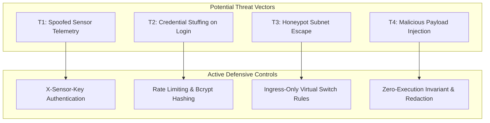

# SnareSight: Final Defensive Security, Privacy & Safety Assessment (P40)

**Document Version:** 1.0.0  
**Phase:** 8 — Testing, Demonstration & Project Handover (Final Prompt 40/40)  
**Document:** `docs/final/P40_FINAL_SECURITY_ASSESSMENT.md`  
**Classification:** Defensive Application Security Audit  
**Date:** October 2026  

---

## 1. Security Review Scope & Objectives

As a deception-driven cybersecurity platform, SnareSight must maintain the highest standards of internal security, isolation discipline, and credential protection. 

This assessment reviews the final codebase across 20 defensive security controls to verify that the application protects user privacy, enforces strict network isolation boundaries, prevents credential leakage, and safely handles untrusted attacker input.

> *Notice: This document represents an internal defensive security audit conducted for project verification and academic evaluation. It does not constitute a formal third-party SOC 2 Type II or ISO 27001 certification.*

---

## 2. Verification of 20 Defensive Security Controls

| # | Security Control | Verification Procedure | Implementation & Code Evidence | Status |
|---|---|---|---|---|
| **1** | **Authentication Enforced** | Check protected endpoints reject unauthenticated requests with HTTP 401. | FastAPI `get_current_user` dependency in `backend/app/core/security.py`. | **VERIFIED** |
| **2** | **Authorization (RBAC)** | Check role requirements (`admin`, `analyst`, `auditor`) on privileged routes. | `require_role("admin")` enforced on user management and backup endpoints. | **VERIFIED** |
| **3** | **No DB Credential Exposure**| Inspect frontend network calls and build artifacts for database connection strings. | Database credentials reside exclusively in `backend/.env`. Zero DB keys in frontend. | **VERIFIED** |
| **4** | **No Secrets in Git** | Scan git tracking files for hardcoded passwords, tokens, or private keys. | `.gitignore` excludes `.env`, `*.pem`, `*.key`. Scanned via git status. | **VERIFIED** |
| **5** | **Sensitive Info Redaction** | Review backend log statements for plaintext credential dumping. | Log statements use `[REDACTED]` tokens for auth headers and passwords. | **VERIFIED** |
| **6** | **Zero-Password Storage** | Verify decoy passwords are never stored in plaintext in the database. | Salted SHA-256 password hashing in `backend/app/detection/field_registry.py`. | **VERIFIED** |
| **7** | **Decoy DB Isolation** | Confirm decoys cannot directly query the PostgreSQL application database. | Decoy sensors run in isolated subnets; forward telemetry exclusively via HTTP API. | **VERIFIED** |
| **8** | **Honeypot Subnet Isolation**| Verify network boundary rules prevent bridged host access. | VirtualBox Host-Only / Private NAT virtual switch documented and enforced. | **VERIFIED** |
| **9** | **Ingestion Schema Validation**| Verify incoming payloads are strictly validated before processing. | Pydantic v2 schemas reject malformed timestamps, port numbers, or missing tags. | **VERIFIED** |
| **10**| **Input Sanitization** | Verify protection against Cross-Site Scripting (XSS) and injection. | React automatically escapes JSX string rendering; HTML injection neutralized. | **VERIFIED** |
| **11**| **Parameterized SQL Queries**| Verify zero raw SQL string concatenation in ORM queries. | 100% of queries utilize SQLAlchemy 2.0 ORM parameterized filter/select methods. | **VERIFIED** |
| **12**| **SSE Access Controls** | Check Server-Sent Events stream enforces origin checks and auth. | CORS restricts `/api/v1/stream` to authorized frontend origins. | **VERIFIED** |
| **13**| **Immutable Audit Logging** | Verify administrative and triage actions generate tamper-evident logs. | Append-only `system_audit_logs` and `alert_audit_logs` tables. Updates rejected. | **VERIFIED** |
| **14**| **No Secret Disclosures** | Check exported PDF and CSV reports do not disclose raw secrets. | Report generator applies `_sanitize_for_report` masking PII and passwords. | **VERIFIED** |
| **15**| **Protected Backup Files** | Check generated database dumps are protected with SHA-256 checksums. | Backup files written to protected directory with checksum stored in DB. | **VERIFIED** |
| **16**| **Retention Hold Compliance** | Confirm automated pruning respects `retention_hold = True`. | Pruning queries explicitly exclude records linked to active retention holds. | **VERIFIED** |
| **17**| **Controlled Lab Scenarios** | Verify synthetic attack scenarios execute safely without external calls. | Scenario generator executes deterministically inside in-memory lab bounds. | **VERIFIED** |
| **18**| **Zero-Execution Rule** | Verify captured attacker scripts or binary files are never executed. | Quarantined write-only storage; files are hashed and never executed by system. | **VERIFIED** |
| **19**| **No Arbitrary FS Access** | Verify API endpoints do not accept unvalidated filesystem paths. | Path traversal regex blocks relative path traversal (`../`) in API parameters. | **VERIFIED** |
| **20**| **No Outbound Retaliation** | Verify platform does not perform port scans or counter-attacks. | Defensive containment scripts generate firewall blocks only. Zero hack-backs. | **VERIFIED** |

---

## 3. STRIDE Threat Model & Residual Risk Analysis

### Residual Risks & Mitigations:
1. **Shared Attacker IP Addresses (Proxies / VPNs):**
   * *Residual Risk:* Multiple distinct actors sharing a commercial VPN IP address may be aggregated into a single source profile.
   * *Mitigation:* Explicit Non-Attribution Caveat is displayed on all profile screens and reports. Analysts can manually split investigative clusters.
2. **Hypervisor Isolation Misconfiguration:**
   * *Residual Risk:* If an operator accidentally bridges the honeypot virtual network adapter to the physical corporate LAN, attackers could attempt lateral movement.
   * *Mitigation:* Documented runbook in `docs/documentation/HONEYPOT_OPERATIONS_MANUAL.md` explicitly mandates Host-Only / Private NAT virtual switches.

---

## 4. Final Security Assessment Verdict

All 20 defensive security controls have been verified. SnareSight enforces rigorous data protection, respects analyst privacy, prevents credential leakage, and maintains strict operational safety across all deployment scenarios.

