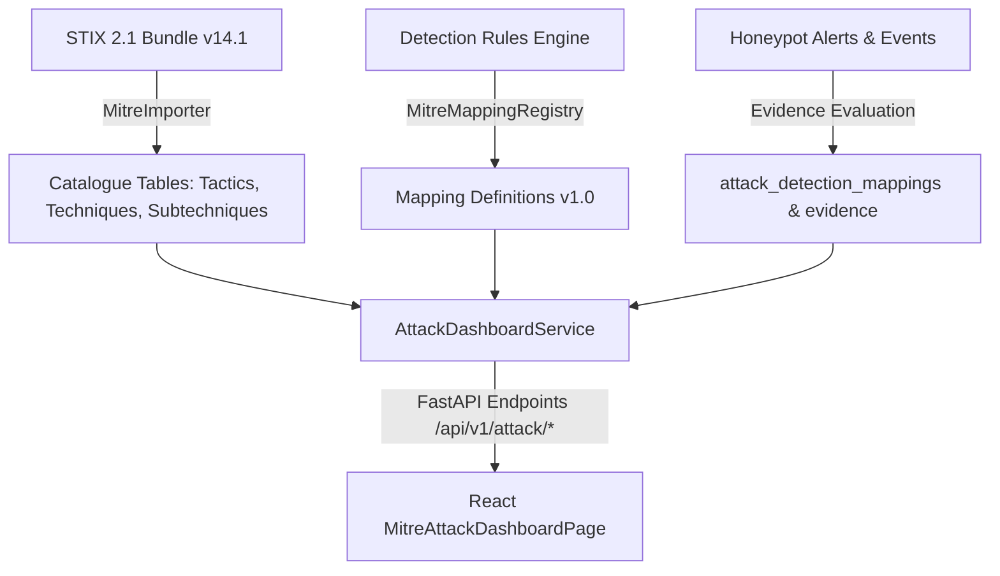

# MITRE ATT&CK System Architecture

## Architecture Overview
The SnareSight ATT&CK subsystem consists of three tightly coupled layers:
1. **Intelligence Base Layer (STIX 2.1 Ingestion)**:
   - Parses the enterprise STIX 2.1 bundle (`enterprise-attack-v14.1.json`).
   - Persists normalized tactics, techniques, sub-techniques, and relationships in PostgreSQL / SQLite.
2. **Deception Mapping & Evidence Layer**:
   - `MitreMappingRegistry` defines detection rule associations.
   - `AttackDetectionMappingModel` and `AttackMappingEvidenceModel` record live telemetry hits against rules with assigned confidence scores.
3. **SOC Presentation & Operational Analytics Layer**:
   - `AttackDashboardService` aggregates summary KPIs, matrix views, technique explorer records, coverage analytics, and traceability chains.
   - Frontend `MitreAttackDashboardPage` renders interactive views with live deep-linking into `/alerts`, `/events`, and `/sessions`.

## Component Flow Diagram

## Relational Schema Elements
- `attack_dataset_versions`: Tracks bundle provenance, version string (`v14.1`), SHA-256 integrity, and active status.
- `attack_tactics`: Enterprise tactics, short names, and descriptions.
- `attack_techniques`: Enterprise techniques, descriptions, platforms, data sources.
- `attack_subtechniques`: Sub-technique parent-child linkages.
- `attack_tactic_technique_map`: Many-to-many associations between techniques and tactics.
- `attack_detection_mappings`: Active mapping records linking detections to techniques.
- `attack_mapping_evidence`: Supporting alerts, events, relevance scores, and evidence timestamps.
- `attack_mapping_reviews`: Audit log of analyst decisions (`ACCEPT`, `REJECT`, `REQUEST_MORE_EVIDENCE`).
- `attack_mapping_history`: State transitions and confidence modifications.

