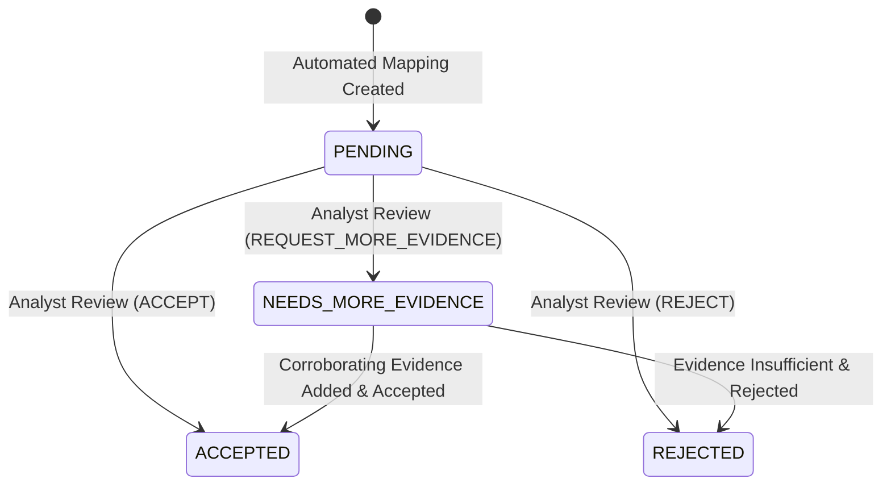

# SnareSight MITRE ATT&CK Analyst Review Workflow

> [!WARNING]
> **CRITICAL OPERATIONAL NOTICE:**
> An ATT&CK mapping indicates that observed behavior is consistent with a documented adversary technique. It does not, by itself, establish attacker identity, successful compromise, intent, or completion of an attack.

---

## 1. Overview & Operational Principles

Automated threat mappings represent preliminary evidential findings. The Analyst Review Workflow allows authorized security analysts to inspect, validate, challenge, and override proposed ATT&CK technique associations.

### Core Review Invariants:
1. **Zero Silent Modification:** Review actions never overwrite or delete the original automated assessment scores, rationale, or event evidence.
2. **Auditable Traceability:** Every review action records the analyst's identity, review timestamp, action type (`ACCEPT`, `REJECT`, `REQUEST_MORE_EVIDENCE`), and substantive justification comment in `attack_mapping_reviews`.
3. **State History:** State transitions are logged in `attack_mapping_history`.
4. **Authorization Gate:** Review submission requires authorized analyst or administrator credentials (`X-API-Key` or `Bearer` token).

---

## 2. Review Lifecycle State Machine

---

## 3. Review Actions & Guidelines

### 3.1 `ACCEPT`
- **Criteria:** The observed evidence thoroughly supports the technique scope, and the decoy context is appropriately understood.
- **Result:** `review_status` transitions to `ACCEPTED`. Finding is displayed in SOC dashboards as a verified adversary technique observation.

### 3.2 `REJECT`
- **Criteria:** Telemetry represents known scanner probing without malicious technique behavior, client software misconfiguration, or uncorroborated anomaly.
- **Result:** `review_status` transitions to `REJECTED`. The mapping is flagged as dismissed and excluded from active threat posture metrics.

### 3.3 `REQUEST_MORE_EVIDENCE`
- **Criteria:** The observed behavior could be consistent with the technique, but corroborating forensic signals (e.g. session persistence, distinct payloads, user agent headers) are needed before confirmation.
- **Result:** `review_status` transitions to `NEEDS_MORE_EVIDENCE`.

